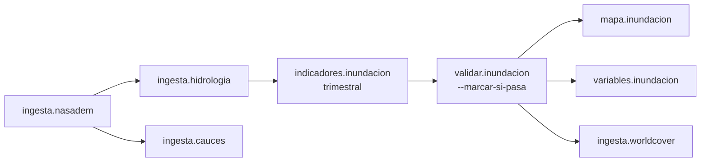

# Programador de tareas

Cada fuente tiene su propio ritmo (el relieve no cambia; Sentinel-2 revisita cada 5 días; el SIRSD-S se publica por concurso; OSM cambia mes a mes). El programador decide **qué está vencido, en qué orden correrlo** y lo ejecuta. Documento: [[Documentos del proyecto#09-orquestacion.md]].

## Piezas

| Pieza | Archivo | Qué hace |
|---|---|---|
| Programación (datos) | `operacion.tarea_programada` | Una fila por tarea: código, comando, cadencia, día/meses, dependencias, activa |
| Lógica pura | [[Motor - orquestación#programacion.py]] | `esta_vencida`, `ordenar_por_dependencia`, `bloqueadas_por_dependencia`. **Sin base de datos**: se prueba sin PostgreSQL |
| Ejecutor | [[Motor - orquestación#orquestador.py]] | Lee las tareas, ejecuta los comandos con `subprocess`, registra el resultado |
| Servicio | contenedor `terrafoco-programador` | `python -m orquestacion.orquestador --demonio --intervalo 3600` (revisa cada hora) |

## Cadencias

| Cadencia | Regla |
|---|---|
| `unica` | Una sola vez en la vida del sistema (censos, NASADEM) |
| `semanal` | 7 días desde la última corrida exitosa |
| `mensual` | Una vez al mes, desde el día indicado |
| `estacional` | Una vez al año, solo dentro de los meses válidos |
| `trimestral` | Una vez por trimestre calendario |
| `anual` | Una vez por año calendario |
| `manual` | Nunca vence sola; se dispara con `--forzar` |

Tras un **error**, espera **24 horas** antes de reintentar (`ESPERA_TRAS_ERROR`): antes reintentaba cada hora y llenaba la bitácora de fallas iguales.

## La cadena de inundación (ejemplo de dependencias)



Si una dependencia falló o no ha corrido, la tarea queda **bloqueada** (no corre sobre capas a medias). La dependencia se busca en **toda** la lista de tareas, no solo en las vencidas (era un error: se pasaba `[tarea]`).

## Tareas activas (27 en la tabla)

Ingestas: `censo`, `nasadem`, `hidrologia`, `manzanas`, `poblacion_censal`, `zonal_ls` (únicas); `ciren`, `cr2met`, `soilgrids`, `desinventar`, `cauces`, `localidades` (anuales); `sentinel`, `transparencia` (SIRSD-S de IDE MINAGRI), `practicas`, `equipamiento`, `areas_verdes` (mensuales); `worldcover` (trimestral). Indicadores: `erosion`, `superficie_erosionada`, `area_verde` (mensuales); `inundacion`, `validar.inundacion`, `mapa.inundacion`, `variables.inundacion` (trimestrales). Desactivadas: `landsat`, `limites`.

Migraciones que las definen: 005, 010, 018, 019. → [[Migraciones]]

## Comandos

```bash
docker exec -i terrafoco-programador python -m orquestacion.orquestador --listar     # qué está vencido
docker exec -i terrafoco-programador python -m orquestacion.orquestador --ejecutar   # corre lo vencido
docker exec -i terrafoco-programador python -m orquestacion.orquestador --forzar ingesta.ciren
```

## Estado conocido

En el ciclo completo de prueba corrieron 16 tareas, 15 ok. `ingesta.practicas` falla porque falta `/datos/mascara_ciren.tif` en este equipo (lo deja `ingesta.ciren` con su máscara; existe en el equipo de Bastián), y CR2MET necesita su zip descargado a mano.

## Por qué no Airflow

El orquestador **no sabe nada del dominio**: solo qué comando invocar, cuándo y de qué depende. Migrar a Airflow o Prefect sería escribir DAGs que llamen los mismos comandos, sin tocar el motor. Para un equipo de tres, Airflow sería más infraestructura que problema.

Pruebas: [[Motor - pruebas#test_programacion.py]]
