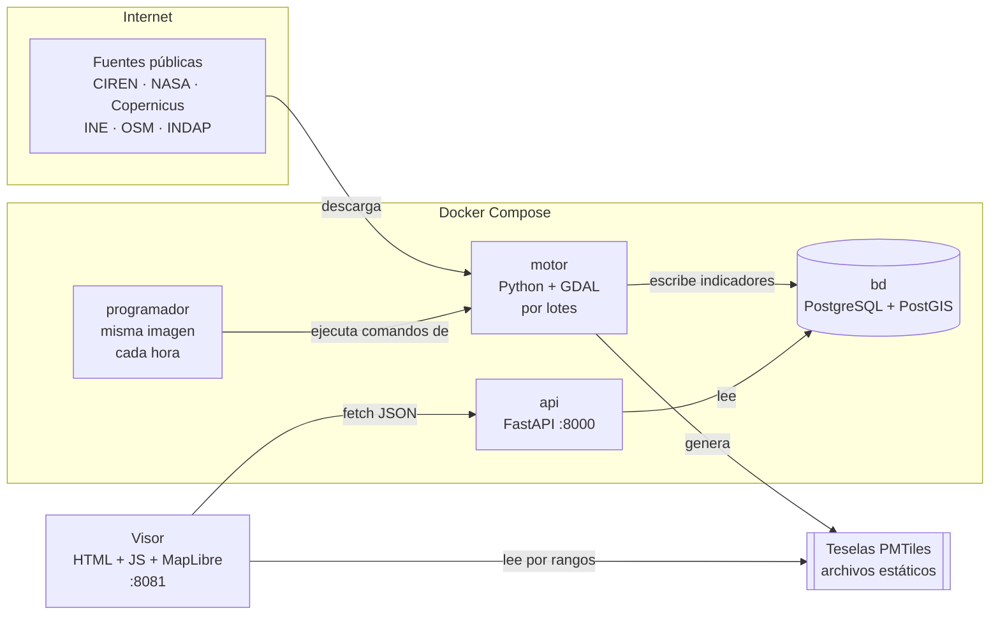

# L03 · Arquitectura en concreto

> [!abstract] En una frase
> Cuatro piezas separadas a propósito: el **motor** calcula por lotes y escribe en la **base**; la **API** solo lee la base y responde JSON; el **visor** pide a la API y dibuja. **Quien calcula no atiende al público, y quien atiende al público no calcula.**

## 1. El dibujo



Leerlo de izquierda a derecha es leer el viaje de un dato: entra por el motor, queda en la base, sale por la API y se dibuja en el visor. Las teselas son un atajo: el motor las deja como archivos y el visor las lee directo, sin pasar por la API.

## 2. Las piezas, una por una

| Pieza | Carpeta | Hecha con | Hace | No hace |
|---|---|---|---|---|
| **bd** | `bd/` | PostgreSQL 16 + PostGIS 3.4 | Guarda territorio, indicadores, inversión y operación; calcula la vista de pertinencia | Nada de lógica de pantalla |
| **motor** | `motor/` | Python, GDAL, rasterio, numpy, pysheds | Descarga fuentes, calcula indicadores, genera mapas y teselas | No atiende peticiones web |
| **programador** | `motor/orquestacion/` | El **mismo** contenedor del motor | Decide qué tarea venció y la ejecuta en orden | No sabe nada de erosión ni de inundaciones |
| **api** | `api/` | FastAPI + psycopg | Expone los indicadores en JSON/GeoJSON | No calcula; solo escribe el catálogo de fuentes |
| **visor** | `prototipo/` | HTML + JS sin framework, MapLibre GL 5, PMTiles, three.js | Las pantallas | No guarda nada en el servidor |

## 3. El archivo que lo levanta todo: `docker-compose.yml`

Abre `docker-compose.yml` en la raíz. Tiene cuatro servicios. Lo que importa de cada uno:

```yaml
services:
  bd:
    image: postgis/postgis:16-3.4          # imagen oficial: Postgres con PostGIS
    container_name: terrafoco-bd
    ports: ["5432:5432"]
    volumes:
      - bd_datos:/var/lib/postgresql/data  # los datos viven en un volumen con nombre
      - "./bd:/docker-entrypoint-initdb.d:ro"   # esquema.sql se carga la primera vez
    healthcheck: ...pg_isready...          # los demás esperan a que la base esté lista
```

```yaml
  motor:
    build: ./motor                         # se construye desde motor/Dockerfile
    environment:
      BD_URL: postgresql://terrafoco:...@bd:5432/terrafoco   # "bd" es el nombre del servicio
      ID_REGION: ${ID_REGION:-6}           # la región sale del entorno, no del código
      EARTHDATA_USER: ${EARTHDATA_USER:-}  # credenciales: del .env, nunca escritas
    volumes:
      - ./motor:/app                       # el código del PC dentro del contenedor
      - datos_crudos:/datos                # rásteres descargados (gigabytes)
    command: ["tail", "-f", "/dev/null"]   # no hace nada solo: se le piden cosas
```

> [!info] El truco de `tail -f /dev/null`
> El motor **no es un servicio**: no se queda escuchando. Ese comando lo deja vivo sin hacer nada, para que se le puedan pedir tareas con `docker exec -i terrafoco-motor python -m <módulo>`.

```yaml
  api:
    build: ./api
    environment:
      TERRAFOCO_CLAVE_ADMIN: ${TERRAFOCO_CLAVE_ADMIN:-}   # sin clave, la API no escribe
      TERRAFOCO_ORIGENES: ${TERRAFOCO_ORIGENES:-*}         # CORS
    ports: ["8000:8000"]
    command: ["uvicorn", "main:app", "--host", "0.0.0.0", "--port", "8000", "--reload"]
```

`uvicorn` es el servidor web que corre la aplicación FastAPI `app` del archivo `main.py`. `--reload` la reinicia al guardar un cambio (cómodo para desarrollar).

```yaml
  programador:
    build: ./motor                         # ¡la misma imagen que el motor!
    command: ["python", "-m", "orquestacion.orquestador", "--demonio", "--intervalo", "3600"]
    restart: unless-stopped                # si se cae, Docker lo levanta de nuevo
```

El programador es el motor con otro comando: cada 3.600 segundos (una hora) revisa qué tareas vencieron.

```yaml
volumes:
  bd_datos:     { name: terrafoco_bd }
  datos_crudos: { name: terrafoco_datos }
```

> [!warning] Por qué los volúmenes tienen nombre explícito
> Por defecto Docker los prefija con el nombre de la carpeta. Mover el repositorio de lugar los "desconectaba": aparecía una base vacía y los datos quedaban huérfanos sin ningún error. Con nombre fijo, no pasa.

## 4. Los Dockerfile: por qué dos imágenes distintas

**`motor/Dockerfile`** parte de `ghcr.io/osgeo/gdal:ubuntu-small-3.9.2`, la imagen oficial de **GDAL** (la biblioteca que lee y escribe rásteres). Instalar GDAL con `pip` exige que la versión del programa y la del enlace de Python coincidan, y eso cambia entre Windows, macOS y Linux. Con la imagen oficial, los tres integrantes tienen la misma.

**`api/Dockerfile`** parte de `python:3.12-slim`, mucho más liviana: la API **no necesita GDAL**, solo consulta PostGIS.

> [!tip] Frase para la presentación
> "El motor pesa 1,3 GB porque trae GDAL; la API es una imagen de Python mínima porque solo consulta. Separarlos también separa sus dependencias."

## 5. Las ocho decisiones que hay que saber defender

1. **El motor no vive detrás de HTTP.** Una ingesta satelital tarda minutos u horas. Si la hiciera la API, el visor esperaría (o se caería por tiempo de espera). El motor corre **por lotes** y deja el resultado en la base. → [[L06 El motor - anatomía de un módulo]]
2. **La única escritura por HTTP es el catálogo de fuentes**, porque es una decisión humana (marcar una fuente como "parcial"), no un cálculo. Está protegida con una clave. → [[L10 La API por dentro]]
3. **GDAL desde la imagen oficial**, no por pip: la misma versión para todos.
4. **Orquestador propio y simple, sin Airflow.** El orquestador no sabe nada del dominio: solo qué comando correr, cuándo y de qué depende. Migrar a Airflow sería escribir DAGs que llamen los mismos comandos. → [[L09 El motor - programador y teselas]]
5. **Teselas de valores en vez de un servidor de mapas.** Cada píxel guarda el **valor** (no el color) codificado en sus tres canales RGB; el navegador lo colorea con una expresión. No hace falta GeoServer. → [[L12 El visor - el mapa]]
6. **Mejora progresiva en el visor.** Si la API no responde, usa la copia local de los últimos datos reales; si MapLibre no carga, un mapa esquemático. Nunca queda en blanco y **siempre dice qué está mostrando**. → [[L11 El visor - cómo arranca una página]]
7. **Funciones puras separadas de la entrada/salida.** RUSLE, la programación de tareas, la focalización y las cuentas de inundación reciben números y devuelven números: se prueban sin base ni red. → [[L15 Pruebas y calidad]]
8. **La región es un dato, no código.** Las coordenadas del área de interés se leen de `territorio.region`. → [[L06 El motor - anatomía de un módulo]]

## 6. Cómo se hablan las piezas

| De → a | Cómo | Ejemplo |
|---|---|---|
| Motor → base | SQL con psycopg (`INSERT`) | `calcular.py` inserta en `indicadores.erosion` |
| Motor → disco | Archivos en el volumen `/datos` | `dem_utm.tif`, `susceptibilidad.tif` |
| Motor → visor | Archivos copiados a `prototipo/datos/` | `teselas/*.pmtiles`, PNG por comuna |
| Programador → motor | Ejecuta el comando como un proceso (`subprocess.run`) | `python -m indicadores.inundacion` |
| API → base | SQL con psycopg (`SELECT`) | `SELECT … FROM indicadores.v_pertinencia` |
| Visor → API | `fetch` HTTP, JSON | `GET /pertinencia?origen=CIREN&region=6` |
| Visor → teselas | `fetch` con encabezado `Range` (solo unos bytes del archivo) | `erosion.pmtiles` |

> [!note] Nadie más habla con la base
> El navegador **nunca** se conecta a PostgreSQL. En el servidor público la base ni siquiera expone su puerto. Todo pasa por la API.

## 7. Dónde corre cada cosa

| Entorno | Qué corre | Para qué |
|---|---|---|
| PC de desarrollo (Windows + Docker Desktop) | Todo | Trabajar |
| GitHub Codespaces | Lo mismo, en la nube de GitHub | Demo sin depender del PC de nadie |
| Servidor público (VM Ubuntu) | Base + API + Caddy (HTTPS). **Sin motor** | Sitio público; el motor procesa en el PC y se publica el resultado |
| Copia portable (pendrive, Windows) | PostgreSQL embebido + API + visor, lanzados por `TerraFoco.cmd` | Demo sin internet ni Docker |

→ [[L16 Despliegue y copias]]

## Pruébalo

```bash
docker compose ps                                   # los cuatro contenedores
curl http://localhost:8000/salud                    # la API responde y ve PostGIS
docker exec -i terrafoco-programador python -m orquestacion.orquestador --listar
docker exec -i terrafoco-programador python -m estado   # resumen de lo cargado
```

Luego apaga la API (`docker stop terrafoco-api`), recarga el visor y mira la barra superior: dice **"Copia local"**. Vuelve a encenderla con `docker start terrafoco-api`.

## Cómo decirlo en la presentación

> [!example] Versión corta
> "Son cuatro piezas en Docker. El motor, en Python con GDAL, descarga las fuentes y calcula por lotes; lo deja todo en PostgreSQL con PostGIS. Una API en FastAPI solo lee esa base y responde JSON. El visor, en HTML y JavaScript con MapLibre, le pide los datos a la API y lee los mapas a 30 metros directamente de archivos de teselas. Separamos cálculo y consulta porque una descarga satelital tarda horas y no puede bloquear al usuario."

## Autoevaluación

> [!question]- ¿Por qué el motor no está detrás de la API?
> Porque sus procesos tardan minutos u horas (descargas satelitales, cálculos regionales). Detrás de HTTP bloquearían al visor. Corre por lotes y deja el resultado en la base; la API solo lee.

> [!question]- ¿Qué es lo único que la API escribe y cómo se protege?
> El catálogo de fuentes (`POST` y `PATCH /fuentes`). Con una clave de administración por encabezado `Authorization: Bearer`, cerrada por defecto si no está configurada, comparada en tiempo constante.

> [!question]- ¿Por qué el motor y la API usan imágenes de Docker distintas?
> El motor necesita GDAL (imagen oficial de OSGeo, pesada); la API solo consulta la base (Python slim, liviana). Además, la imagen oficial garantiza la misma versión de GDAL para todos.

> [!question]- ¿Qué diferencia hay entre el motor y el programador?
> Ninguna en el código: son la misma imagen. El motor queda inactivo esperando comandos; el programador corre el orquestador en modo demonio, que cada hora ejecuta las tareas vencidas.

> [!question]- ¿Cómo llega el mapa a 30 m al navegador si no pasa por la API?
> El motor genera archivos PMTiles con el valor de cada píxel; se copian a `prototipo/datos/teselas/` y el visor los lee directamente pidiendo solo los bytes que necesita (peticiones de rango HTTP).

> [!question]- ¿Qué pasa con los datos si mueves la carpeta del repositorio?
> Nada: los volúmenes tienen nombre fijo (`terrafoco_bd`, `terrafoco_datos`), así que no dependen de la carpeta.

Siguiente: [[L04 Un dato de punta a punta]]
