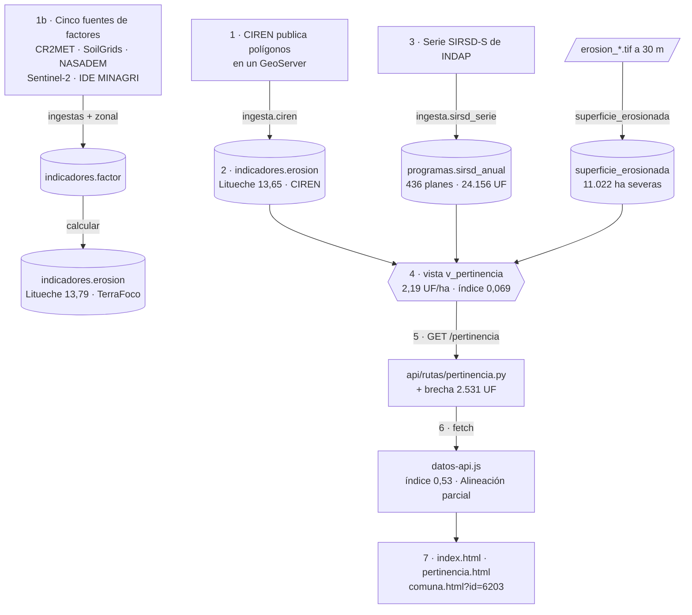

# L04 · Un dato de punta a punta

> [!abstract] En una frase
> Seguimos a **Litueche** desde que CIREN publica su erosión en internet hasta que el visor la pinta y dice "Alineación parcial": cada paso es un archivo concreto del repositorio, y al final sabes explicar el sistema completo con un solo ejemplo.

Esta es la lección más importante del curso. Si en la presentación te piden "muéstrame cómo funciona", **cuenta este recorrido**.



---

## Paso 1 · CIREN publica la erosión

CIREN ya calculó la erosión de todo Chile con RUSLE y la publica **por polígono** (pedazos de terreno), en un servidor de mapas (GeoNode + GeoServer) en `inventarioerosion.ciren.cl`. Cada polígono trae:

| Campo | Qué es |
|---|---|
| `RUSLE` | Pérdida de suelo, t/ha/año (**el dato**) |
| `AREA_HA` | Superficie del polígono |
| `CLASEROS` | Clase de erosión de CIREN (`NO SUELOS` = agua, roca, ciudad) |

Viene organizado **por cuenca** (unas 50 en O'Higgins), con unos 40.000 polígonos cada una.

## Paso 2 · El motor lo trae y lo resume por comuna

**Archivo:** `motor/ingesta/ciren.py`. **Comando:** `python -m ingesta.ciren`.

### 2.1 Pide la lista de capas de la región

```python
def capas_de_region(id_region, familia="rea"):
    filtro = "r%02d" % id_region            # "r06" para O'Higgins
    url = API_CAPAS + "?" + urllib.parse.urlencode({
        "limit": 500, "alternate__icontains": filtro,
    })
    ...
```

`rea` es la pérdida **real** (actual). La "potencial" sería sin cobertura; se compara la inversión con el estado real.

### 2.2 Descarga cada cuenca por WFS, con paciencia

WFS es el estándar para pedir geometrías a un servidor. El de CIREN corta con error 503 tras varias descargas seguidas, así que:

```python
REINTENTOS = 5
ESPERA_BASE = 20        # segundos; se multiplica por el número de intento
PAUSA_ENTRE_CUENCAS = 3
```

Si falla, espera 20 s, luego 40, 60… y entre cuencas hace una pausa de 3 s.

### 2.3 La carga en PostGIS y cruza con las comunas

`importar` usa `ogr2ogr` (herramienta de GDAL) para meter el GeoJSON en una tabla temporal. Luego la consulta clave, `SQL_AGREGAR`:

```sql
WITH recorte AS (
    SELECT c.id_comuna,
           e.rusle::numeric  AS rusle,
           -- solo la parte del polígono que cae dentro de la comuna:
           ST_Area(ST_Intersection(e.geom, c.geom)::geography) / 10000.0 AS ha
    FROM   operacion.erosion_ciren_cruda e
    JOIN   territorio.comuna c ON ST_Intersects(e.geom, c.geom)
    WHERE  e.rusle IS NOT NULL
      AND  upper(btrim(e.claseros)) <> 'NO SUELOS'   -- agua, roca y ciudad no erosionan
)
SELECT id_comuna, SUM(rusle * ha) AS ponderado, SUM(ha) AS ha
FROM   recorte WHERE ha > 0
GROUP  BY id_comuna
```

Lectura en castellano: *para cada polígono que toca una comuna, toma la parte que cae dentro, multiplica su erosión por sus hectáreas y suma; suma también las hectáreas*. Es una **media ponderada por superficie**: un polígono grande pesa más que uno chico.

> [!important] Tres decisiones en esa consulta
> 1. **No se usa `AREA_HA`** del origen: es el área del polígono completo, y aquí interesa solo la parte que cae en la comuna (`ST_Intersection`).
> 2. **Se excluye `NO SUELOS`**: el agua y la roca vienen con erosión 0 y hundirían el promedio con superficie que nunca pudo erosionarse.
> 3. **`::geography`** calcula el área sobre la Tierra real en m² (las geometrías están en grados).

### 2.4 Acumula entre cuencas y recién al final divide

Una comuna recibe polígonos de varias cuencas. `acumular` suma numeradores y denominadores; la división se hace una sola vez al final:

```python
def acumular(total, parcial):
    for id_comuna, d in parcial.items():
        acc = total.setdefault(id_comuna, {"id_region": d["id_region"],
                                           "ponderado": 0.0, "ha": 0.0})
        acc["ponderado"] += d["ponderado"]
        acc["ha"] += d["ha"]
```

> [!warning] Por qué no promediar por cuenca
> Promediar los promedios de cada cuenca da un número distinto y **equivocado** (una cuenca con 10 ha en la comuna pesaría igual que una con 10.000). Sumar primero y dividir al final da la media correcta.

### 2.5 Guarda una fila por comuna

```python
SQL_INSERTAR = """
INSERT INTO indicadores.erosion
    (id_region, id_comuna, anio, factor_r, factor_k, factor_ls, factor_c,
     factor_p, perdida_ton_ha, clase, origen)
VALUES (%(id_region)s, %(id_comuna)s, %(anio)s, 1, 0.00001, 1, 1, 1,
        %(perdida)s, %(clase)s, 'CIREN')
"""
```

- Los factores van en 1 (K en su mínimo positivo) porque CIREN publica el **resultado**, no la descomposición, y la tabla exige factores positivos.
- La clase se calcula con **la misma función** que el cálculo propio (`clasificar` de `rusle.py`), en vez de copiar la etiqueta de CIREN: así los dos orígenes quedan en la misma escala.
- Todo va dentro de `with Bitacora("Ingesta CIREN — …", fuente="ciren") as b:` → queda una fila en la bitácora con cuántas comunas se cargaron. → [[L06 El motor - anatomía de un módulo]]

> [!example] Resultado para Litueche
> `indicadores.erosion`: id_comuna 6203, `perdida_ton_ha` **13,65**, clase **Moderada**, origen **CIREN**, año 2024.

> [!info] Si falla una cuenca, no se guarda nada
> Cada corrida inserta filas nuevas y la vista toma la más reciente. Una corrida con una cuenca caída reemplazaba en silencio a una completa (San Vicente pasó de 12,5 a 16,0). Por eso, si alguna cuenca falla, `ciren.py` termina con error y **conserva la línea base anterior**, salvo que se pida `--aceptar-parcial`.

## Paso 2b · En paralelo, el cálculo propio

El proyecto no se queda con el número de CIREN: lo **recalcula** con datos satelitales recientes. Para Litueche, cinco ingestas dejan un factor cada una en `indicadores.factor`:

| Factor | Valor | Fuente | Módulo |
|---|---|---|---|
| R | 1.071,41 | CR2MET v2.5, lluvia 2002–2021 (500 mm/año) | `ingesta/cr2met.py` |
| K | 0,02694 | SoilGrids (textura y carbono, 7 puntos) | `ingesta/soilgrids.py` |
| LS | 1,691 | NASADEM, 653.403 celdas de 30 m | `ingesta/srtm.py` + `ingesta/zonal.py` |
| C | 0,2825 | Sentinel-2, NDVI mediano de verano 0,387 | `ingesta/sentinel.py` |
| P | 0,9999 | SIRSD-S (19,3 ha bonificadas de 58.806 agrícolas) | `ingesta/practicas.py` |

`python -m calcular` los multiplica:

$$1.071{,}41 \times 0{,}02694 \times 1{,}691 \times 0{,}2825 \times 0{,}9999 = 13{,}79 \text{ t/ha/año}$$

Y guarda otra fila en `indicadores.erosion`, ahora con `origen = 'TerraFoco'` y los cinco factores reales. CIREN dice 13,65; el cálculo propio, 13,79. → [[L07 El motor - erosión y RUSLE]]

## Paso 3 · La inversión y el denominador

Dos tablas más alimentan el índice:

- **`programas.sirsd_anual`** (`python -m ingesta.sirsd_serie`): la serie 2012–2025 por comuna y año. Litueche: **436 planes**, $614,7 millones nominales = **24.156 UF** (cada año dividido por la UF promedio de ese año, tabla `programas.uf_anual`).
- **`indicadores.superficie_erosionada`** (`python -m indicadores.superficie_erosionada`): cuántas hectáreas de la comuna tienen erosión **Severa o superior** (> 18 t/ha/año) en el ráster de 30 m del cálculo propio. Litueche: **11.022 ha**.

Las dos vienen versionadas como **semillas** en `bd/semillas/`, para que cualquier equipo tenga el índice sin descargar nada. → [[Semillas]]

## Paso 4 · La vista calcula el índice

**Archivo:** `bd/migraciones/013_serie_sirsd_y_pertinencia_por_ha_erosionada.sql`. La vista `indicadores.v_pertinencia` hace, para cada comuna y origen:

1. **Última erosión** (`DISTINCT ON (id_comuna, origen) … ORDER BY anio DESC, calculado_en DESC`).
2. **Inversión en UF**: `SUM(incentivo / uf_promedio)` → 24.156 UF.
3. **UF por hectárea erosionada**: `incentivo_uf / ha_sobre_umbral` → 24.156 / 11.022 = **2,19 UF/ha**.
4. **Necesidad normalizada**: la erosión llevada a 0–1 entre las comunas del mismo grupo.
5. **Inversión normalizada**: la UF/ha en **logaritmo**, llevada a 0–1.
6. **Pertinencia** = necesidad − inversión → para Litueche, **+0,069**.

La explicación línea por línea está en [[L05 La base de datos por dentro]].

> [!tip] Por qué es una vista y no una tabla
> La vista no guarda el índice: lo **calcula cada vez** que se consulta. Si mañana se recarga la serie de INDAP, el índice ya está al día, sin correr nada.

## Paso 5 · La API lo entrega

**Archivo:** `api/rutas/pertinencia.py`. **Petición:** `GET /pertinencia?origen=CIREN&region=6`.

```python
@router.get("")
def listar(region: int = Query(default=config.ID_REGION_POR_DEFECTO),
           origen: str = Query(default="CIREN"),
           incluir_fuera_de_dominio: bool = Query(default=False),
           limite: int = Query(default=0, ge=0, le=500)):
    with bd.conexion() as con:
        filas = con.execute(SQL_LISTA,
                            (region, origen, incluir_fuera_de_dominio)).fetchall()
    ...
    datos = [_fila(f) for f in filas]
    return datos[:limite] if limite else datos
```

- Los parámetros de la URL llegan como argumentos de la función: FastAPI los lee y los valida (`ge=0, le=500` = entre 0 y 500).
- `SQL_LISTA` consulta la vista **y** calcula la mediana regional de UF/ha (solo con las comunas del dominio).
- `_fila` convierte cada fila en un diccionario y agrega la **brecha en UF** con `focalizacion.brecha_uf`:

$$\text{brecha} = \max(0,\; \text{mediana} - \text{uf\_ha}) \times \text{ha severas} = (2{,}42 - 2{,}19) \times 11.022 \approx 2.531 \text{ UF}$$

Respuesta (recortada):

```json
{ "id_comuna": 6203, "nombre": "Litueche", "perdida_ton_ha": 13.65,
  "en_dominio": true, "incentivo_uf": 24156, "ha_erosion_severa": 11022.4,
  "inversion_uf_ha": 2.1915, "pertinencia": 0.0689,
  "mediana_uf_ha": 2.4212, "brecha_uf": 2531.2 }
```

## Paso 6 · El visor la recibe

**Archivo:** `prototipo/js/datos-api.js`, función `GT.hidratar`.

```javascript
var url = GT_api('/pertinencia', { origen: origen || GT.origenElegido,
                                   incluir_fuera_de_dominio: 'true' });
promesa = fetch(url, { signal: AbortSignal.timeout(4000) })   // máximo 4 s
  .then(function (r) { ... return r.json(); })
  .then(function (filas) {
    var n = aplicar(filas);          // vuelca cada fila en GT.comunas
    GT.origenDatos = 'api';
    ...
  })
  .catch(function (e) {              // si la API no respondió:
    var copia = window.TERRAFOCO_INDICADORES;   // la copia local
    ...
  })
  .then(rotularCapasDeErosion)
  .then(rotular);                    // escribe el badge "Datos reales · …"
```

Dentro de `aplicar`, para cada fila:

```javascript
c.erosion = f.perdida_ton_ha;                 // 13,65
c.monto = Math.round(f.monto_total / 1e6);    // en millones
c.inversionUFha = f.inversion_uf_ha;          // 2,19
c.brechaUF = f.brecha_uf;                     // 2.531
c.fueraDeDominio = (f.en_dominio === false);
var i = aEscalaCero(f.pertinencia);           // (0,069 + 1) / 2 = 0,53
c.indice = (c.fueraDeDominio && !GT.incluirFueraDeDominio) ? null : i;
```

`aEscalaCero` lleva el índice de −1..1 (la API) a 0..1 (el visor). Con 0,53, `GT.categoriaPertinencia` (en `js/data.js`) lo clasifica:

| 0–1 | Categoría |
|---|---|
| < 0,25 | Sobre-cobertura |
| 0,25 – 0,40 | Cobertura adecuada |
| **0,40 – 0,60** | **Alineación parcial** ← Litueche |
| 0,60 – 0,75 | Brecha alta |
| ≥ 0,75 | Brecha crítica |

## Paso 7 · Las pantallas lo muestran

- **Panel general** (`index.html`): Litueche cuenta en "Superficie analizada", su erosión pinta su polígono en el mapa (Moderada) y entra al índice regional.
- **Mapa:** `mapa-real.js` le pone a cada polígono la propiedad `_color` con `GTMapa.valorCapa` y MapLibre lo pinta con `'fill-color': ['get', '_color']`. → [[L12 El visor - el mapa]]
- **Pertinencia** (`pertinencia.html`): Litueche aparece en la dispersión necesidad–inversión y en el ranking.
- **Ficha** (`comuna.html?id=6203`): erosión 13,65 (CIREN) y 13,79 (propio); la descomposición R × K × LS × C × P; el incentivo año por año; y la **recomendación** de `GT.recomendacion`: *"Mantener la asignación y orientar los planes a prácticas de conservación… Llegar a la mediana regional requiere ≈ 2.531 UF."*

## ¿Y si algo falla en el camino?

| Falla | Qué pasa | Dónde se decide |
|---|---|---|
| CIREN no responde una cuenca | Se reintenta; si sigue fallando, no se guarda y queda la línea base anterior | `ciren.py::main` |
| A Litueche le falta un factor | No se calcula su erosión propia (no se rellena con promedios) | `calcular.py::reunir` |
| La API no responde | El visor usa la copia local de los últimos datos reales y el badge dice "Copia local" | `datos-api.js::GT.hidratar` |
| No hay copia local | Usa los datos de ejemplo y el badge dice "Prototipo · datos de ejemplo" | ídem |
| MapLibre no carga | Mapa esquemático y aviso | `mapa-real.js::crearConRespaldo` |

## Pruébalo

```bash
# La fila de CIREN y la propia, lado a lado
bash herramientas/sql.sh "SELECT origen, perdida_ton_ha, clase, factor_r, factor_c FROM indicadores.erosion WHERE id_comuna = 6203 ORDER BY calculado_en DESC LIMIT 4;"

# La vista
bash herramientas/sql.sh "SELECT origen, perdida_ton_ha, incentivo_uf, ha_erosion_severa, inversion_uf_ha, pertinencia FROM indicadores.v_pertinencia WHERE id_comuna = 6203;"
```

- En el navegador: `http://localhost:8000/pertinencia/6203` (la API sola).
- En el visor: `comuna.html?id=6203`, y abre la consola (F12): `GT.comuna('litueche')` muestra el objeto con todo lo que llegó.

## Cómo decirlo en la presentación

> [!example] El recorrido en un minuto
> "Tomemos Litueche. El motor baja los polígonos de CIREN, se queda con la parte de cada uno que cae en la comuna y calcula la media ponderada por superficie: 13,65 toneladas por hectárea al año. En paralelo, cinco ingestas calculan los cinco factores de RUSLE con datos satelitales, y el producto da 13,79: casi lo mismo. De INDAP cargamos 14 años de incentivo, 24 mil UF, y del ráster de 30 metros contamos 11 mil hectáreas con erosión severa: 2,2 UF por hectárea. La base calcula el índice en una vista; la API lo entrega con la brecha, 2.500 UF para llegar a la mediana; y el visor lo clasifica como alineación parcial y lo dice en la ficha con una recomendación."

## Autoevaluación

> [!question]- ¿Cómo se pasa de miles de polígonos de CIREN a un número por comuna?
> Se recorta cada polígono a la comuna (`ST_Intersection`), se multiplica su erosión por las hectáreas de ese recorte y se suma; se suman también las hectáreas; al final de todas las cuencas se divide. Es una media ponderada por superficie. Se excluyen los polígonos "NO SUELOS".

> [!question]- ¿Por qué se suman numeradores y denominadores entre cuencas en vez de promediar promedios?
> Porque un promedio de promedios le da el mismo peso a una cuenca con 10 ha en la comuna que a una con 10.000 ha. Sumando primero y dividiendo una sola vez se obtiene la media correcta.

> [!question]- ¿Qué tiene de distinto la fila de CIREN y la del cálculo propio en `indicadores.erosion`?
> La columna `origen` ('CIREN' o 'TerraFoco'). La de CIREN trae los factores en 1 porque CIREN no publica la descomposición; la propia trae los cinco factores reales. Las dos se clasifican con la misma función.

> [!question]- ¿Dónde se calcula el índice de pertinencia: en el motor, en la API o en la base?
> En la base, en la vista `indicadores.v_pertinencia`. La API la consulta y le agrega la brecha en UF; el visor la reescala a 0–1 y la clasifica.

> [!question]- ¿Por qué Litueche es "Alineación parcial"?
> Su pertinencia en la API es +0,069; el visor la lleva a 0–1 con (p + 1)/2 = 0,53, que cae en el tramo 0,40–0,60.

> [!question]- ¿Qué es la brecha en UF de Litueche y cómo se calcula?
> Lo que le falta para que su inversión por hectárea erosionada llegue a la mediana regional: (2,42 − 2,19) × 11.022 ha ≈ 2.531 UF. Lo calcula `api/focalizacion.py::brecha_uf`.

> [!question]- ¿Qué pasa en la pantalla si la API se cae?
> `GT.hidratar` entra al `.catch`, usa `TERRAFOCO_INDICADORES` (la copia local generada por `herramientas/sembrar_indicadores.py`) y el badge dice "Copia local". Si tampoco hay copia, usa los datos de ejemplo y lo declara.

Siguiente: [[L05 La base de datos por dentro]]
