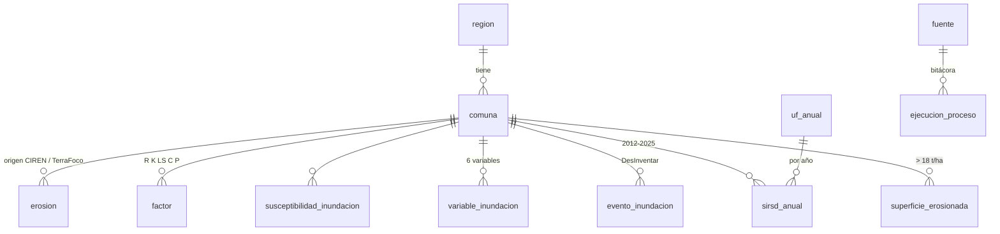

# L05 · La base de datos por dentro

> [!abstract] En una frase
> La base es PostgreSQL con PostGIS, ordenada en cuatro esquemas; **nunca sobrescribe** un indicador (cada recálculo es una fila nueva y gana la más reciente) y calcula el índice de pertinencia **en una vista**, al momento de consultarlo.

## 1. Cómo nace la base

| Archivo | Cuándo corre | Qué hace |
|---|---|---|
| `bd/esquema.sql` | La **primera vez** que arranca el contenedor `bd` (Postgres ejecuta lo que hay en `/docker-entrypoint-initdb.d`) | Crea las extensiones, los 4 esquemas, las tablas base, la región 6, el programa SIRSD-S, las prácticas y las primeras tareas programadas |
| `bd/migraciones/001…019_*.sql` | Con `bash herramientas/inicializar.sh` (Postgres **no** entra a subcarpetas) | Cada cambio posterior, en orden |
| `bd/semillas/*.csv` | Los carga el motor (`ingesta.sirsd_serie`, `superficie_erosionada --desde-semilla`) si las tablas están vacías | Datos agregados versionados: la serie del SIRSD-S y la superficie erosionada |

`herramientas/inicializar.sh` es **idempotente**: se puede correr diez veces. Las migraciones usan `CREATE TABLE IF NOT EXISTS`, `ADD COLUMN IF NOT EXISTS` y `DROP VIEW IF EXISTS`; las semillas `ON CONFLICT DO NOTHING`. → [[Migraciones]]

```bash
# Lo esencial de inicializar.sh
for f in bd/migraciones/*.sql; do $PSQL < "$f"; done          # migraciones en orden
python3 herramientas/sembrar_comunas.py | $PSQL               # las 33 comunas
[ "$(contar programas.sirsd_anual)" = "0" ] && $MOTOR ingesta.sirsd_serie
[ "$(contar indicadores.superficie_erosionada)" = "0" ] && \
    $MOTOR indicadores.superficie_erosionada --desde-semilla
```

## 2. El mapa de tablas



### `territorio` — lo que está en el mapa

| Tabla | Qué guarda | Desde |
|---|---|---|
| `region` | Código, nombre, **EPSG de trabajo** (32719), **extensión** (rectángulo del área de interés), resolución (30 m) | esquema |
| `comuna` | 33 comunas: código INE, nombre, provincia, km², **geometría** (MultiPolygon, 4326) | esquema |
| `ciudad` | Ciudades y pueblos (Límite Urbano Censal) | esquema, llenada en 015 |
| `cauce` | Red hídrica de IDE Chile con orden de Strahler | 008 |
| `manzana_censal`, `zona_censal`, `limite_urbano`, `area_verde` | Módulo 3: población urbana y parques | 014 |
| `manzana`, `equipamiento` | Personas por manzana (2017) y escuelas, salud, emergencia (OSM) | 016 |
| `unidad_censal` | Censo 2024 en toda la región: ciudad, aldea y campo | 019 |

### `indicadores` — lo que se calcula

| Tabla | Qué guarda | Desde |
|---|---|---|
| `erosion` | Pérdida de suelo por comuna, con sus 5 factores, clase, **origen** y `en_dominio` | esquema + 003 |
| `factor` | Cada factor de RUSLE por separado, con fuente y `detalle` (JSON) | 002 |
| `susceptibilidad_inundacion` | Índice comunal, clase, `calibrado`, pesos y método | esquema + 011 |
| `variable_inundacion` | Media comunal de cada una de las seis variables | 007 |
| `evento_inundacion` | Los eventos históricos (DesInventar) | 009 |
| `superficie_erosionada` | Hectáreas con erosión > 18 t/ha/año | 013 |
| `urbano`, `area_verde`, `cobertura_agricola` | Temperatura, déficit de área verde, % cultivo y pradera | esquema + 006, 014, 019 |
| **`v_pertinencia`** | **Vista**: el índice | esquema → 001 → 004 → **013** |

### `programas` — la inversión

| Tabla | Qué guarda |
|---|---|
| `programa` | SIRSD-S de INDAP y de SAG (el mismo código, dos organismos) |
| `practica` | Prácticas y el factor RUSLE sobre el que actúan (C, P o K) |
| `ejecucion` | Ejecución por comuna, cargada de IDE MINAGRI (alimenta el factor P) |
| `sirsd_anual` | **La serie 2012–2025** por comuna y año: planes, agricultores, incentivo, hectáreas (013) |
| `uf_anual` | UF promedio de cada año, 2012–2025, para deflactar (013) |

### `operacion` — el funcionamiento

| Tabla | Qué guarda |
|---|---|
| `fuente` | El **catálogo de fuentes**: nombre, organismo, URL, estado administrativo, código (012) |
| `ejecucion_proceso` | La **bitácora**: cada corrida del motor con inicio, fin, estado y registros |
| `tarea_programada` | Las tareas del programador: comando, cadencia, dependencia |

## 3. Tres patrones de diseño que se repiten

### 3.1 Nunca se sobrescribe: gana la más reciente

`indicadores.erosion`, `factor`, `susceptibilidad_inundacion` y `variable_inundacion` **solo reciben INSERT**. Recalcular agrega una versión. Para leer "el valor vigente" se usa siempre el mismo molde:

```sql
SELECT DISTINCT ON (id_comuna, origen)          -- una fila por comuna y origen...
       id_comuna, origen, perdida_ton_ha, clase, anio
FROM   indicadores.erosion
ORDER  BY id_comuna, origen, anio DESC, calculado_en DESC;   -- ...la del año más
                                                               -- reciente y, dentro de él,
                                                               -- la última calculada
```

`DISTINCT ON` es propio de PostgreSQL: de cada grupo se queda con la **primera** fila según el `ORDER BY`.

> [!tip] Por qué vale la pena
> El histórico es parte del producto: se puede explicar por qué un indicador cambió entre dos entregas, y un recálculo malo no destruye el anterior. Comentario en el esquema: *"El histórico es parte del producto."*

### 3.2 La base hace cumplir las reglas

```sql
CONSTRAINT erosion_factores_positivos
    CHECK (factor_r > 0 AND factor_k > 0 AND factor_ls > 0
           AND factor_c > 0 AND factor_p > 0),
CONSTRAINT erosion_clase_valida
    CHECK (clase IN ('Ligera','Moderada','Severa','Muy severa','Extrema'))
```

Aunque el código tenga un error, la base **rechaza** una fila imposible. En `indicadores.factor`, el CHECK `valor > 0` existe porque un factor en cero anula toda la multiplicación de RUSLE.

### 3.3 Particionada por región

```sql
CREATE TABLE indicadores.erosion ( ... ) PARTITION BY LIST (id_region);
CREATE TABLE indicadores.erosion_r06 PARTITION OF indicadores.erosion FOR VALUES IN (6);
```

Cada región vive en su propia "subtabla". Agregar otra región no hace más lentas las consultas de O'Higgins. (Lo mismo con `susceptibilidad_inundacion`.)

## 4. La vista de pertinencia, línea por línea

Es el SQL más importante del proyecto. Está en `bd/migraciones/013_serie_sirsd_y_pertinencia_por_ha_erosionada.sql`. Se arma con **CTE** (`WITH nombre AS (...)`): consultas intermedias con nombre, como pasos de una receta.

### Paso 1 · La erosión vigente

```sql
WITH ultima_erosion AS (
    SELECT DISTINCT ON (id_comuna, origen)
           id_comuna, id_region, origen, perdida_ton_ha, clase, anio, en_dominio
    FROM   indicadores.erosion
    ORDER  BY id_comuna, origen, anio DESC, calculado_en DESC
),
```

Una fila por comuna **y por origen**: la vista expone CIREN y TerraFoco lado a lado. Quien consulta elige.

### Paso 2 · La inversión, en UF

```sql
inversion AS (
    SELECT s.id_comuna,
           SUM(s.ha_reales)                 AS ha_bonificadas,
           SUM(s.incentivo)                 AS monto_total,      -- pesos nominales
           SUM(s.incentivo / u.uf_promedio) AS incentivo_uf,     -- ← cada año en su UF
           SUM(s.agricultores)              AS beneficiarios,
           SUM(s.planes)                    AS planes,
           SUM(s.inversion_total) FILTER (WHERE NOT s.inversion_anomala) AS inversion_total,
           MIN(s.anio) AS anio_desde, MAX(s.anio) AS anio_hasta,
           COUNT(*) FILTER (WHERE u.anio IS NULL) AS anios_sin_uf
    FROM   programas.sirsd_anual s
    LEFT   JOIN programas.uf_anual u USING (anio)
    GROUP  BY s.id_comuna
),
```

- **`incentivo / uf_promedio` año por año:** $1 millón de 2012 no vale lo mismo que $1 millón de 2025. Se convierte cada año con su UF y recién entonces se suma.
- **`FILTER (WHERE …)`**: suma solo algunas filas. `inversion_anomala` marca un error del sistema de origen (6307/2017: 4.811 millones contra ~100 los años vecinos).
- **`anios_sin_uf`**: si faltara la UF de un año, no desaparece en silencio: queda contado.

### Paso 3 · El denominador

```sql
superficie AS (
    SELECT DISTINCT ON (id_comuna)
           id_comuna, ha_sobre_umbral, en_dominio
    FROM   indicadores.superficie_erosionada
    WHERE  origen = 'TerraFoco' AND umbral_t_ha = 18
    ORDER  BY id_comuna, anio DESC, calculado_en DESC
),
```

Las hectáreas con erosión Severa o superior, del ráster de 30 m del cálculo propio.

### Paso 4 · Todo junto, comuna por comuna

```sql
base AS (
    SELECT c.id_comuna, c.id_region, c.nombre, c.provincia, c.superficie_km2,
           e.origen, e.anio AS anio_erosion,
           (e.en_dominio AND COALESCE(sf.en_dominio, false)) AS en_dominio,
           e.perdida_ton_ha, e.clase,
           ... i.incentivo_uf, ...
           sf.ha_sobre_umbral AS ha_erosion_severa,
           i.incentivo_uf / NULLIF(sf.ha_sobre_umbral, 0) AS inversion_uf_ha
    FROM   territorio.comuna c
    JOIN   ultima_erosion e ON e.id_comuna = c.id_comuna
    LEFT   JOIN inversion i  ON i.id_comuna = c.id_comuna
    LEFT   JOIN superficie sf ON sf.id_comuna = c.id_comuna
)
```

- **`JOIN` vs `LEFT JOIN`**: sin erosión no hay comuna en la vista (`JOIN`); sin inversión o sin superficie, la comuna **sigue** con esos campos en nulo (`LEFT JOIN`).
- **`NULLIF(x, 0)`** devuelve nulo si x es 0: así no se divide por cero.
- **`en_dominio`** es verdadero solo si lo es la erosión **y** el denominador. Con CIREN como origen, las 6 comunas precordilleranas quedan fuera igual, porque su superficie "severa" sale del cálculo propio, que ahí sobreestima.
- **`COALESCE(a, b)`** usa `a` y, si es nulo, `b`.

### Paso 5 · Normalizar y restar

```sql
SELECT b.*,
       (b.perdida_ton_ha - MIN(b.perdida_ton_ha) OVER w)
         / NULLIF(MAX(b.perdida_ton_ha) OVER w - MIN(b.perdida_ton_ha) OVER w, 0)
         AS necesidad_norm,

       (LN(NULLIF(b.inversion_uf_ha, 0)) - MIN(LN(NULLIF(b.inversion_uf_ha, 0))) OVER w)
         / NULLIF(MAX(LN(NULLIF(b.inversion_uf_ha, 0))) OVER w
                  - MIN(LN(NULLIF(b.inversion_uf_ha, 0))) OVER w, 0)
         AS inversion_norm,

       necesidad_norm - COALESCE(inversion_norm, 0)   -- (escrito completo en el archivo)
         AS pertinencia
FROM   base b
WINDOW w AS (PARTITION BY b.id_region, b.origen, b.en_dominio);
```

- **Funciones de ventana** (`MIN(...) OVER w`): calculan el mínimo y el máximo **del grupo** sin colapsar las filas. Cada comuna sigue siendo una fila, pero "ve" el mínimo y máximo de su grupo.
- **`WINDOW w AS (PARTITION BY region, origen, en_dominio)`**: el grupo. Se normaliza **por región** (cambiar a escala nacional sería cambiar esta línea), **por origen** (mezclar CIREN con el cálculo propio en un mismo mínimo–máximo no tendría sentido: son dos escalas) y **por dominio** (las comunas donde el modelo sobreestima aplastarían la escala).
- **`LN`** es el logaritmo natural. La inversión va de 0,3 a 34 UF/ha (dos órdenes de magnitud); en escala lineal tres comunas dejaban a las demás apretadas contra el cero.
- **`COALESCE(inversion_norm, 0)`**: una comuna sin inversión cuenta como inversión cero, que es lo peor para el índice (máxima brecha), no como "sin índice".

> [!example] Con números de Navidad
> Navidad tiene la erosión más alta de su grupo → `necesidad_norm = 1`. Y la UF/ha más baja (0,32) → `inversion_norm = 0`. Pertinencia = 1 − 0 = **1** (el máximo posible). En el visor: (1 + 1)/2 = **1,00**, "Brecha crítica".

### Las tres decisiones de la migración 013 (memorízalas)

1. **Período completo 2012–2025**, no un año: el programa funciona por concursos; una comuna puede tener un año grande y el siguiente cero por el ciclo, no por focalización.
2. **Deflactado a UF**: catorce años de pesos nominales subestiman los años tempranos.
3. **Por hectárea erosionada**: la necesidad es intensiva (t/ha) y la inversión extensiva (pesos totales). Para compararlas, la inversión se lleva a "por hectárea con problema".

Y una cuarta: la variable es el **incentivo** (la plata del Estado), no la inversión total (que incluye el aporte del agricultor).

## 5. Las otras migraciones, en una línea cada una

| # | Qué cambió |
|---|---|
| 001 | La vista deja de exigir el cálculo propio: con CIREN el índice existe desde el primer día |
| 002 | Tabla `indicadores.factor`: cada factor llega por su lado, con su fuente |
| 003 | Columna `en_dominio`: las 6 precordilleranas se marcan, no se borran |
| 004 | La vista expone el dominio de validez |
| 005 | Las tareas programadas apuntan a módulos que existen |
| 006 | El indicador urbano admite escala comunal |
| 007 | Variables del índice de inundación por comuna |
| 008 | Red hídrica de IDE Chile |
| 009 | Eventos históricos de DesInventar |
| 010 | El programador conoce el módulo de inundaciones |
| 011 | El índice de inundación guarda con qué pesos y cortes se calculó |
| 012 | Catálogo de fuentes sembrado + `codigo` que lo une con la bitácora |
| 013 | **Serie SIRSD-S 2012–2025, UF y pertinencia por hectárea erosionada** |
| 014 | Áreas verdes y población urbana (módulo 3) |
| 015 | Ciudades y pueblos |
| 016 | Manzanas y equipamiento crítico (exposición) |
| 017 | El catálogo dice lo que hay cargado |
| 018 | El programador conoce las fuentes nuevas |
| 019 | Superficie agrícola y población rural (exposición para INDAP) |

## Pruébalo

```bash
bash herramientas/sql.sh "\dn"                                   # los esquemas
bash herramientas/sql.sh "\dt indicadores.*"                     # tablas de un esquema
bash herramientas/sql.sh "SELECT nombre, round(pertinencia::numeric,3), en_dominio FROM indicadores.v_pertinencia WHERE origen='CIREN' ORDER BY pertinencia DESC NULLS LAST LIMIT 5;"
bash herramientas/sql.sh "SELECT count(*), count(DISTINCT calculado_en) FROM indicadores.erosion WHERE origen='TerraFoco';"   # cuántas versiones hay
```

## Cómo decirlo en la presentación

> [!example] Versión corta
> "La base tiene cuatro esquemas: territorio, indicadores, programas y operación. Los indicadores nunca se sobrescriben: cada recálculo es una fila nueva con su fecha, y las consultas toman la más reciente. El índice de pertinencia no se guarda: es una vista que lo calcula al consultarlo, normalizando por región, por origen y por dominio de validez. Por eso cambiar el alcance de comparación es cambiar una línea, no migrar datos."

## Autoevaluación

> [!question]- ¿Por qué las migraciones no se cargan solas al levantar Docker?
> Postgres solo ejecuta lo que está en la raíz de `/docker-entrypoint-initdb.d` (ahí está `esquema.sql`) y solo la primera vez; `migraciones/` es una subcarpeta. Por eso existe `inicializar.sh`.

> [!question]- ¿Qué hace `DISTINCT ON (id_comuna, origen) … ORDER BY … anio DESC, calculado_en DESC`?
> Se queda con una fila por comuna y origen: la del año más reciente y, entre ellas, la última calculada. Es como se lee el valor vigente en tablas que nunca se sobrescriben.

> [!question]- ¿Por qué el incentivo se divide por la UF año por año y no al final?
> Porque cada año tiene su UF: un peso de 2012 vale más que uno de 2025. Convertir cada año y después sumar da el total en moneda comparable.

> [!question]- ¿Qué es `PARTITION BY id_region, origen, en_dominio` en la vista?
> El grupo dentro del cual se normaliza (mínimo y máximo). Separar por región da escala regional; por origen evita mezclar dos escalas de erosión distintas; por dominio evita que las comunas donde el modelo sobreestima aplasten la escala de las demás.

> [!question]- ¿Por qué se usa logaritmo en la inversión y no en la necesidad?
> La inversión por hectárea va de 0,3 a 34 UF/ha (dos órdenes de magnitud) y en escala lineal unas pocas comunas aplastaban al resto. La erosión no tiene ese rango extremo.

> [!question]- ¿Qué pasa en la vista con una comuna que nunca recibió incentivo?
> `inversion_norm` queda nulo y `COALESCE(…, 0)` la cuenta como cero: su pertinencia es igual a su necesidad, la máxima brecha posible para esa erosión.

> [!question]- ¿Qué impide guardar un factor RUSLE igual a cero?
> El CHECK `valor > 0` de `indicadores.factor` y los CHECK de `indicadores.erosion`: un cero anularía toda la multiplicación. Además el almacén del motor descarta los no positivos antes de insertar.

Siguiente: [[L06 El motor - anatomía de un módulo]]
