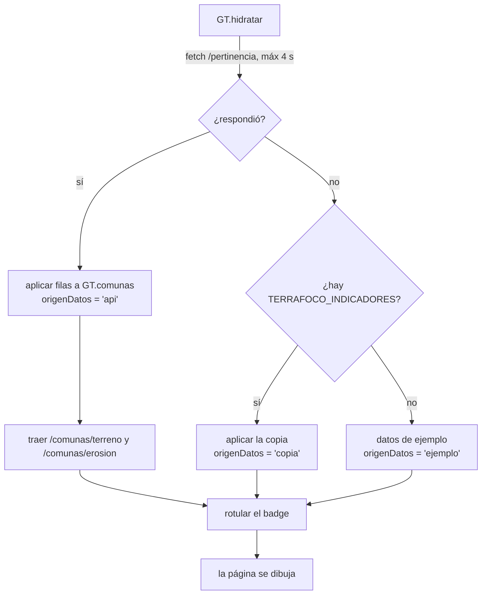

# L11 · El visor: cómo arranca una página

> [!abstract] En una frase
> Cada página HTML carga una serie de scripts **en un orden fijo** (tema → dónde está la API → colores → datos de ejemplo → copia local → hidratación → barra superior → mapas → módulos), espera a que `GT.hidratar()` traiga los datos reales —o caiga a la copia local, o a los de ejemplo— y recién entonces se dibuja, **declarando siempre de dónde salió lo que muestra**.

## 1. La carpeta `prototipo/`

```
prototipo/
├── index.html, visor.html, predios.html, pertinencia.html, comuna.html,
│   inundaciones.html, urbano.html, fuentes.html, ayuda.html   ← 9 páginas
├── css/styles.css        ← una sola hoja de estilos (sistema de diseño monocromo)
├── js/                   ← ~25 módulos
├── datos/
│   ├── comunas.js / .geojson     ← copia estática de las 33 geometrías
│   ├── indicadores.js            ← COPIA LOCAL de los últimos datos reales
│   ├── teselas/*.pmtiles         ← las pirámides de valores
│   ├── erosion/, inundacion/, calor/   ← PNG por comuna + índices (respaldo)
│   └── predios_ejemplo*.csv      ← 12 predios ficticios
└── vendor/               ← MapLibre, PMTiles, three.js (copias locales)
```

> [!question]- ¿Por qué sin framework (sin React ni Vue)? Piénsalo antes de abrir.
> El visor tiene que abrirse en cualquier máquina, también con **doble clic** desde el disco (`file://`) y desde un pendrive, sin compilar nada. HTML + JS plano cumple eso sin paso de construcción y sin dependencias que actualizar. Lo que resuelven los frameworks (componentes reactivos complejos) no es el problema de este visor: el trabajo pesado lo hacen MapLibre y la GPU.

> [!question]- ¿Por qué hay librerías en `vendor/` si existen en internet?
> Una red que bloquee `unpkg.com` (pasa en redes institucionales) dejaba la pantalla sin mapa. Se cargan de `vendor/` y el CDN queda de respaldo (`cargarRecurso` en `mapa-real.js` prueba una dirección y si falla la siguiente).

## 2. El esqueleto de una página

Todas las páginas son iguales por fuera (ejemplo: `index.html`):

```html
<head>
  <script src="js/tema.js"></script>              <!-- 1. ANTES del CSS: fija oscuro/claro -->
  <link rel="stylesheet" href="css/styles.css">
</head>
<body>
<div class="app">
  <div id="sidebar"></div>                         <!-- lo rellena pintarShell -->
  <div class="main">
    <div id="topbar"></div>                        <!-- lo rellena pintarShell -->
    <div class="content"> ... tarjetas propias de la página ... </div>
  </div>
</div>

<script src="js/api-base.js"></script>        <!-- 2. dónde está la API y qué región -->
<script src="js/paleta.js"></script>          <!-- 3. PALETA: todos los colores -->
<script src="js/data.js"></script>            <!-- 4. GT: datos de ejemplo y reglas -->
<script src="datos/indicadores.js"></script>  <!-- 5. la copia local -->
<script src="js/datos-api.js"></script>       <!-- 6. GT.hidratar() -->
<script src="js/shell.js"></script>           <!-- 7. pintarShell: menú y barra -->
<script src="js/mapa.js"></script>            <!-- 8. GTMapa: esquemático + leyendas -->
<script src="datos/comunas.js"></script>      <!--    geometrías de respaldo -->
<script src="js/mapa-real.js"></script>       <!-- 9. GTMapaReal: MapLibre -->
<script src="js/graficos.js"></script>        <!-- 10. GTGrafico -->
<script>
GT.hidratar().then(function () {               // ← espera los datos
  pintarShell('index', 'Panel general', ...);  // ← menú y barra
  ... dibujar tarjetas, mapa, gráficos ...
});
</script>
</body>
```

> [!important] El orden importa
> Cada script usa lo que definieron los anteriores: `datos-api.js` le cuelga funciones a `GT`, que crea `data.js`; `mapa-real.js` usa `PALETA` y `GT_api`. Cambiar el orden rompe la página.

### Los objetos globales

| Objeto | Archivo | Qué es |
|---|---|---|
| `GT_API_BASE`, `GT_REGION`, `GT_api()` | `api-base.js` | Dirección de la API, región activa y armador de URLs |
| `PALETA` | `paleta.js` | Colores por tema: interfaz, rampas de datos, mapa |
| `GT` | `data.js` + `datos-api.js` | Las 33 comunas con sus datos, reglas de negocio y la hidratación |
| `TERRAFOCO_INDICADORES` | `datos/indicadores.js` | Copia local de los últimos datos reales |
| `TERRAFOCO_COMUNAS` | `datos/comunas.js` | Copia de las geometrías |
| `GTMapa` | `mapa.js` | Mapa esquemático (respaldo), colores por capa, leyendas |
| `GTMapaReal` | `mapa-real.js` | El mapa con MapLibre |
| `GTDetalle` | `detalle-comuna.js` | El detalle a 30 m |
| `GTGrafico` | `graficos.js` | Gráficos en SVG sin librerías |
| `GTCalculo`, `GTInundacion`, `GTZonas`, `GTPredios`, `GTModelo3D`, `GTSim*` | sus archivos | Módulos de cada pantalla |

## 3. Los scripts base, uno por uno

### `tema.js` — oscuro o claro, antes de pintar

```javascript
var tema = 'oscuro';
if (localStorage.getItem('terrafoco_tema') === 'claro') tema = 'claro';
var pedido = new URLSearchParams(window.location.search).get('tema');   // ?tema=claro
if (pedido === 'claro' || pedido === 'oscuro') { tema = pedido; localStorage.setItem(...); }
document.documentElement.setAttribute('data-tema', tema);              // <html data-tema="...">
```

Va en el `<head>` porque, cargado al final, la página aparecía un instante en oscuro y saltaba al claro. **Cambiar de tema recarga la página**: el mapa base, las rampas y los gráficos se arman con el tema al cargar, y repintarlos "en caliente" sería un segundo camino que mantener sincronizado. El `?tema=claro` existe para proyectores, donde el oscuro se ve lavado.

### `api-base.js` — ¿dónde está la API?

```javascript
var GT_API_BASE = (function () {
  var local = /^(localhost|127\.0\.0\.1|\[::1\])$/.test(window.location.hostname) ||
              window.location.protocol === 'file:' ||
              /\.app\.github\.dev$/.test(window.location.hostname);     // Codespaces
  var POR_DEFECTO = local ? 'http://localhost:8000' : window.location.origin + '/api';
  // ?api=https://... en la URL: se usa y se recuerda en localStorage
  ...
})();

function GT_api(ruta, extra) {             // GT_api('/pertinencia', {origen: 'CIREN'})
  var partes = ['region=' + GT_REGION];    //   → http://localhost:8000/pertinencia?region=6&origen=CIREN
  ...
}
```

- En el PC: `localhost:8000`. En el servidor público: `/api` del mismo dominio (Caddy la redirige). En otro lugar: `?api=https://…` una vez, y se recuerda.
- `GT_REGION` funciona igual con `?region=N`. **Todas** las llamadas pasan por `GT_api`, que agrega la región sola: cambiar de región no depende de acordarse en cada sitio.

### `paleta.js` — la única fuente del color

```javascript
const TEMA = document.documentElement.getAttribute('data-tema') === 'claro' ? 'claro' : 'oscuro';
const TEMAS_PALETA = {
  oscuro: { tinta: '#E8E8EA', ..., rampas: { erosion: [...5 colores...], agua: [...], ... },
            mapa: { estilo: '...dark-matter...', borde: ..., seleccion: '#FFFFFF', ... } },
  claro:  { ... },
};
const PALETA = Object.assign({ tema: TEMA, codificacion: {...} }, TEMAS_PALETA[TEMA]);
```

- La interfaz es **monocroma** (grises del negro al blanco); el color queda para los **datos**.
- Las **rampas** de datos del tema oscuro se generaron en OKLCH y se validaron: luminosidad monótona, la clase más tenue a más de 2:1 del fondo. El oscuro **no es el claro invertido** (invertir dejaría la clase más baja como la más brillante).
- `codificacion`: los colores con que el motor escribe los PNG por comuna. **No son colores de pantalla**: el visor lee la clase de cada píxel por ese color. Si se usaran los colores del tema, en oscuro "Ligera" (casi blanco) se confundía con "Extrema" y una comuna salía 92 % extrema.
- `css/styles.css` replica estos colores en variables (`--texto`, `--acento`, `--ero-1`…).

### `data.js` — los datos de ejemplo y las reglas

Tiene dos cosas distintas:

1. **Datos de ejemplo** (`GT.comunas` con cifras escritas a mano en la fase de prototipo): solo se ven si no hay API **ni** copia local, y la barra lo declara.
2. **Reglas de negocio** que usan todas las pantallas:

```javascript
GT.clasesErosion = [ {max: 10, nombre: 'Ligera'}, {max: 18, nombre: 'Moderada'}, ... ];
GT.categoriasPertinencia = [ {max: 0.25, nombre: 'Sobre-cobertura'}, ..., {max: 1.01, nombre: 'Brecha crítica'} ];
GT.enIndice = function (c) { return !c.sinDatoEnOrigen && typeof c.indice === 'number'; };
GT.recomendacion = function (c) { ... 'Priorizar en el próximo concurso del SIRSD-S...' ... };
GT.fmt = function (n, dec) { return n.toLocaleString('es-CL', ...); };   // coma decimal
```

`GT.enIndice` es el filtro por el que pasa **toda** vista del índice (ranking, KPIs, dispersión, capa): así ninguna pantalla muestra en el índice una comuna fuera del dominio o sin dato.

### `datos/indicadores.js` — la copia local

```javascript
window.TERRAFOCO_INDICADORES = { origen: 'CIREN', comunas: [...33...], sirsd: {...},
                                 factores: {...}, evolucion: {...}, inundacion: [...], ... };
```

La genera `herramientas/sembrar_indicadores.py` consultando la API y usando **las mismas cuentas** (`focalizacion.py`). Es un `.js` y no un `.json` porque con doble clic (`file://`) el navegador **bloquea** `fetch` a archivos locales; un `<script>` sí carga.

## 4. `datos-api.js` — la hidratación

"Hidratar" es reemplazar los datos de ejemplo de `GT.comunas` por los reales. El flujo de `GT.hidratar()`:



```javascript
GT.hidratar = function (origen) {
  if (promesa) return promesa;                     // una sola vez por página
  var url = GT_api('/pertinencia', { origen: origen || GT.origenElegido,
                                     incluir_fuera_de_dominio: 'true' });
  promesa = fetch(url, { signal: AbortSignal.timeout(4000) })
    .then(function (r) { if (!r.ok) throw new Error('la API respondió ' + r.status); return r.json(); })
    .then(function (filas) {
      var n = aplicar(filas);
      GT.origenDatos = 'api'; GT.origenErosion = filas[0].origen; ...
      return Promise.all([traerTerreno(), traerErosiones()]);
    })
    .catch(function (e) {
      var copia = window.TERRAFOCO_INDICADORES;
      if (copia && copia.comunas && copia.comunas.length && aplicar(copia.comunas)) {
        GT.origenDatos = 'copia'; return;
      }
      GT.origenDatos = 'ejemplo';
    })
    .then(rotularCapasDeErosion)
    .then(rotular);
  return promesa;
};
```

> [!important] La promesa nunca se rechaza
> Si la API no está, se resuelve igual (con la copia o el ejemplo). *"Una pantalla en blanco por un backend apagado sería peor que un dato ilustrativo bien rotulado."* Por eso cada página puede envolver todo su código en `GT.hidratar().then(...)` sin manejar errores.

### `aplicar`: unir por nombre, marcar lo que falta

```javascript
function aplicar(filas) {
  var porNombre = {};
  GT.comunas.forEach(function (c) {
    porNombre[normalizar(c.nombre)] = c;
    c.sinDatoEnOrigen = true;          // todas "sin dato" hasta que llegue la suya
  });
  filas.forEach(function (f) {
    var c = porNombre[normalizar(f.nombre)];    // "Marchigüe" = "marchigue"
    if (!c) { sinPar.push(f.nombre); return; }
    c.sinDatoEnOrigen = false;
    c.erosion = f.perdida_ton_ha; ...
    c.indice = (c.fueraDeDominio && !GT.incluirFueraDeDominio) ? null : aEscalaCero(f.pertinencia);
  });
}
```

- **`normalizar`** quita tildes y mayúsculas: el nombre de la API y el de `data.js` calzan aunque uno diga "Marchigüe" y el otro "Marchigue".
- **`sinDatoEnOrigen = true` primero:** si una comuna no viene en la respuesta (con origen TerraFoco llegan 27, no 33), queda marcada y **no** se queda con su valor de ejemplo mezclado entre los reales.
- **`aEscalaCero`**: `(p + 1) / 2`, de −1..1 a 0..1.

### El badge: siempre dice qué estás viendo

`rotular` escribe el aviso de la barra superior en uno de tres estados:

| Estado | Texto | Color |
|---|---|---|
| `api` | "Datos reales · erosión CIREN 2024 · 27 de 33 comunas en el índice" | Verde (en vivo) o ámbar si se incluyen comunas fuera del dominio |
| `copia` | "Copia local · CIREN" | Neutro: es dato real, pero no en vivo |
| `ejemplo` | "Prototipo · datos de ejemplo" | Gris |

### Elecciones que se recuerdan (y recargan)

- **Origen** (CIREN o TerraFoco): selector de la barra → `GT.cambiarOrigen` guarda en `localStorage` y **recarga**. Así el visor y la ficha muestran el mismo origen.
- **Fuera de dominio**: casilla → `GT.cambiarDominio`, igual.
- **Región**: selector → recarga con `?region=N`.

> [!tip] ¿Por qué recargar y no repintar?
> Cada página se dibuja **una vez**, dentro del `.then` de `hidratar`. Repintar a mano dejaría partes con el valor viejo. Recargar garantiza consistencia con **un solo camino de carga**. Es una decisión que se repite en todo el visor (tema, origen, región).

### Otros datos bajo demanda

`GT.hidratarInundacion()`, `GT.hidratarUrbano()`, `GT.hidratarAreasVerdes()`, `GT.factoresRusle()`, `GT.serieSirsd(c)`, `GT.evolucionFocalizacion()`: misma receta (API → copia → ejemplo o `null`) y memorizan la promesa para no pedir dos veces.

## 5. `shell.js` — el marco de todas las páginas

```javascript
pintarShell('index', 'Panel general', 'Región de O\'Higgins · 33 comunas',
            CONTROLES_REGION + SELECTOR_ORIGEN + CASILLA_DOMINIO + BOTON_EXPORTAR,
            'Resumen de la Región de O\'Higgins: ...');
```

Hace, en orden:

1. Dibuja el **menú lateral** desde `MENU` (General · Módulo 1 — Suelos · Módulos 2 y 3 · Núcleo), marcando la página activa.
2. Dibuja la **barra superior**: migas, buscador global de comunas, el **badge**, el reloj (hora de Chile) y el botón de tema.
3. Arma el **encabezado** de la página: título, subtítulo, explicación; reparte los controles (botones junto al título, filtros en su fila).
4. Rotula el badge (`GT.rotularOrigen`), monta el selector de origen y los controles de región (pide `GET /regiones` y muestra **el período real** de los datos, leído de la base).
5. Conecta exportar (`window.GT_exportar` o CSV de las comunas), el menú en pantallas chicas y el buscador.

## 6. Mejora progresiva, en resumen

| Si falla… | El visor… | Y lo dice |
|---|---|---|
| La API | Usa la copia local | Badge "Copia local" |
| La API y no hay copia | Usa los datos de ejemplo | Badge "Prototipo · datos de ejemplo" |
| MapLibre (red bloqueada) | Intenta el CDN; si no, mapa esquemático | Chip "Cartografía esquemática" |
| Las geometrías de la API | Usa `datos/comunas.js` | Chip "Geometrías reales · copia estática de IDE Chile" |
| Las teselas (o se abre con doble clic) | Usa los PNG por comuna | El detalle se ve por comuna |

**Nunca queda en blanco y nunca presenta una copia como dato en vivo.** → [[Copia local y modo sin API]]

## Pruébalo

1. Abre `index.html` y la consola (F12). Escribe `GT.origenDatos` → `"api"`. Escribe `GT.comunas.filter(GT.enIndice).length` → 27.
2. `docker stop terrafoco-api`, recarga: badge "Copia local", `GT.origenDatos` → `"copia"`. `docker start terrafoco-api`.
3. Abre `prototipo/index.html` con **doble clic** (sin servidor): funciona con la copia y los PNG.
4. Agrega `?tema=claro` a la URL.

## Cómo decirlo en la presentación

> [!example] Versión corta
> "El visor es HTML y JavaScript sin framework, para que abra en cualquier máquina, incluso con doble clic desde un pendrive. Cada página espera a que se hidraten los datos: si la API responde, son reales; si no, usa una copia local de los últimos datos reales; y si tampoco hay copia, datos de ejemplo. En los tres casos la barra superior dice qué se está viendo. Nunca queda en blanco y nunca hace pasar una copia por un dato en vivo."

## Autoevaluación

> [!question]- ¿Por qué `tema.js` va en el `<head>` y antes del CSS?
> Para fijar `data-tema` antes de que se pinte nada; cargado al final, la página parpadeaba en oscuro y saltaba al claro.

> [!question]- ¿Qué hace `GT_api('/pertinencia', {origen: 'CIREN'})`?
> Arma `http(s)://<API>/pertinencia?region=<región activa>&origen=CIREN`, con la dirección de la API resuelta por `api-base.js`.

> [!question]- ¿Por qué la copia local es un `.js` y no un `.json`?
> Porque al abrir con doble clic (`file://`) el navegador bloquea `fetch` a archivos locales; un `<script>` sí carga.

> [!question]- ¿Qué tres orígenes de datos puede tener una página y cómo se ven?
> `api` (badge "Datos reales…"), `copia` (badge "Copia local…") y `ejemplo` (badge "Prototipo · datos de ejemplo").

> [!question]- ¿Por qué `aplicar` marca primero todas las comunas como `sinDatoEnOrigen`?
> Para que una comuna ausente de la respuesta (con TerraFoco llegan 27) no se quede con su valor de ejemplo mezclado entre los reales sin que nada la distinga.

> [!question]- ¿Por qué cambiar de origen, región o tema recarga la página?
> Porque cada página se dibuja una vez dentro del `.then` de `hidratar`; recargar mantiene un solo camino de carga y evita partes con el valor viejo.

> [!question]- ¿Qué es `PALETA.codificacion` y por qué no sigue al tema?
> Los colores exactos con que el motor escribe cada clase en los PNG; el visor recupera la clase leyendo ese color. Es un código, no un color de pantalla: si siguiera al tema, las clases se confundirían.

Siguiente: [[L12 El visor - el mapa]]
