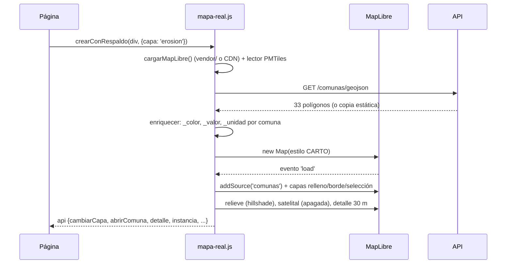

# L12 · El visor: el mapa

> [!abstract] En una frase
> `mapa-real.js` arma un mapa **MapLibre** sobre un mapa base de CARTO, le agrega las 33 comunas como una **fuente GeoJSON** pintada por la propiedad `_color` de cada una, y al hacer clic en una comuna le pide a `detalle-comuna.js` que monte su **grilla de 30 m** leída de las teselas, aplique el umbral y la dibuje refinada a la resolución de la pantalla.

## 1. MapLibre en cinco conceptos

| Concepto | Qué es | En TerraFoco |
|---|---|---|
| **Mapa** (`new maplibregl.Map`) | El lienzo interactivo, dibujado por la tarjeta de video (WebGL) | Uno por página |
| **Estilo** | La receta del mapa base: qué fuentes y capas trae, con qué colores | CARTO Dark Matter (oscuro) o Positron (claro), de `PALETA.mapa.estilo` |
| **Fuente** (*source*) | De dónde vienen los datos | `comunas` (GeoJSON), `relieve` (`raster-dem` desde PMTiles), `base-satelital` (ráster Sentinel-2) |
| **Capa** (*layer*) | Cómo se dibuja una fuente | `comunas-relleno` (`fill`), `comunas-borde` (`line`), `relieve-sombra` (`hillshade`), `color-relief` |
| **Propiedades** (`paint`, `layout`) | Color, grosor, opacidad, visibilidad | `'fill-color': ['get', '_color']` |

Y dos herramientas:

- **Expresiones:** pequeñas fórmulas en listas que MapLibre evalúa en la GPU. `['get', '_color']` = "usa la propiedad `_color` de cada polígono". `['interpolate', ['linear'], ['zoom'], 8.3, 0, 9.8, 1]` = "opacidad 0 en el zoom 8,3 y 1 en el 9,8, interpolando".
- **Eventos:** `mapa.on('click', 'comunas-relleno', funcion)` = "cuando hagan clic sobre esa capa".

## 2. Cómo se construye el mapa — `GTMapaReal.crear`



### 2.1 Cargar la librería bajo demanda

```javascript
const MAPLIBRE_JS = ['vendor/maplibre-gl.js', 'https://unpkg.com/maplibre-gl@5.24.0/dist/maplibre-gl.js'];
function cargarRecurso(urls, tipo) {      // prueba la primera; si falla, la siguiente
  return urls.slice(1).reduce(function (p, url) {
    return p.catch(function () { return cargarUno(url, tipo); });
  }, cargarUno(urls[0], tipo));
}
```

Además registra el protocolo `pmtiles://` para que MapLibre lea los archivos de teselas por rangos (`registrarTeselas`). Desde `file://` no hay rangos posibles: se queda sin teselas y usa los PNG.

### 2.2 Traer las geometrías (con respaldo)

```javascript
function traerGeometrias() {
  return fetch(GT_api('/comunas/geojson'), { signal: AbortSignal.timeout(4000) })
    .then(...)                                          // 1. la API
    .catch(function (e) {
      if (window.TERRAFOCO_COMUNAS) return window.TERRAFOCO_COMUNAS;   // 2. datos/comunas.js
      return fetch('datos/comunas.geojson')...;                         // 3. el .geojson
    });
}
```

### 2.3 Enriquecer: el color va dentro de cada polígono

```javascript
function enriquecer(geojson, capa) {
  geojson.features.forEach(function (f) {
    const par = porNombre[f.properties.nombre];          // la comuna en GT.comunas
    const info = GTMapa.valorCapa(par.datos, capa, par.indice);
    f.properties._color = info.color;                    // ← lo que pinta MapLibre
    f.properties._valor = info.v;                        // ← lo que dice la ventana emergente
    f.properties._unidad = info.unidad;
    f.properties._nota = info.nota || null;              // "fuera del dominio del modelo"
  });
}
```

`GTMapa.valorCapa` (en `mapa.js`) decide valor y color de cada comuna para cada capa: `erosion10` (CIREN), `erosion26` (propia, en gris "sin dato" si está fuera del dominio y no se pidió verla), `ndvi`, `pendiente`, `inversion`, `pertinencia` (por **categoría**, no por rampa, para que el mapa y la tabla coincidan), `inundacion` (por la **clase** comunal), `urbano-temp`, `urbano-verde`. Las reglas de color están en un solo lugar.

### 2.4 Al cargar: las capas, en un orden pensado

```javascript
mapa.on('load', function () {
  mapa.addSource('comunas', { type: 'geojson', data: geo });
  entintarBase(mapa);                          // fondo y agua del mapa base en los tonos de la interfaz
  const punto = puntosDeInsercion(mapa);       // ¿dónde están los caminos y las etiquetas del estilo?

  mapa.addLayer({ id: 'base-satelital-capa', type: 'raster', ..., layout: { visibility: 'none' } },
                punto.sobreElFondo);           // satelital: creada desde el inicio, apagada

  mapa.addLayer({ id: 'comunas-relleno', type: 'fill', source: 'comunas',
                  paint: { 'fill-color': ['get', '_color'], 'fill-opacity': ... } },
                punto.bajoCaminos);            // el coropleto, BAJO los caminos

  mapa.addLayer({ id: 'comunas-borde', type: 'line', ... }, punto.bajoEtiquetas);
  mapa.addLayer({ id: 'comunas-activa-casco', ... filter: ['==', 'nombre', ''] }, ...);
  mapa.addLayer({ id: 'comunas-activa', ... filter: ['==', 'nombre', ''] }, ...);
  mapa.fitBounds(limitesRegion(), { padding: 28, duration: 0 });   // encuadre por las geometrías
  ...
});
```

- **El coropleto va bajo los caminos y las etiquetas** (`punto.bajoCaminos`): es el fondo temático sobre el que se leen calles, pueblos y ríos, no una tapa encima del mapa.
- **La comuna seleccionada** es una línea sobre un "casco" de color opuesto (blanca sobre casco oscuro en el tema oscuro), como en la cartografía impresa: se ve sobre cualquier color de relleno. Seleccionar es cambiar el **filtro** de esas capas.
- **Encuadre por las geometrías**, no por coordenadas fijas: otra región se encuadraría sola.
- **La capa satelital se crea apagada desde el inicio:** cambiar de base es encender una capa, no reconstruir el estilo (`setStyle` borraría las capas temáticas).

> [!info] ¿Por qué no el satelital de Google?
> Sus condiciones prohíben obtener las teselas por fuera de su API, que es de pago, exige tarjeta y prohíbe cachear. Se ofrece **Sentinel-2**, que además es la misma familia de imagen con que se calcula el factor C: se valida un dato de 2024 contra una imagen de la misma fuente, no contra una foto de fecha desconocida.

### 2.5 Relieve y 3D

```javascript
mapa.addSource('relieve', { type: 'raster-dem', url: 'pmtiles://…/relieve.pmtiles',
                            tileSize: 512, encoding: 'mapbox' });
mapa.addLayer({ id: 'relieve-sombra', type: 'hillshade', source: 'relieve',
                paint: { 'hillshade-method': 'igor', 'hillshade-exaggeration': 0.55, ... } });
// botón 3D:
mapa.setTerrain({ source: 'relieve-3d', exaggeration: 1.6 });
mapa.easeTo({ pitch: 62, ... });
```

El método de sombreado `igor` casi no sombrea lo plano: el valle central, donde se lee el dato, queda limpio. El 3D levanta el terreno ×1,6 e inclina la cámara; se gira arrastrando con la **rueda del mouse apretada**, como en Google Earth (`orbitaConRueda`).

### 2.6 Los clics

```javascript
mapa.on('click', 'comunas-relleno', function (e) {
  const p = e.features[0].properties;                       // la comuna bajo el clic
  if (p.nombre === seleccionada && cfg.alClicEnAbierta) {   // clic dentro de la ya abierta:
    cfg.alClicEnAbierta(e.lngLat); return;                  //   la página decide (celda, parque…)
  }
  seleccionada = p.nombre;
  pintarSeleccion();                                         // filtros + opacidades
  const c = GT.comunas.find(function (x) { return x.nombre === p.nombre; });
  if (cfg.alSeleccionar && c) cfg.alSeleccionar(c);          // la página reacciona
  if (detalle && c && detalleActivo && detalle.disponible()) detalle.mostrar(c);   // ← 30 m
});

mapa.on('click', function (e) {                              // clic fuera de toda comuna
  if (!mapa.queryRenderedFeatures(e.point, { layers: ['comunas-relleno'] }).length)
    volverARegion();
});
```

### 2.7 La ventana emergente con el valor de la celda

Al pasar el cursor: el valor **comunal** (de `_valor`) y, si hay detalle, el valor de la **celda** de 30 m bajo el cursor (`detalle.claseEn(lngLat)`): "Litueche · 13,65 t/ha/año · comuna · celda: 23,4 t/ha/año · Severa". Responde "¿esto de aquí es grave?" sin comparar colores contra la leyenda.

### 2.8 Lo que devuelve: el control remoto del mapa

`crear` resuelve una promesa con un objeto que la página usa: `cambiarCapa`, `cambiarOpacidad`, `cambiarBase`, `activarDetalle`, `abrirComuna`, `volverARegion`, `detalle()`, `instancia` (el mapa de MapLibre). Por ejemplo, el visor llama `api.cambiarCapa('pertinencia')` al elegir otra capa: se re-enriquece el GeoJSON y `setData` repinta.

### 2.9 El respaldo: `crearConRespaldo`

```javascript
GTMapaReal.crearConRespaldo = function (contenedor, opciones) {
  return GTMapaReal.crear(contenedor, opciones)
    .catch(function (e) {
      console.warn('[mapa-real] usando el mapa esquemático:', e.message);
      marcarOrigen(contenedor, false);                  // chip "Cartografía esquemática"
      return GTMapa.crearRegional(contenedor, opciones);   // SVG dibujado por mapa.js
    });
};
```

`mapa.js` dibuja una grilla de 33 celdas irregulares en SVG (con una semilla fija, siempre igual). Es el respaldo final: si MapLibre no carga, la página igual muestra algo y lo dice.

## 3. El detalle a 30 m — `detalle-comuna.js`

### 3.1 Las variables con detalle

```javascript
const VARIABLES = {
  erosion:    { teselas: 'datos/teselas/erosion.pmtiles', ruta: 'datos/erosion/',
                clases: ['Ligera','Moderada','Severa','Muy severa','Extrema'],
                alfas: [0.10, 0.50, 0.78, 0.90, 0.95], cortesInclusivos: true, ... },
  inundacion: { teselas: 'datos/teselas/inundacion.pmtiles', clases: ['Baja','Media','Alta','Muy alta'],
                alfas: [0.04, 0.22, 0.78, 1], umbral: true, localidades: true, ... },
  calor:      { teselas: 'datos/teselas/calor.pmtiles', ... titulo: 'temperatura a 70 m' },
  // y ndvi, pendiente
};
```

Las **alfas** (opacidad por clase) son una decisión de diseño: la clase más baja va casi transparente porque es la mayor parte del territorio y, pintada, tapaba caminos y casas justo donde no hay nada que focalizar. Las clases altas, casi opacas.

### 3.2 Dos modos

| Modo | Cuándo | De dónde sale cada celda |
|---|---|---|
| **Continuo** | Hay teselas y servidor con rangos | `.pmtiles`: el **valor** exacto de cada celda en toda la región |
| **Por comuna** | Sin teselas o desde `file://` | `datos/<variable>/<var>_<id>.png`: la **clase** de cada celda (leída del color con `PALETA.codificacion`) |

### 3.3 Lo que pasa al abrir una comuna

1. **Se arma la grilla de la comuna** (`base`): ancho y alto en celdas, sus cuatro esquinas, `valores` (el valor de cada celda, en modo continuo) y `original` (la clase de cada celda; 255 = fuera de la comuna).
2. **Se aplica el umbral** (si la variable lo tiene): `aplicarUmbral` produce `base.clases`, igual a `original` pero con 255 en las celdas bajo el umbral.
3. **Se dibuja la vista refinada:** en vez de cuadrados de 30 m, un **Web Worker** (código que corre fuera del hilo de la página) calcula **un punto por píxel de pantalla**: cada punto toma la clase con más peso entre las 16 celdas que lo rodean (peso gaussiano, σ = 0,35 celda). Resultado: bordes suaves sin inventar clases. Se recalcula al detenerse el mapa (`moveend`), no en cada cuadro.
4. **Se emiten eventos** para que la página reaccione:

```javascript
function emitir(tipo, detalle) {
  contenedor.dispatchEvent(new CustomEvent('detalle:' + tipo, { detail: detalle }));
}
// 'detalle:base'    → hay grilla nueva (la página carga población, cultivos…)
// 'detalle:umbral'  → cambió el umbral (la página recalcula la exposición)
// 'detalle:resumen' → resumen de la comuna (fracción por clase, celdas sobre el umbral)
```

> [!tip] Por qué eventos
> `detalle-comuna.js` no sabe nada de población ni de escuelas. Solo anuncia "hay grilla nueva" o "cambió el umbral". `inundacion.js` escucha y calcula la exposición. Así el detalle sirve igual para erosión, inundación, calor, NDVI y pendiente.

### 3.4 Cómo se lee el valor de una celda en una tesela

```javascript
function lectorDeValores(archivo, z, tamano, escala) {
  return function valorEn(lngLat, alListo) {
    const n = Math.pow(2, z);                                     // teselas por lado en el zoom z
    const fx = (lngLat.lng + 180) / 360 * n;                      // columna (con decimales)
    const fy = (1 - Math.log(Math.tan(lat) + 1 / Math.cos(lat)) / Math.PI) / 2 * n;   // fila (Mercator)
    const x = Math.floor(fx), y = Math.floor(fy);                // qué tesela
    ...decodificar la tesela x/y (una vez; queda en caché)...
    const px = Math.floor((fx - x) * tamano), py = Math.floor((fy - y) * tamano);    // qué píxel
    const i = (py * tamano + px) * 4;                             // RGBA
    const codigo = t[i] * 65536 + t[i + 1] * 256 + t[i + 2];      // R·65536 + G·256 + B
    if (codigo === 0) return null;                                // sin dato
    return (-10000 + codigo * 0.1) / escala;                      // la fórmula inversa
  };
}
```

Es la decodificación de [[L09 El motor - programador y teselas]] escrita en JavaScript. La tesela se dibuja en un lienzo invisible con `premultiplyAlpha: 'none'` y `colorSpaceConversion: 'none'`: **cada byte es parte de un número**, y cualquier "corrección de color" del navegador lo cambiaría.

### 3.5 La capa `color-relief` y su expresión

En modo continuo también existe una capa `color-relief` que colorea la "elevación" de la tesela por clases. Su expresión se arma **desde los cortes que vienen en los metadatos del archivo**:

```javascript
function expresionColor(cortes, tramos, alfas, visibles, inclusivos) {
  const d = 0.05;
  const e = ['interpolate', ['linear'], ['elevation'],
             -10000, 'rgba(0,0,0,0)', -10000 + d, 'rgba(0,0,0,0)'];   // sin dato: transparente
  e.push(-10000 + 2 * d, color(0));
  cortes.forEach(function (c, i) {
    const cierre = inclusivos ? c : c - d;
    e.push(cierre, color(i), cierre + d, color(i + 1));               // escalón: dos paradas pegadas
  });
  return e;
}
```

`color-relief` solo acepta interpolaciones; para lograr **clases escalonadas** cada corte se convierte en dos paradas separadas por media décima (la resolución de la codificación). Ocultar una clase = poner su color transparente y volver a pasar la expresión: **sin descargar nada**.

## 4. El panel del detalle

Al abrir una comuna aparece un panel sobre el mapa: título ("erosión a 30 m"), resumen ("mediana 0,13 · decil superior 14,4 t/ha/año"), la leyenda con el **porcentaje de la comuna en cada clase** (clic para ocultar una clase) y botones de **descarga KML/GeoJSON** de las clases altas (`GTZonas`, que junta las celdas en rectángulos para que el archivo pese poco). → [[L13 El visor - las pantallas]]

## Pruébalo

1. `visor.html` → clic en **Pichilemu**: zoom, panel del detalle, mueve el cursor y mira el valor de cada celda.
2. Clic en una clase de la leyenda del panel para ocultarla.
3. Botón **3D**; gira con la rueda apretada.
4. Consola: `GTMapaReal.teselas` (no nulo = modo continuo).
5. Abre `visor.html` con doble clic (`file://`): el detalle cae al modo por comuna.

## Cómo decirlo en la presentación

> [!example] Versión corta
> "El mapa es MapLibre, que dibuja en la tarjeta de video. Las comunas llegan como GeoJSON desde PostGIS y cada una trae su color ya calculado según la capa elegida. Al hacer clic, el visor lee de las teselas la grilla de 30 metros de esa comuna, aplica el umbral y la dibuja refinada a la resolución de la pantalla en un proceso aparte, para que no se trabe. Bajo el cursor decodificamos el valor exacto de la celda desde los colores del píxel."

## Autoevaluación

> [!question]- ¿Qué es una fuente y qué es una capa en MapLibre?
> La fuente es de dónde vienen los datos (GeoJSON de comunas, teselas de relieve); la capa es cómo se dibujan (relleno, línea, sombreado). Una fuente puede tener varias capas.

> [!question]- ¿Cómo sabe MapLibre de qué color pintar cada comuna?
> Cada polígono trae la propiedad `_color` calculada por `GTMapa.valorCapa` en `enriquecer`, y la capa usa la expresión `['get', '_color']`.

> [!question]- ¿Por qué el coropleto va bajo los caminos y etiquetas?
> Para que sea un fondo temático sobre el que se leen calles, pueblos y ríos, y no una tapa que los oculte.

> [!question]- ¿Qué pasa si MapLibre no carga?
> Intenta la copia de `vendor/` y luego el CDN; si ambos fallan, `crearConRespaldo` dibuja el mapa esquemático de `mapa.js` y marca "Cartografía esquemática".

> [!question]- ¿Qué hace el Web Worker del detalle?
> Calcula la vista refinada: un punto por píxel de pantalla, eligiendo la clase con más peso gaussiano entre las 16 celdas vecinas. Corre fuera del hilo principal para que la página no se trabe.

> [!question]- ¿Para qué sirven los eventos `detalle:base` y `detalle:umbral`?
> Para que la página reaccione sin que el detalle sepa de ella: al abrir una comuna (`base`) la página carga población y cultivos; al mover el umbral, recalcula la exposición.

> [!question]- ¿Por qué la tesela se decodifica con `colorSpaceConversion: 'none'`?
> Porque cada byte del color es parte del número; cualquier corrección de color o premultiplicación del navegador alteraría el valor.

> [!question]- ¿Cómo se logran clases escalonadas en `color-relief` si solo admite interpolación?
> Poniendo en cada corte dos paradas pegadas (a media décima, la resolución de la codificación): el color cambia de golpe, como un escalón.

Siguiente: [[L13 El visor - las pantallas]]
