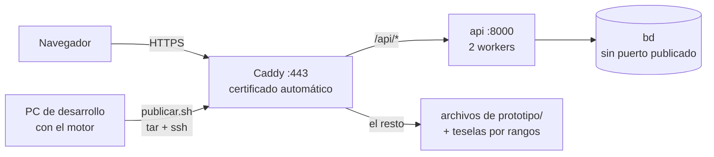

# L16 · Despliegue y copias

> [!abstract] En una frase
> TerraFoco corre en cuatro lugares: el **PC de desarrollo** (todo, con Docker), **GitHub Codespaces** (lo mismo en la nube, para la demo), un **servidor público** (base + API + Caddy con HTTPS, **sin motor**) y una **copia portable** para Windows (PostgreSQL embebido + API + visor, con un doble clic en `TerraFoco.cmd`).

## 1. Los cuatro entornos

| Entorno | Qué corre | Cómo se levanta | Para qué |
|---|---|---|---|
| **PC de desarrollo** | bd, motor, programador, api + visor | `docker compose up -d` + `bash herramientas/inicializar.sh` + `python herramientas/servir_prototipo.py prototipo 8081` | Trabajar |
| **GitHub Codespaces** | Lo mismo, en una máquina de GitHub | Abrir el repo en Codespaces: `.devcontainer/` lo arma solo | Demo desde cualquier navegador sin depender de un PC |
| **Servidor público** | bd + api + Caddy (HTTPS). **Sin motor** | `despliegue/preparar_servidor.sh` y `despliegue/publicar.sh` | Sitio con dominio |
| **Copia portable** | PostgreSQL embebido + API + visor | Doble clic en `TerraFoco.cmd` | Pendrive, sin Docker ni internet para la base |

## 2. El PC de desarrollo: dos detalles de las herramientas

### `servir_prototipo.py`: por qué no `python -m http.server`

```
"Sirve el prototipo por HTTP, sin caché.
 `python -m http.server` sirve, salvo por un detalle que ya costó dos tardes:
 no manda Cache-Control, y el navegador se queda con la versión vieja de un .js
 editado hace un minuto."
```

Además le agrega **peticiones de rango** (`herramientas/rangos.py`): `http.server` las ignora y devuelve el archivo entero, el lector de PMTiles lo rechaza y el visor vuelve a los PNG **sin avisar**. Atiende varias peticiones a la vez (hilos).

### `sembrar_indicadores.py`: la copia local

Consulta la API y escribe `prototipo/datos/indicadores.js` con los últimos valores reales (usando las mismas cuentas de `api/focalizacion.py`). Antes, sin API, el visor caía a las cifras de ejemplo: "Litueche aparecía con 38,4 t/ha cuando el dato real es 4,64". Se corre desde el PC con la API arriba:

```bash
python herramientas/sembrar_indicadores.py
```

## 3. GitHub Codespaces — `.devcontainer/`

- `devcontainer.json`: imagen universal de Codespaces (trae Docker, Python y `gh`), 2 CPU, 8 GB; puertos 8000 (API) y 8081 (visor).
- `construir.sh` (una vez): construye las imágenes para que el primer arranque no espere.
- `arrancar.sh` (cada vez que arranca o se reanuda): `docker compose up -d`, sirve el visor con **nginx**, hace **públicos** los puertos 8000 y 8081 (un puerto privado exige la cookie de GitHub, que el `fetch` entre orígenes no lleva) e imprime el enlace del visor **con `?api=` ya apuntado** a la API del Codespace.

Por eso existe `?api=` en `api-base.js`: en un Codespace, "localhost" es el computador del público, donde no hay nada. Guion de la demo: `docs/12-demo-en-codespaces.md`.

## 4. El servidor público — `despliegue/`



- **`docker-compose.yml` de producción, aparte del de desarrollo:** la base **no publica su puerto**, la API corre sin `--reload` con 2 procesos, CORS solo para el dominio, y **no hay motor** (ni credenciales de NASA o Copernicus en el servidor). Si falta `BD_PASSWORD`, `TERRAFOCO_CLAVE_ADMIN` o `DOMINIO`, se niega a arrancar.
- **`Caddyfile`:** Caddy **pide y renueva el certificado HTTPS solo**. `/api/*` va a la API **quitando el prefijo** (FastAPI sigue viendo `/pertinencia`); el resto son los archivos del visor. Encabezados de seguridad (HSTS, `nosniff`, `Referrer-Policy`, sin `Server`) y los HTML sin caché. Por eso en el servidor `api-base.js` usa `window.location.origin + '/api'`.
- **`preparar_servidor.sh`** (una vez, en una Ubuntu nueva): instala Docker, abre solo SSH/HTTP/HTTPS en el firewall, **genera en el servidor** la contraseña de la base y la clave de administración (no viajan por la red ni quedan en el repositorio), respaldo diario de la base (14 días) y swap.
- **`publicar.sh`** (desde el PC): el servidor **no clona el repositorio**; recibe por `tar | ssh` solo `api/`, `bd/`, `prototipo/` y `despliegue/`. `--base` reemplaza los datos del servidor por los de la base local; `--teselas` sube los `.pmtiles` (~150 MB, no están en git).

> [!tip] La idea
> **El motor procesa en el PC y se publica el resultado.** El servidor expuesto a internet solo lee: menos superficie de ataque y nada de credenciales satelitales en él.

## 5. La copia portable (Windows)

Para mostrar el sistema en un equipo **sin Docker** y **sin depender de internet** para los datos.

```
TerraFoco-portable/
├── TerraFoco.cmd       ← doble clic aquí
├── python/             ← el Python OFICIAL (firmado), con las dependencias de la API
├── lanzador/           ← lanzador_portable.py y sus módulos
├── pgsql/              ← PostgreSQL + PostGIS embebidos
├── datos/terrafoco.sql.gz + version.txt   ← volcado de la base
├── base/               ← la base se crea aquí en el primer arranque
├── api/, prototipo/    ← el código
```

- **`herramientas/empaquetar_portable.py`** arma la carpeta: vuelca la base desde Docker, copia el Python oficial e instala las dependencias de la API en él, escribe el lanzador.
- **`herramientas/lanzador_portable.py`** (lo corre `TerraFoco.cmd`): si `base/` no existe o es de un volcado anterior, la crea desde `datos/terrafoco.sql.gz`; arranca PostgreSQL en un puerto libre, la API y el servidor del visor, y abre el navegador.

> [!info] Por qué un `.cmd` y el Python oficial, y no un `.exe`
> Un `.exe` compilado y sin firma es bloqueado por **Smart App Control** de Windows. Con el Python oficial (firmado por la Python Software Foundation) y un `.cmd`, abre sin bloqueos y sin tocar la configuración de seguridad del equipo.

## 6. La entrega académica

`herramientas/sincronizar.py` copia el código a la estructura de carpetas que exige la entrega (APT122: fases, evidencias), **en un solo sentido** (del repositorio a la entrega, nunca al revés).

## 7. Plan B para el día de la presentación

| Si falla… | Usa… |
|---|---|
| El PC no levanta Docker | La **copia portable** (`TerraFoco.cmd`) |
| No hay internet | La copia portable (el mapa base de CARTO no cargará, pero los datos, el detalle y los gráficos sí) |
| La API se cae en vivo | El visor sigue con la **copia local** y lo dice: aprovéchalo para mostrar la mejora progresiva |
| Todo lo local falla | **Codespaces** o el servidor público |

> [!warning] Antes de presentar
> - Abre Docker Desktop con tiempo (en este PC se cae seguido). **Nunca** "Reset to factory defaults".
> - Corre `python herramientas/sembrar_indicadores.py` para que la copia local esté al día.
> - Ten la portable en el escritorio y pruébala una vez.
> - Deja el visor abierto en `index.html` con el mapa ya cargado (el mapa base tarda ~20 s la primera vez).

## Cómo decirlo en la presentación

> [!example] Versión corta
> "Para desarrollar usamos Docker Compose. Para mostrarlo hay tres caminos: un Codespace de GitHub que se arma solo, un servidor público con HTTPS automático donde solo corren la base y la API —el motor procesa en nuestro equipo y publicamos el resultado—, y una copia portable para Windows que abre con un doble clic, con PostgreSQL embebido, sin Docker ni internet."

## Autoevaluación

> [!question]- ¿Por qué el servidor público no tiene motor?
> Porque procesar rásteres necesita credenciales satelitales, GDAL y mucha memoria; el servidor expuesto solo necesita leer. El motor procesa en el PC y `publicar.sh` sube el resultado (base y teselas).

> [!question]- ¿Cómo sabe el visor dónde está la API en cada entorno?
> `api-base.js`: en localhost, `file://` o Codespaces usa `localhost:8000` (o `?api=`); en otro dominio, `origen + /api`, que Caddy redirige a la API.

> [!question]- ¿Por qué hace falta `servir_prototipo.py` y no basta `http.server`?
> Porque `http.server` no envía `Cache-Control` (el navegador se queda con JS viejo) y no atiende peticiones de rango, que PMTiles necesita.

> [!question]- ¿Qué tiene la copia portable y por qué no es un `.exe`?
> Python oficial con las dependencias, PostgreSQL+PostGIS embebidos, el volcado de la base, la API y el visor, lanzados por `TerraFoco.cmd`. No es un `.exe` porque Smart App Control bloquea ejecutables compilados sin firma.

> [!question]- ¿Dónde se generan la contraseña de la base y la clave de administración del servidor?
> En el propio servidor, con `preparar_servidor.sh`: no viajan por la red ni quedan en el repositorio.

Siguiente: [[L17 Guion de la presentación]]
