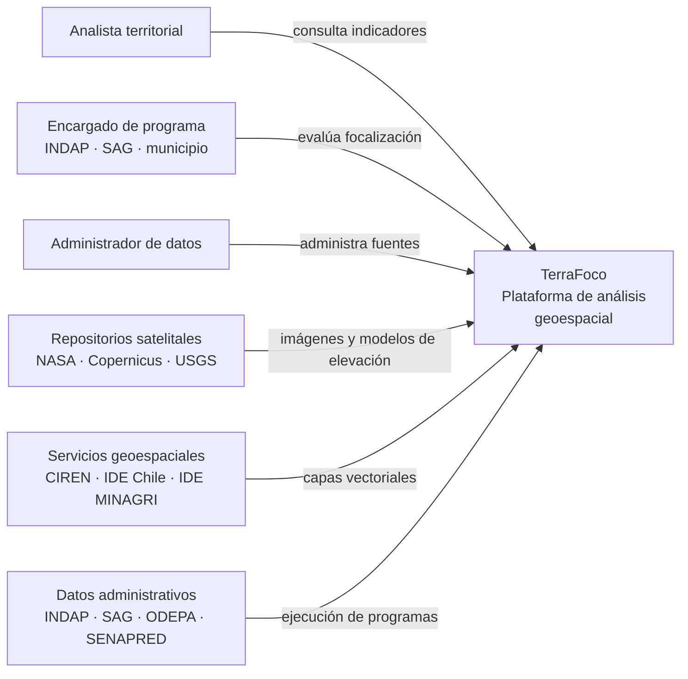
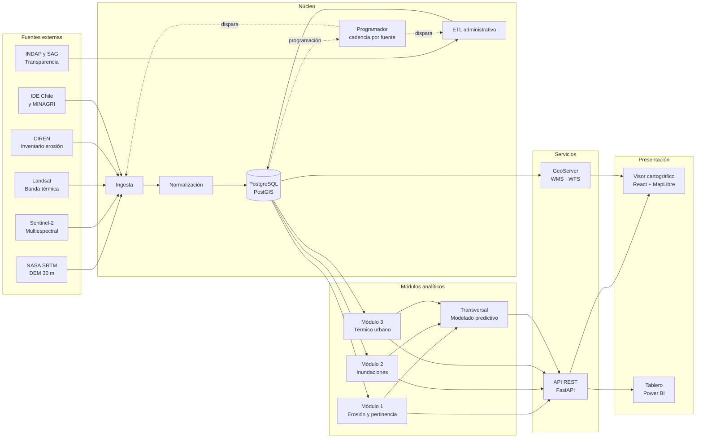
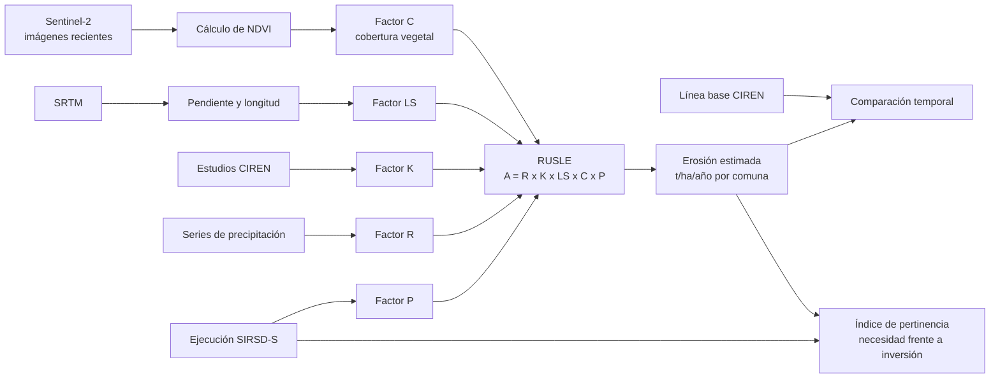
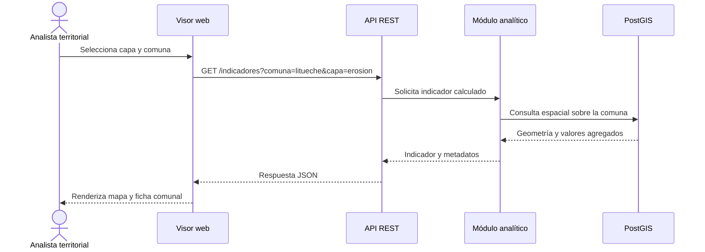
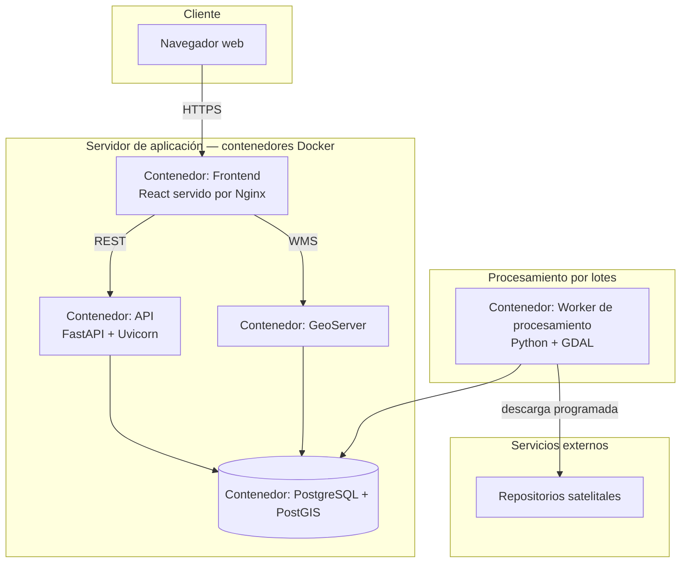
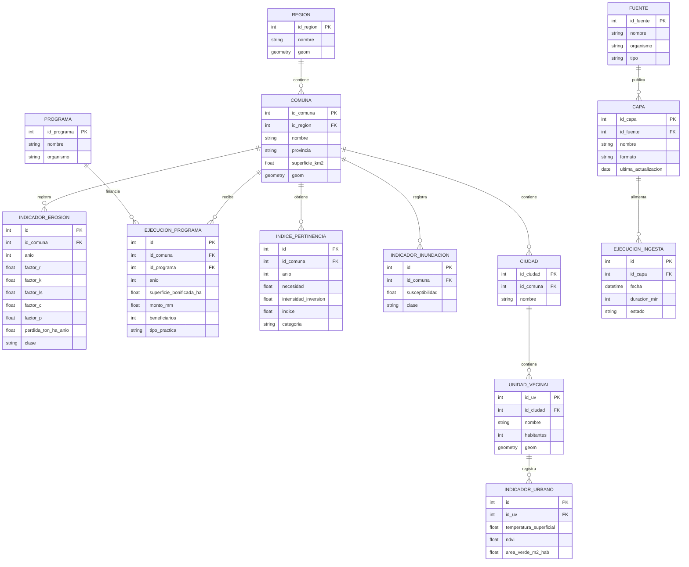

# Arquitectura — TerraFoco

Todos los diagramas están escritos en **Mermaid**, que GitHub renderiza de forma
nativa. Para editarlos basta modificar el bloque de código; para previsualizar antes
de hacer commit, pegar el bloque en [mermaid.live](https://mermaid.live).

---

## 1. Diagrama de contexto

Qué es el sistema, quién lo usa y con qué se conecta hacia afuera.

---

## 2. Diagrama de componentes

La vista principal. Cinco capas: fuentes externas, núcleo, módulos analíticos,
servicios y presentación.

### Responsabilidades por componente

| Componente | Responsabilidad | Tecnología |
|---|---|---|
| **Programador** | Decide qué ingesta corre y cuándo, según la cadencia propia de cada fuente. Resuelve dependencias y no ejecuta un indicador si su ingesta falló | Python; ver [documento 09](09-orquestacion.md) |
| Ingesta | Conexión a repositorios de origen y descarga de insumos | Python, requests, earthaccess |
| Normalización | Reproyección a un sistema común, remuestreo y recorte al área de interés | GDAL, Rasterio |
| ETL administrativo | Consolidación de planillas mensuales de Transparencia Activa | Python, Pandas |
| Base de datos | Persistencia con indexación espacial y versionado temporal | PostgreSQL + PostGIS |
| Módulo 1 | Factor C actualizado, contraste con línea base, índice de pertinencia | Rasterio, GeoPandas, NumPy |
| Módulo 2 | Derivados hidrológicos y análisis multicriterio | RichDEM, NumPy |
| Módulo 3 | Temperatura superficial, NDVI, déficit de área verde | Rasterio, NumPy |
| Modelado predictivo | Comparación de tres algoritmos y selección del mejor | scikit-learn, XGBoost |
| API REST | Exposición de indicadores con documentación automática | FastAPI |
| GeoServer | Publicación de capas por estándares OGC | GeoServer |
| Visor | Cartografía interactiva en navegador | React, MapLibre GL JS |
| Tablero | Indicadores agregados para gestión | Power BI |

---

## 3. Flujo de procesamiento del módulo de erosión

Cómo se produce el indicador principal, de la imagen satelital al índice.

---

## 4. Diagrama de secuencia

Recorrido de una consulta desde el navegador hasta la base de datos.

---

## 5. Diagrama de despliegue

> El procesamiento pesado corre como worker por lotes, separado de la API. Así una
> ingesta de imágenes no bloquea las consultas del visor.

---

## 6. Modelo de datos conceptual

---

## 7. Decisiones de arquitectura

| Decisión | Alternativa descartada | Motivo |
|---|---|---|
| PostGIS como base de datos | Archivos GeoTIFF en disco | Permite consultas de superposición y agregación espacial directamente en la base, sin cargar el raster completo en memoria |
| Worker separado para procesamiento | Procesar dentro de la API | Una ingesta de imágenes tarda minutos; bloquear la API haría inusable el visor |
| MapLibre GL en vez de Leaflet | Leaflet | Renderizado vectorial acelerado por GPU, necesario para el volumen de polígonos comunales |
| API REST propia además de GeoServer | Solo GeoServer | GeoServer publica capas, pero no expone los indicadores calculados ni el índice de pertinencia |
| Python en toda la cadena | Python para datos y Node para la API | Un solo lenguaje entre procesamiento y backend reduce la duplicación de lógica de negocio |
| Contenedores Docker | Instalación directa en el servidor | GDAL y PostGIS tienen dependencias del sistema difíciles de reproducir; el contenedor garantiza el mismo entorno en las tres máquinas del equipo |
