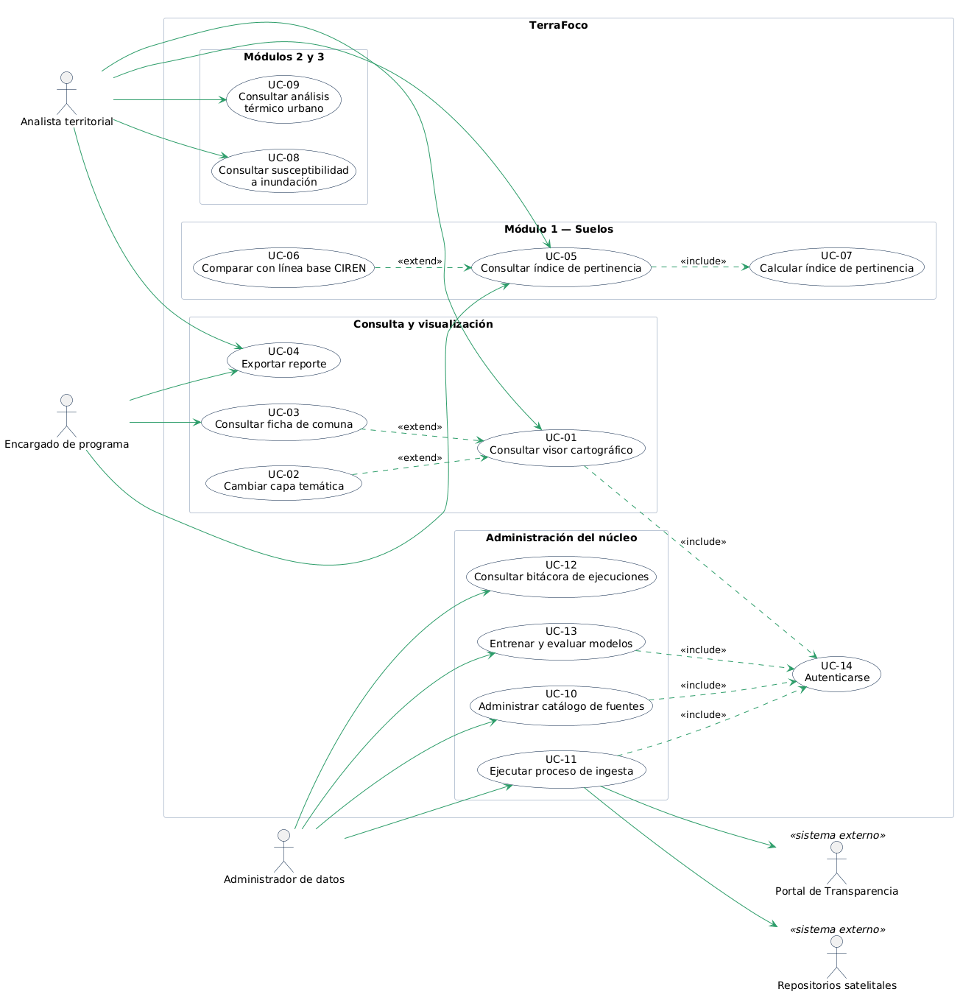

# Casos de uso — TerraFoco

El diagrama está en notación **UML estándar**, escrito en PlantUML. El código fuente
está en [`uml/casos-de-uso.puml`](uml/casos-de-uso.puml) y la imagen generada en
[`img/casos-de-uso.png`](img/casos-de-uso.png).

**Para regenerarlo tras un cambio:** pegar el contenido del `.puml` en
[plantuml.com/plantuml](https://www.plantuml.com/plantuml/uml/), guardar la imagen
sobre `img/casos-de-uso.png` y hacer commit de ambos archivos. Las instrucciones
completas están en el [README de documentación](README.md).

---

## 1. Actores

| Actor | Tipo | Descripción | Interés en el sistema |
|---|---|---|---|
| **Analista territorial** | Primario | Profesional que estudia el estado del territorio: agrónomo, geógrafo, analista de un servicio público | Obtener indicadores calculados sin manejar software SIG especializado |
| **Encargado de programa** | Primario | Responsable de la ejecución del SIRSD-S en INDAP o SAG, o de planificación en un municipio | Verificar si la inversión de su programa está bien focalizada |
| **Administrador de datos** | Primario | Perfil técnico del equipo que mantiene el núcleo | Mantener las fuentes actualizadas y los procesos corriendo |
| **Repositorios satelitales** | Secundario, externo | NASA Earthdata, Copernicus, USGS | Proveen las imágenes y modelos de elevación |
| **Portal de Transparencia** | Secundario, externo | Publicaciones de INDAP y SAG | Provee la ejecución de los programas |

---

## 2. Diagrama de casos de uso

**Cómo leerlo**

- Los **actores** están fuera del recuadro del sistema. Los dos marcados como
  `«sistema externo»` no son personas: son sistemas con los que TerraFoco se
  comunica.
- Los **paquetes** interiores agrupan los casos de uso por módulo, lo que hace
  visible la correspondencia con la arquitectura.
- `«include»` indica que el caso de uso incorpora obligatoriamente a otro:
  consultar el índice **siempre** requiere que el cálculo se haya ejecutado.
- `«extend»` indica un comportamiento opcional que amplía el caso base: cambiar la
  capa temática es algo que *puede* ocurrir mientras se consulta el visor, no algo
  que siempre ocurra.

---

## 3. Listado de casos de uso

| ID | Caso de uso | Actor principal | Módulo | Prioridad |
|---|---|---|---|---|
| UC-01 | Consultar visor cartográfico | Analista territorial | Presentación | Alta |
| UC-02 | Cambiar capa temática | Analista territorial | Presentación | Alta |
| UC-03 | Consultar ficha de comuna | Analista · Encargado | Presentación | Alta |
| UC-04 | Exportar reporte | Analista · Encargado | Presentación | Media |
| UC-05 | Consultar índice de pertinencia | Analista · Encargado | Módulo 1 | **Crítica** |
| UC-06 | Comparar con línea base CIREN | Analista territorial | Módulo 1 | Alta |
| UC-07 | Calcular índice de pertinencia | Sistema | Módulo 1 | **Crítica** |
| UC-08 | Consultar susceptibilidad a inundación | Analista territorial | Módulo 2 | Media |
| UC-09 | Consultar análisis térmico urbano | Analista territorial | Módulo 3 | Media |
| UC-10 | Administrar catálogo de fuentes | Administrador de datos | Núcleo | Alta |
| UC-11 | Ejecutar proceso de ingesta | Administrador de datos | Núcleo | **Crítica** |
| UC-12 | Consultar bitácora de ejecuciones | Administrador de datos | Núcleo | Media |
| UC-13 | Entrenar y evaluar modelos | Administrador de datos | Transversal | Media |
| UC-14 | Autenticarse | Todos | Núcleo | Alta |

---

## 4. Especificaciones detalladas

Se especifican los tres casos de uso de prioridad crítica.

### UC-05 — Consultar índice de pertinencia

| Campo | Contenido |
|---|---|
| **Identificador** | UC-05 |
| **Nombre** | Consultar índice de pertinencia territorial |
| **Actor principal** | Analista territorial, Encargado de programa |
| **Descripción** | El actor consulta, para la región piloto, qué comunas presentan mayor brecha entre la severidad de la erosión y la intensidad de la inversión pública recibida |
| **Precondiciones** | El proceso de cálculo (UC-07) se ejecutó al menos una vez. El actor está autenticado |
| **Postcondiciones** | El actor visualiza el ranking comunal y la clasificación por categoría de pertinencia |
| **Prioridad** | Crítica |

**Flujo principal**

1. El actor ingresa a la sección Índice de pertinencia.
2. El sistema recupera los indicadores calculados para la región y el año activos.
3. El sistema muestra el gráfico de dispersión de necesidad frente a inversión, con los cuadrantes de interpretación.
4. El sistema muestra el ranking comunal ordenado de mayor a menor brecha.
5. El actor selecciona una comuna del gráfico o de la tabla.
6. El sistema despliega el detalle: erosión estimada, intensidad de intervención, índice y categoría.

**Flujos alternativos**

- **5a. El actor filtra por provincia.** El sistema recalcula el ranking mostrado y vuelve al paso 4.
- **5b. El actor cambia el año de análisis.** El sistema recupera los indicadores del año seleccionado y vuelve al paso 2.

**Flujos de excepción**

- **2a. No existen indicadores calculados para el período.** El sistema informa que el cálculo no se ha ejecutado e indica la fecha de la última ejecución disponible.
- **2b. Falla la conexión con la base de datos.** El sistema muestra un mensaje de error y registra el evento en la bitácora.

---

### UC-07 — Calcular índice de pertinencia

| Campo | Contenido |
|---|---|
| **Identificador** | UC-07 |
| **Nombre** | Calcular índice de pertinencia territorial |
| **Actor principal** | Sistema (proceso programado) |
| **Descripción** | El sistema calcula, por comuna, un índice que relaciona la severidad de la erosión con la intensidad de la inversión del programa SIRSD-S |
| **Precondiciones** | Existen indicadores de erosión y registros de ejecución del programa para el período |
| **Postcondiciones** | Los índices quedan almacenados y disponibles para consulta |
| **Prioridad** | Crítica |

**Flujo principal**

1. El proceso recupera la erosión estimada por comuna para el período.
2. El proceso recupera la ejecución del programa por comuna: superficie bonificada, monto y beneficiarios.
3. El proceso normaliza ambas variables a una escala común de 0 a 1 dentro de la región.
4. El proceso calcula el índice como la diferencia entre necesidad normalizada e intensidad de inversión normalizada.
5. El proceso clasifica cada comuna en una de las cinco categorías de pertinencia.
6. El proceso persiste los resultados con marca temporal.
7. El proceso registra la ejecución en la bitácora.

**Flujos de excepción**

- **2a. No hay datos de superficie bonificada.** El proceso construye el índice con monto ejecutado y número de beneficiarios, y marca el resultado como *precisión reducida*.
- **2b. No hay datos de ejecución para una comuna.** El proceso marca esa comuna como *sin información* y la excluye del cálculo, dejando constancia en la bitácora.

---

### UC-11 — Ejecutar proceso de ingesta

| Campo | Contenido |
|---|---|
| **Identificador** | UC-11 |
| **Nombre** | Ejecutar proceso de ingesta de datos |
| **Actor principal** | Administrador de datos |
| **Actores secundarios** | Repositorios satelitales, Portal de Transparencia |
| **Descripción** | El administrador dispara la descarga, normalización y carga de una fuente de datos hacia la base espacial |
| **Precondiciones** | La fuente está registrada en el catálogo. El administrador está autenticado |
| **Postcondiciones** | Los datos quedan normalizados y almacenados. La ejecución queda registrada |
| **Prioridad** | Crítica |

**Flujo principal**

1. El administrador selecciona una fuente del catálogo y solicita su actualización.
2. El sistema verifica las credenciales de acceso al repositorio de origen.
3. El sistema descarga los insumos correspondientes al área de interés.
4. El sistema reproyecta al sistema de referencia común y remuestrea a la resolución de trabajo.
5. El sistema recorta los datos al área de la región piloto.
6. El sistema almacena el resultado con versionado temporal.
7. El sistema actualiza la fecha de última carga de la fuente.
8. El sistema registra la ejecución con duración y estado.

**Flujos alternativos**

- **1a. La ejecución es automática y programada.** El proceso arranca sin intervención del administrador y continúa desde el paso 2.

**Flujos de excepción**

- **2a. Credenciales inválidas o repositorio no disponible.** El sistema aborta, marca la fuente en estado *error* y registra el motivo.
- **3a. La descarga se interrumpe.** El sistema reintenta hasta tres veces. Si persiste, aborta y registra la falla.
- **4a. Los datos vienen en un sistema de referencia no soportado.** El sistema aborta y registra el sistema de referencia encontrado para revisión manual.

---

## 5. Trazabilidad con el prototipo

Cada caso de uso tiene una pantalla que lo representa en el prototipo no funcional.

| Caso de uso | Pantalla del prototipo |
|---|---|
| UC-01, UC-02 | `visor.html` |
| UC-03 | `visor.html` (panel lateral) y `comuna.html` |
| UC-04 | Botón *Exportar* de la barra superior |
| UC-05, UC-06, UC-07 | `pertinencia.html` |
| UC-08 | `inundaciones.html` |
| UC-09 | `urbano.html` |
| UC-10, UC-11, UC-12 | `fuentes.html` |
| UC-13 | Pendiente — se incorpora en el Sprint 5 |

> Esta tabla es un buen argumento en la defensa: demuestra que el prototipo no es
> decorativo, sino la materialización de los casos de uso especificados.
