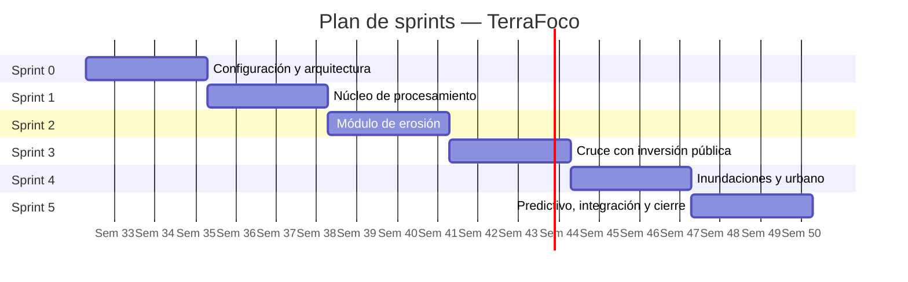

# Gestión del proyecto — Scrum

El proyecto aplica una metodología dual: **CRISP-DM** estructura el trabajo sobre los
datos y **Scrum** conduce el desarrollo. Esta combinación es la que la Escuela
establece para proyectos con componente de ciencia de datos.

---

## 1. Roles

| Rol | Integrante | Responsabilidad |
|---|---|---|
| **Product Owner** | Carla Morales | Mantiene y prioriza el backlog, define criterios de aceptación, es la voz de la contraparte del piloto |
| **Scrum Master** | Bastián Cárcamo | Facilita las ceremonias, gestiona impedimentos, protege el alcance del sprint |
| **Development Team** | Los tres | Ejecutan el sprint backlog y se autoorganizan |

En un equipo de tres, PO y SM también desarrollan. Lo relevante es que la
responsabilidad de priorizar y la de facilitar tengan dueño explícito.

---

## 2. Ceremonias y cadencia

**Duración del sprint: 3 semanas.** Se eligió sobre el estándar de 2 porque la carga
académica es paralela a otras asignaturas y un sprint de 2 semanas produciría
demasiada ceremonia respecto del tiempo efectivo de trabajo.

| Ceremonia | Cuándo | Duración | Resultado |
|---|---|---|---|
| **Sprint Planning** | Primer lunes del sprint | 90 min | Sprint backlog comprometido |
| **Daily** | Lunes, miércoles y viernes | 15 min | Impedimentos detectados |
| **Sprint Review** | Último viernes del sprint | 60 min | Incremento demostrado a la docente guía |
| **Retrospectiva** | Último viernes, tras la review | 45 min | Acuerdos de mejora |
| **Refinamiento** | Miércoles de la semana 2 | 45 min | Backlog estimado para el sprint siguiente |

> La *daily* de tres veces por semana en vez de diaria es una adaptación deliberada a
> la realidad de un equipo que no trabaja tiempo completo. Conviene declararla en el
> informe como decisión, no dejar que parezca incumplimiento.

---

## 3. Estimación

Se usa **story points** con serie de Fibonacci: 1, 2, 3, 5, 8, 13.

| Puntos | Significado aproximado |
|---|---|
| 1 | Tarea trivial, menos de 2 horas |
| 2 | Media jornada |
| 3 | Una jornada de trabajo |
| 5 | Dos a tres jornadas |
| 8 | Casi un sprint de una persona |
| 13 | Demasiado grande, debe dividirse |

**Velocidad estimada inicial:** 25 puntos por sprint para el equipo completo. Se
ajusta con la velocidad real del Sprint 1 en adelante.

---

## 4. Épicas

| ID | Épica | Puntos | Sprints |
|---|---|---|---|
| **E1** | Núcleo de procesamiento geoespacial | 34 | 0 – 1 |
| **E2** | Datos de inversión pública | 18 | 1 – 3 |
| **E3** | Módulo de erosión y pertinencia | 34 | 2 – 3 |
| **E4** | Módulo de susceptibilidad a inundación | 18 | 4 |
| **E5** | Módulo térmico y cobertura urbana | 16 | 4 |
| **E6** | Presentación y experiencia de usuario | 26 | 1 – 5 |
| **E7** | Modelado predictivo | 16 | 5 |
| **E8** | Calidad, validación y cierre | 18 | 0 – 5 |

**Total estimado: 180 puntos** en 6 sprints. Con velocidad de 25 puntos, el margen es
ajustado — de ahí la priorización explícita del alcance.

---

## 5. Product Backlog

Ordenado por prioridad. `MoSCoW`: **M** = Must, **S** = Should, **C** = Could.

### E1 — Núcleo de procesamiento geoespacial

| ID | Historia de usuario | Pts | MoSCoW |
|---|---|---|---|
| HU-01 | Como administrador de datos, quiero un modelo de datos espacial en PostGIS, para almacenar información raster y vectorial con versionado temporal | 8 | M |
| HU-02 | Como administrador de datos, quiero descargar automáticamente imágenes Sentinel-2 del área de interés, para no tener que hacerlo a mano cada vez | 8 | M |
| HU-03 | Como administrador de datos, quiero descargar el modelo de elevación SRTM del área, para derivar las variables topográficas | 5 | M |
| HU-04 | Como administrador de datos, quiero que los insumos se reproyecten y recorten automáticamente, para trabajar con un sistema de referencia y una extensión homogéneos | 8 | M |
| HU-05 | Como administrador de datos, quiero consultar la bitácora de ejecuciones, para saber qué procesos corrieron y con qué resultado | 5 | S |

**Criterios de aceptación de HU-04**
- Todos los insumos quedan en el mismo sistema de referencia proyectado.
- Todos los raster quedan remuestreados a 30 m.
- La extensión coincide con el límite de la región piloto, con tolerancia de una celda.
- El proceso registra duración y estado en la bitácora.

---

### E2 — Datos de inversión pública

| ID | Historia de usuario | Pts | MoSCoW |
|---|---|---|---|
| HU-06 | Como administrador de datos, quiero consolidar las planillas mensuales de Transparencia Activa en una tabla única, para poder analizarlas por comuna y año | 8 | M |
| HU-07 | Como administrador de datos, quiero validar la consistencia de los montos contra las series de ODEPA, para detectar errores de carga | 5 | S |
| HU-08 | Como Product Owner, quiero gestionar la solicitud de acceso a información pública ante INDAP y SAG, para obtener superficie bonificada y tipo de práctica | 5 | M |

**Criterios de aceptación de HU-06**
- El proceso lee todas las planillas de un directorio sin intervención manual.
- Normaliza nombres de comuna a los códigos oficiales del INE.
- Los registros sin comuna identificable quedan en una tabla de rechazos, no se descartan en silencio.
- El total consolidado por año coincide con la suma de las planillas de origen.

---

### E3 — Módulo de erosión y pertinencia

| ID | Historia de usuario | Pts | MoSCoW |
|---|---|---|---|
| HU-09 | Como analista, quiero que el sistema calcule el NDVI desde Sentinel-2, para derivar el factor de cobertura vegetal | 5 | M |
| HU-10 | Como analista, quiero que el sistema derive pendiente y longitud desde el SRTM, para obtener el factor topográfico | 5 | M |
| HU-11 | Como analista, quiero obtener la erosión estimada por comuna aplicando RUSLE, para conocer el estado actual del territorio | 8 | M |
| HU-12 | Como analista, quiero comparar la erosión estimada con la línea base de CIREN, para saber si la situación mejoró o empeoró | 5 | M |
| HU-13 | Como encargado de programa, quiero ver un índice que relacione erosión con inversión recibida, para identificar comunas mal focalizadas | 8 | M |
| HU-14 | Como encargado de programa, quiero ver el ranking comunal ordenado por brecha, para priorizar dónde intervenir | 3 | M |

**Criterios de aceptación de HU-13**
- El índice se calcula para las 33 comunas de la región piloto.
- Cada comuna queda clasificada en una de las cinco categorías definidas.
- Si falta la superficie bonificada, el índice se calcula con monto y beneficiarios y se marca como *precisión reducida*.
- Las comunas sin datos de ejecución quedan identificadas como *sin información*, no como índice cero.

---

### E4 — Módulo de susceptibilidad a inundación

| ID | Historia de usuario | Pts | MoSCoW |
|---|---|---|---|
| HU-15 | Como analista, quiero que el sistema derive acumulación de flujo y distancia a cauces del DEM, para alimentar el análisis multicriterio | 8 | S |
| HU-16 | Como analista, quiero obtener un índice de susceptibilidad por comuna, para saber qué territorios presentan condiciones favorables a inundación | 5 | S |
| HU-17 | Como analista, quiero contrastar el índice con los eventos históricos de SENAPRED, para saber qué tan confiable es | 5 | S |

---

### E5 — Módulo térmico y cobertura urbana

| ID | Historia de usuario | Pts | MoSCoW |
|---|---|---|---|
| HU-18 | Como analista, quiero calcular la temperatura superficial desde las bandas térmicas de Landsat, para identificar islas de calor | 8 | S |
| HU-19 | Como analista, quiero obtener el área verde por habitante por unidad vecinal, para detectar déficit respecto del estándar | 8 | S |

---

### E6 — Presentación y experiencia de usuario

| ID | Historia de usuario | Pts | MoSCoW |
|---|---|---|---|
| HU-20 | Como analista, quiero ver las comunas en un mapa coloreado según el indicador, para identificar patrones territoriales de un vistazo | 8 | M |
| HU-21 | Como analista, quiero cambiar la capa temática desde un panel, para comparar distintas variables sobre el mismo territorio | 5 | M |
| HU-22 | Como encargado de programa, quiero abrir la ficha de una comuna, para revisar su detalle sin salir del mapa | 5 | M |
| HU-23 | Como encargado de programa, quiero exportar un reporte de la región, para incluirlo en mis informes de gestión | 5 | C |
| HU-24 | Como usuario sin formación informática, quiero que la interfaz sea comprensible sin capacitación previa, para poder usarla en mi trabajo diario | 3 | M |

**Criterios de aceptación de HU-24**
- Un usuario sin experiencia previa completa las tres tareas del plan de usabilidad sin ayuda.
- Ningún término técnico aparece sin una explicación accesible en la interfaz.
- Toda cifra mostrada indica su unidad de medida.

---

### E7 — Modelado predictivo

| ID | Historia de usuario | Pts | MoSCoW |
|---|---|---|---|
| HU-25 | Como analista, quiero que el sistema evalúe tres algoritmos de clasificación, para saber cuál predice mejor la susceptibilidad territorial | 8 | M |
| HU-26 | Como analista, quiero ver las métricas comparadas de los tres algoritmos, para justificar la elección del modelo | 5 | M |
| HU-27 | Como analista, quiero conocer qué variables pesan más en la predicción, para entender el resultado y no solo aceptarlo | 3 | C |

**Criterios de aceptación de HU-25**
- Se evalúan al menos Random Forest, Gradient Boosting y Regresión Logística.
- Se reportan exactitud, precisión, exhaustividad y área bajo la curva ROC.
- La validación es cruzada, con al menos 5 particiones.
- El modelo seleccionado supera el umbral definido y a los otros dos.

---

### E8 — Calidad, validación y cierre

| ID | Historia de usuario | Pts | MoSCoW |
|---|---|---|---|
| HU-28 | Como equipo, queremos un plan de pruebas con casos definidos, para verificar sistemáticamente el comportamiento del sistema | 5 | M |
| HU-29 | Como equipo, queremos pruebas automatizadas de los cálculos de indicadores, para detectar regresiones al modificar el código | 5 | M |
| HU-30 | Como equipo, queremos ejecutar una prueba de usabilidad con la contraparte del piloto, para validar la interfaz con usuarios reales | 5 | M |
| HU-31 | Como equipo, queremos documentar el proceso analítico según CRISP-DM, para dejar trazabilidad metodológica | 3 | M |

---

## 6. Planificación de sprints



| Sprint | Foco | Historias | Pts | Incremento demostrable |
|---|---|---|---|---|
| **0** | Configuración, arquitectura y modelo de datos | HU-01, HU-08, HU-28 | 18 | Entorno operativo, base de datos modelada, solicitud SAIP enviada |
| **1** | Núcleo de procesamiento | HU-02, HU-03, HU-04, HU-05 | 26 | Ingesta funcionando sobre SRTM y Sentinel-2 |
| **2** | Módulo de erosión | HU-09, HU-10, HU-11, HU-20 | 26 | Mapa de erosión estimada por comuna |
| **3** | Cruce con inversión pública | HU-06, HU-07, HU-12, HU-13, HU-14 | 29 | Índice de pertinencia calculado y validado |
| **4** | Inundaciones y urbano | HU-15, HU-16, HU-17, HU-18, HU-19 | 34 | Los dos módulos secundarios operativos |
| **5** | Predictivo, integración y cierre | HU-25, HU-26, HU-29, HU-30, HU-31 | 26 | Sistema integrado, validado y documentado |

> **El Sprint 4 está sobrecargado** (34 puntos frente a una velocidad de 25). Es
> deliberado y es donde se aplica la priorización: si la velocidad real no alcanza,
> HU-19 y HU-27 son las primeras candidatas a mover al backlog. El núcleo y el
> módulo de erosión no se tocan.

---

## 7. Definition of Ready

Una historia entra a un sprint solo si:

- [ ] Está redactada en formato *Como… quiero… para…*
- [ ] Tiene criterios de aceptación verificables
- [ ] Está estimada por el equipo
- [ ] No depende de una historia sin terminar
- [ ] Las fuentes de datos que necesita están disponibles

---

## 8. Definition of Done

Una historia está terminada solo si:

- [ ] El código está en la rama principal y pasó revisión de al menos un compañero
- [ ] Cumple todos sus criterios de aceptación
- [ ] Tiene pruebas automatizadas si involucra cálculo de indicadores
- [ ] La documentación afectada quedó actualizada
- [ ] Fue demostrada en la Sprint Review
- [ ] No dejó defectos conocidos sin registrar

---

## 9. Evidencia por sprint

Cada sprint debe dejar en el repositorio:

```
docs/sprints/sprint-N/
├── planning.md          Sprint backlog comprometido
├── scrumboard.png       Captura del tablero al cierre
├── burndown.png         Gráfico de avance
├── impedimentos.md      Registro de impedimentos y su resolución
├── review.md            Qué se demostró y qué retroalimentación hubo
└── retrospectiva.md     Qué salió bien, qué no, qué se cambia
```

---

## 10. Herramientas de gestión

| Herramienta | Uso | Por qué |
|---|---|---|
| **GitHub Projects** | Tablero Scrum y backlog | Está en el mismo lugar que el código; las historias se enlazan con los commits y los pull requests |
| **GitHub Issues** | Historias de usuario y defectos | Cada historia es un issue con etiquetas de épica y sprint |
| **Milestones de GitHub** | Sprints | El avance del milestone funciona como burndown natural |

> **Recomendación:** usar GitHub Projects en vez de Trello o Jira. La entrega exige
> que todo esté en GitHub, y tener el tablero ahí evita mantener dos sistemas
> sincronizados. Además deja evidencia automática de la trazabilidad entre historia,
> commit y entrega — que es exactamente lo que se evalúa.

**Cómo montarlo:** en el repositorio → pestaña **Projects** → *New project* →
plantilla **Team backlog**. Crear campos personalizados `Épica`, `Story points` y
`Sprint`. Cada historia del backlog de arriba se crea como issue.
