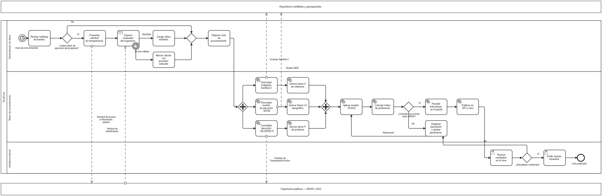

# Modelo de proceso — Actualización del ciclo analítico territorial

Este documento modela en **BPMN 2.0** el proceso más extenso del sistema: el ciclo
completo que va desde la revisión de las fuentes hasta la publicación de los
indicadores actualizados.

Se eligió este proceso porque es el único que atraviesa **los tres roles del equipo**,
se comunica con **dos organismos externos**, contiene **decisiones, ejecución en
paralelo, un plazo legal que puede vencer y un ciclo de reproceso**. Es decir, ejercita
prácticamente toda la notación.

**Disparador:** temporizador trimestral.
**Resultado esperado:** indicadores recalculados, validados y publicados en el visor.

---

## 1. Diagrama

El archivo fuente es [`uml/proceso-ciclo-analitico.bpmn`](uml/proceso-ciclo-analitico.bpmn),
en formato **BPMN 2.0 estándar**. Se abre y edita en Camunda Modeler, en
[demo.bpmn.io](https://demo.bpmn.io) o importándolo en draw.io.

---

## 2. Cómo leer el diagrama

### Participantes

| Elemento | Qué representa |
|---|---|
| **Carril superior** | Repositorios satelitales y geoespaciales. Es una *caja negra*: sabemos que responden, no cómo trabajan por dentro |
| **Carril central** | TerraFoco, dividido en tres calles según quién ejecuta cada actividad |
| **Carril inferior** | INDAP y SAG, también caja negra |

Las líneas **punteadas** entre carriles son **flujos de mensaje**: cruzan la frontera
de la organización. Las líneas **continuas** son flujos de secuencia: ocurren dentro
de TerraFoco.

### Calles de TerraFoco

| Calle | Quién es | Qué hace |
|---|---|---|
| **Administrador de datos** | Persona del equipo | Gestiona fuentes, tramita la solicitud de transparencia y dispara el ciclo |
| **Motor de procesamiento** | El sistema, sin intervención humana | Descarga, calcula los factores, aplica RUSLE y publica |
| **Analista territorial** | Persona usuaria | Valida los resultados y emite el reporte |

### Tipos de actividad

| Símbolo | Tipo | Significado |
|---|---|---|
| Engranaje | Tarea de servicio | La ejecuta el sistema de forma automática |
| Persona | Tarea de usuario | Requiere que alguien la haga en pantalla |
| Sobre | Tarea de recepción | El proceso queda esperando un mensaje externo |
| Sin ícono | Tarea manual o abstracta | Trabajo humano fuera del sistema |

---

## 3. Las tres fases del proceso

### Fase 1 — Preparación de insumos administrativos

Arranca con el temporizador trimestral. El administrador revisa el catálogo de
fuentes y se abre la primera decisión: **¿faltan datos de ejecución del programa?**

- **No** → el flujo salta directamente al disparo del procesamiento.
- **Sí** → se presenta una solicitud de acceso a información pública, que viaja como
  mensaje hacia INDAP y SAG, y el proceso queda esperando.

Aquí está el elemento más interesante del modelo: la tarea *Esperar respuesta del
organismo* lleva adosado un **evento de borde temporizado de 20 días hábiles**, que
es el plazo legal de la Ley 20.285.

> Modelar el plazo legal como un evento de borde no es un adorno de notación: es la
> forma correcta de representar que **el proceso no puede quedarse esperando para
> siempre**. Si el plazo vence, el flujo se desvía, el cálculo se marca con precisión
> reducida y el ciclo continúa igual. El riesgo R1 del perfil del proyecto queda
> resuelto en el modelo, no solo enunciado en una tabla.

**Nota sobre las dos vías de obtención.** En la práctica el equipo obtiene los datos
de ejecución por **entrega directa del departamento de datos de INDAP**, que asesora
el proyecto. El modelo representa deliberadamente la vía formal —la solicitud de
acceso a información pública— porque es la que el proceso debe poder ejecutar **sin
depender de un vínculo personal**: si la entrega directa no se concreta o el contacto
cambia, el ciclo trimestral sigue funcionando por el camino institucional. Un proceso
que solo funciona gracias a un contacto no es un proceso, es una excepción
afortunada.

### Fase 2 — Procesamiento automático

Una compuerta paralela abre **tres ramas que corren simultáneamente**:

| Rama | Descarga | Produce |
|---|---|---|
| 1 | Imágenes Sentinel-2 | Factor **C** de cobertura vegetal |
| 2 | Modelo de elevación SRTM | Factor **LS** topográfico |
| 3 | Ejecución del SIRSD-S | Factor **P** de prácticas de conservación |

Son paralelas porque no dependen entre sí. La compuerta de unión espera a las tres
antes de continuar: sin los tres factores no se puede aplicar el modelo.

Luego se aplica RUSLE, se calcula el índice de pertinencia, y aparece la segunda
decisión: **¿coincide con la línea base de CIREN?**

- **Sí** → se persiste en PostGIS y se publica.
- **No** → se registra la desviación, se ajustan los parámetros y **se vuelve a
  aplicar el modelo**. Es un ciclo de reproceso explícito.

### Fase 3 — Validación y publicación

El analista revisa los resultados en el visor. Tercera decisión: **¿resultados
conformes?**

- **Sí** → emite el reporte trimestral y el proceso termina.
- **No** → el flujo retrocede a *Registrar desviación y ajustar parámetros*, en el
  carril del motor, reingresando al ciclo de reproceso.

---

## 4. Puntos de decisión

| Compuerta | Pregunta | Salidas |
|---|---|---|
| Exclusiva | ¿Faltan datos de ejecución del programa? | Sí: tramitar solicitud · No: continuar |
| Paralela (apertura) | — | Ejecuta las tres ramas de cálculo a la vez |
| Paralela (cierre) | — | Sincroniza: espera las tres ramas |
| Exclusiva | ¿Coincide con la línea base CIREN? | Sí: publicar · No: reprocesar |
| Exclusiva | ¿Resultados conformes? | Sí: emitir reporte · No: reprocesar |

---

## 5. Eventos y manejo de excepciones

| Evento | Tipo | Efecto |
|---|---|---|
| Inicio de ciclo trimestral | Temporizador de inicio | Dispara el proceso cada tres meses |
| 20 días hábiles | Temporizador de borde, interruptor | Cancela la espera y desvía a *precisión reducida* |
| Ciclo publicado | Fin | Cierra el proceso |

El evento de borde es **interruptor**: al dispararse cancela la tarea de espera. No
se queda esperando la respuesta en paralelo, porque el objetivo es no bloquear el
ciclo trimestral.

---

## 6. Trazabilidad con el resto de la documentación

| Elemento del proceso | Dónde más aparece |
|---|---|
| Descargar Sentinel-2, SRTM · Consolidar SIRSD-S | UC-11 *Ejecutar proceso de ingesta* |
| Aplicar RUSLE · Calcular índice | UC-07 *Calcular índice de pertinencia* |
| Revisar resultados en el visor | UC-05 *Consultar índice de pertinencia* |
| Presentar solicitud de transparencia | Riesgo R1 del perfil · HU-08 del backlog |
| Motor de procesamiento (calle completa) | Núcleo del diagrama de arquitectura |

---

## 7. Cómo abrir y editar el modelo

| Herramienta | Cómo |
|---|---|
| **[demo.bpmn.io](https://demo.bpmn.io)** | Arrastrar el archivo `.bpmn` sobre la ventana. No requiere instalar nada |
| **Camunda Modeler** | Aplicación de escritorio gratuita. *File → Open* |
| **draw.io** | *Archivo → Importar desde → Dispositivo*, seleccionando el `.bpmn` |

Para regenerar la imagen después de editar: exportar a PNG o SVG desde la misma
herramienta, sobre `img/proceso-bpmn.png`.

> El archivo se generó con coordenadas explícitas y fue verificado importándolo en
> bpmn-js: **28 nodos, 32 flujos de secuencia y 5 flujos de mensaje, sin advertencias
> de validación**.
