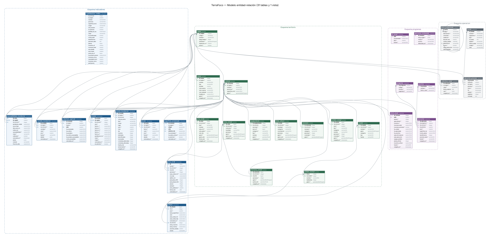
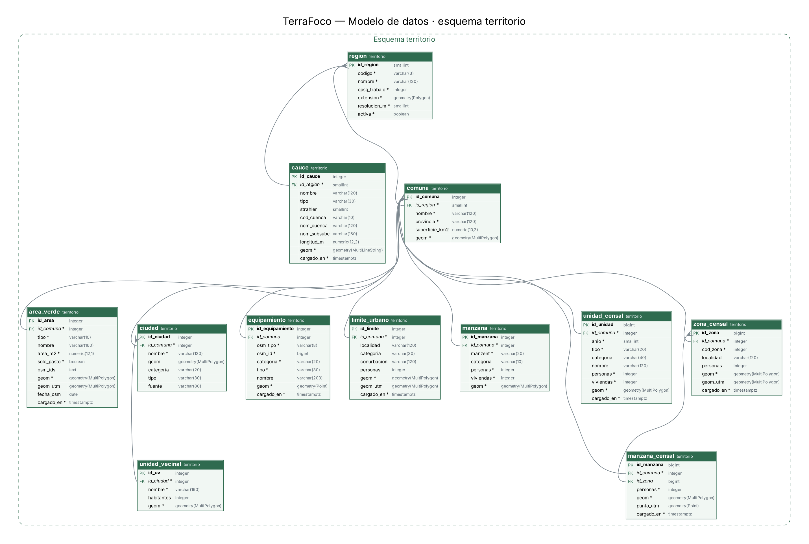
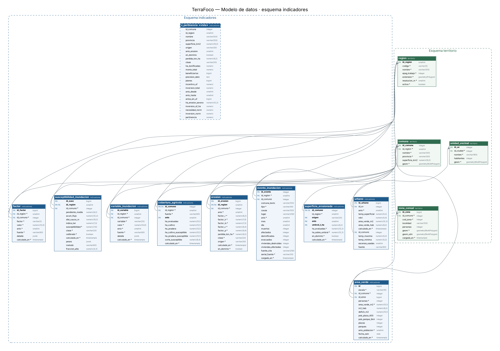
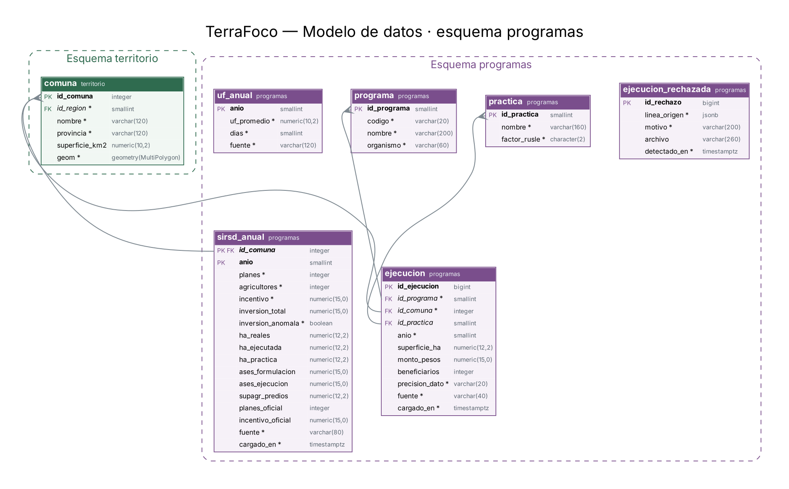
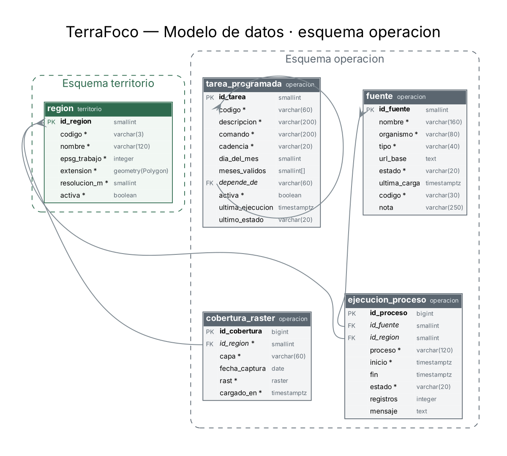

# Modelo de datos

Diagrama entidad-relación, diccionario de datos y reglas de integridad de la base PostgreSQL + PostGIS de TerraFoco.

Versión 1.0 · 02-11-2026 · Equipo TerraFoco: Bastián Cárcamo, Carla Morales, Antonio Lankin  
Fuente: base creada con `bd/esquema.sql` y las migraciones 001 a 019 (Fase2/Evidencias Proyecto)  

## 1. Propósito y alcance

Este documento describe el modelo de datos de TerraFoco: el diagrama entidad-relación, el diccionario de datos de cada tabla, las relaciones, las reglas de integridad y la historia de migraciones. Es el documento propio del modelo que acompaña a `bd/esquema.sql` y a las migraciones de `bd/migraciones`.

El modelo **no se dibujó a mano**: se obtuvo de una base PostgreSQL 16 + PostGIS 3.4 creada desde cero con `esquema.sql` y las 19 migraciones en orden, consultando el catálogo de la base (tablas, columnas, claves, restricciones e índices). Así el diagrama y el diccionario describen exactamente lo que el código crea. La prueba de integración PI-02 comprueba en cada ejecución que esa base tiene las 31 tablas y la vista descritas aquí.

| Elemento | Cantidad |
|---|---|
| Esquemas | 4 (territorio, indicadores, programas, operacion) |
| Tablas | 31 (2 particionadas por región) |
| Vistas | 1 (indicadores.v_pertinencia) |
| Columnas | 289 |
| Claves foráneas | 37 |
| Migraciones | esquema.sql + 001 a 019 |

### 1.1 Archivos del modelo

| Archivo | Contenido |
|---|---|
| Modelo de datos/TerraFoco - Modelo entidad-relacion.drawio | Diagrama editable (draw.io, diagrams.net; se importa en Lucidchart). Cinco páginas: modelo completo y un esquema por página |
| Modelo de datos/TerraFoco - Modelo entidad-relacion completo.png | Imagen del modelo completo |
| Modelo de datos/TerraFoco - ER esquema *.png | Una imagen por esquema |
| Evidencias Proyecto/docs/20-modelo-de-datos.md | Este documento en Markdown, junto al código |
| Evidencias Proyecto/bd/esquema.sql y bd/migraciones/ | La definición ejecutable |

## 2. Convenciones del modelo

- **Cuatro esquemas por responsabilidad**: territorio (geografía), indicadores (resultados del motor), programas (inversión pública) y operacion (cómo corre el núcleo).
- **La comuna es la entidad central.** Su clave es el código oficial del INE (`id_comuna`), no un número interno: así los datos externos se cruzan sin tabla de equivalencias.
- **Geometrías en EPSG:4326** para almacenar y entregar (GeoJSON). Donde se miden superficies o distancias hay una columna generada en UTM 19S (`geom_utm`, EPSG:32719).
- **Nada se sobrescribe** (RNF-06): los indicadores llevan `calculado_en` y cada recálculo inserta una versión; las consultas toman la más reciente.
- **Valores absolutos en las tablas, normalización en la consulta**: el índice de pertinencia es una vista, no una tabla.
- **Nulo significa «sin dato», nunca cero** (RNF-07). Las restricciones CHECK repiten las reglas del dominio (factores positivos, clases válidas, rangos 0-1).
- **Particiones por región** en `indicadores.erosion` e `indicadores.susceptibilidad_inundacion`: agregar una región es insertar una fila en `territorio.region` y crear su partición (RNF-24).
- En el diccionario, * marca las columnas obligatorias (NOT NULL), **PK** la clave primaria y **FK** las claves foráneas.

## 3. Diagrama entidad-relación general

Las tablas se agrupan por esquema y cada línea es una clave foránea (extremo «muchos» en la tabla que la contiene). La vista se dibuja con borde punteado. El detalle legible está en las páginas por esquema (sección 4) y en el archivo editable.



*Figura 1. Modelo entidad-relación completo de TerraFoco*

## 4. Esquemas

### 4.1 Esquema territorio — Territorio

Unidades geográficas: región, comunas, localidades, manzanas y zonas censales, red hídrica, áreas verdes y equipamiento. Es la base espacial a la que se refiere todo lo demás.



*Figura 2. Esquema territorio (se incluyen las tablas de otros esquemas a las que apunta)*

| Tabla | Descripción | Origen | Clave primaria |
|---|---|---|---|
| area_verde | Plazas y parques públicos tomados de OpenStreetMap, filtrados por el estándar SIEDU (≥ 450 m²). | 014 | id_area |
| cauce | Red hídrica 1:25.000 de IDE Chile (ríos, esteros, quebradas) con su orden de Strahler. Insumo de la distancia a cauces. | 008 | id_cauce |
| ciudad | Ciudades, pueblos y localidades de cada comuna, que el visor de inundaciones usa para ubicar el riesgo. | esquema.sql · 015 | id_ciudad |
| comuna | Las comunas oficiales (código INE) con su geometría. Es la entidad central: casi todos los indicadores se refieren a ella. | esquema.sql | id_comuna |
| equipamiento | Equipamiento crítico de OpenStreetMap: educación, salud y emergencia (escuelas, postas, cuarteles). | 016 | id_equipamiento |
| limite_urbano | Límites urbanos censales (INE) con su población. Recorta las áreas verdes y define la población urbana. | 014 | id_limite |
| manzana | Manzanas urbanas con personas y viviendas, para la exposición a inundación. | 016 | id_manzana |
| manzana_censal | Manzanas del Censo 2024 con sus personas, para medir cuánta población tiene una plaza o un parque cerca. | 014 | id_manzana |
| region | Región de trabajo y su área de interés. Agregar una región es insertar una fila: el motor lee aquí el recorte y el EPSG. | esquema.sql | id_region |
| unidad_censal | Unidades censales urbanas y rurales (manzanas, aldeas, entidades rurales), para contar la población rural expuesta. | 019 | id_unidad |
| unidad_vecinal | Unidades vecinales. Prevista para el módulo 3; sin catastro público, el indicador urbano se calcula por zona censal. | esquema.sql | id_uv |
| zona_censal | Zonas censales urbanas del INE: la escala a la que se calcula el déficit de áreas verdes. | 014 | id_zona |

### 4.2 Esquema indicadores — Indicadores

Resultados del motor por comuna o zona: factores y pérdida de suelo (RUSLE), variables e índice de inundación, eventos históricos, áreas verdes, temperatura y superficie agrícola. Ninguna fila se sobrescribe: cada recálculo inserta una versión.



*Figura 3. Esquema indicadores (se incluyen las tablas de otros esquemas a las que apunta)*

| Tabla | Descripción | Origen | Clave primaria |
|---|---|---|---|
| area_verde | Déficit de áreas verdes por comuna o zona censal: m² por habitante, déficit respecto de 10 m²/hab y accesibilidad. | 014 | id |
| cobertura_agricola | Superficie de cultivo y pradera por comuna (ESA WorldCover) y cuánta cae en terreno de susceptibilidad Alta. | 019 | id_comuna, anio |
| erosion | Pérdida de suelo por comuna y año con sus cinco factores RUSLE, de dos orígenes: el inventario de CIREN y el cálculo propio. Particionada por región. | esquema.sql · 003 | id_erosion, id_region |
| evento_inundacion | Eventos históricos de inundación y aluvión de DesInventar (1970-2014) usados para validar el índice. | 009 | id_evento |
| factor | Cada factor RUSLE (R, K, LS, C, P) por comuna, guardado por separado y versionado: la falta de una fuente no bloquea las demás. | 002 | id_factor |
| superficie_erosionada | Hectáreas de cada comuna sobre un umbral de pérdida (18 t/ha/año = erosión severa). Denominador del índice de pertinencia. | 013 | id_comuna, origen, anio, umbral_t_ha |
| susceptibilidad_inundacion | Índice de susceptibilidad a inundación por comuna, con los pesos y el método con que se calculó. Particionada por región. | esquema.sql · 011 | id_susc, id_region |
| urbano | Temperatura superficial (ECOSTRESS) y NDVI por comuna o unidad vecinal, una escala por fila. | esquema.sql · 006 | id_urbano |
| v_pertinencia (vista) | Índice de pertinencia territorial: necesidad normalizada (erosión) menos inversión normalizada (UF por hectárea severa). Se calcula en cada consulta; no se almacena. | vista · 013 | — |
| variable_inundacion | Las seis variables del índice de inundación por comuna, versionadas igual que los factores RUSLE. | 007 | id_variable |

### 4.3 Esquema programas — Programas de inversión pública

El programa SIRSD-S (INDAP y SAG), sus prácticas, la serie anual 2012-2025 por comuna y la UF promedio de cada año para llevar los montos a moneda constante.



*Figura 4. Esquema programas (se incluyen las tablas de otros esquemas a las que apunta)*

| Tabla | Descripción | Origen | Clave primaria |
|---|---|---|---|
| ejecucion | Ejecución del programa por comuna, práctica y año (planilla IDE MINAGRI 2021). Reemplazada en el índice por sirsd_anual. | esquema.sql | id_ejecucion |
| ejecucion_rechazada | Registros que no se pudieron asociar a una comuna. Se guardan para revisión, no se descartan en silencio (RF-11). | esquema.sql | id_rechazo |
| practica | Prácticas bonificables del programa y el factor RUSLE sobre el que actúan (C, P o K). | esquema.sql | id_practica |
| programa | Programas de inversión. El SIRSD-S aparece dos veces porque lo ejecutan INDAP y SAG. | esquema.sql | id_programa |
| sirsd_anual | Serie anual del SIRSD-S 2012-2025 por comuna, extraída por INDAP: planes, agricultores, incentivo y superficie. | 013 | id_comuna, anio |
| uf_anual | UF promedio de cada año, para expresar el incentivo en moneda constante. | 013 | anio |

### 4.4 Esquema operacion — Operación del núcleo

Catálogo de fuentes, bitácora de ejecuciones, programación de tareas y teselas ráster cargadas.



*Figura 5. Esquema operacion (se incluyen las tablas de otros esquemas a las que apunta)*

| Tabla | Descripción | Origen | Clave primaria |
|---|---|---|---|
| cobertura_raster | Teselas ráster cargadas en PostGIS (modelo de elevación, NDVI, temperatura). | esquema.sql | id_cobertura |
| ejecucion_proceso | Bitácora: cada proceso del motor abre una fila al empezar y la cierra con su estado y registros (UC-12). | esquema.sql | id_proceso |
| fuente | Catálogo de fuentes de datos con su estado administrativo. Es lo único que la API escribe (UC-10). | esquema.sql · 012 | id_fuente |
| tarea_programada | Programación de las ingestas y cálculos: comando, cadencia y dependencia. Cambiar una cadencia es un UPDATE, no un despliegue. | esquema.sql · 005, 010, 018 | id_tarea |

## 5. Relaciones

Las 37 claves foráneas del modelo. Todas son uno a muchos: una fila de la tabla referenciada se relaciona con cero o más filas de la que tiene la clave. «Opcional» significa que la columna admite nulo (por ejemplo, un evento histórico cuya comuna no se pudo identificar).

| Tabla.columna | Referencia | Cardinalidad | Participación |
|---|---|---|---|
| indicadores.area_verde.id_comuna | territorio.comuna.id_comuna | 1 : N | Obligatoria |
| indicadores.area_verde.id_zona | territorio.zona_censal.id_zona | 1 : N | Opcional |
| indicadores.cobertura_agricola.id_comuna | territorio.comuna.id_comuna | 1 : N | Obligatoria |
| indicadores.cobertura_agricola.id_region | territorio.region.id_region | 1 : N | Obligatoria |
| indicadores.erosion.id_region | territorio.region.id_region | 1 : N | Obligatoria |
| indicadores.erosion.id_comuna | territorio.comuna.id_comuna | 1 : N | Obligatoria |
| indicadores.evento_inundacion.id_region | territorio.region.id_region | 1 : N | Obligatoria |
| indicadores.evento_inundacion.id_comuna | territorio.comuna.id_comuna | 1 : N | Opcional |
| indicadores.factor.id_region | territorio.region.id_region | 1 : N | Obligatoria |
| indicadores.factor.id_comuna | territorio.comuna.id_comuna | 1 : N | Obligatoria |
| indicadores.superficie_erosionada.id_comuna | territorio.comuna.id_comuna | 1 : N | Obligatoria |
| indicadores.susceptibilidad_inundacion.id_region | territorio.region.id_region | 1 : N | Obligatoria |
| indicadores.susceptibilidad_inundacion.id_comuna | territorio.comuna.id_comuna | 1 : N | Obligatoria |
| indicadores.urbano.id_uv | territorio.unidad_vecinal.id_uv | 1 : N | Opcional |
| indicadores.urbano.id_comuna | territorio.comuna.id_comuna | 1 : N | Opcional |
| indicadores.variable_inundacion.id_region | territorio.region.id_region | 1 : N | Obligatoria |
| indicadores.variable_inundacion.id_comuna | territorio.comuna.id_comuna | 1 : N | Obligatoria |
| operacion.cobertura_raster.id_region | territorio.region.id_region | 1 : N | Obligatoria |
| operacion.ejecucion_proceso.id_fuente | operacion.fuente.id_fuente | 1 : N | Opcional |
| operacion.ejecucion_proceso.id_region | territorio.region.id_region | 1 : N | Opcional |
| operacion.tarea_programada.depende_de | operacion.tarea_programada.codigo | 1 : N (recursiva) | Opcional |
| programas.ejecucion.id_programa | programas.programa.id_programa | 1 : N | Obligatoria |
| programas.ejecucion.id_comuna | territorio.comuna.id_comuna | 1 : N | Obligatoria |
| programas.ejecucion.id_practica | programas.practica.id_practica | 1 : N | Opcional |
| programas.sirsd_anual.id_comuna | territorio.comuna.id_comuna | 1 : N | Obligatoria |
| territorio.area_verde.id_comuna | territorio.comuna.id_comuna | 1 : N | Obligatoria |
| territorio.cauce.id_region | territorio.region.id_region | 1 : N | Obligatoria |
| territorio.ciudad.id_comuna | territorio.comuna.id_comuna | 1 : N | Obligatoria |
| territorio.comuna.id_region | territorio.region.id_region | 1 : N | Obligatoria |
| territorio.equipamiento.id_comuna | territorio.comuna.id_comuna | 1 : N | Opcional |
| territorio.limite_urbano.id_comuna | territorio.comuna.id_comuna | 1 : N | Obligatoria |
| territorio.manzana.id_comuna | territorio.comuna.id_comuna | 1 : N | Obligatoria |
| territorio.manzana_censal.id_comuna | territorio.comuna.id_comuna | 1 : N | Obligatoria |
| territorio.manzana_censal.id_zona | territorio.zona_censal.id_zona | 1 : N | Opcional |
| territorio.unidad_censal.id_comuna | territorio.comuna.id_comuna | 1 : N | Obligatoria |
| territorio.unidad_vecinal.id_ciudad | territorio.ciudad.id_ciudad | 1 : N | Obligatoria |
| territorio.zona_censal.id_comuna | territorio.comuna.id_comuna | 1 : N | Obligatoria |

Hay tres vínculos que no son claves foráneas a propósito: `indicadores.superficie_erosionada.id_region` (se filtra por comuna), `programas.ejecucion_rechazada` (guarda lo que **no** se pudo asociar a una comuna) y la vista `v_pertinencia`, que se calcula sobre territorio.comuna, indicadores.erosion, indicadores.superficie_erosionada, programas.sirsd_anual y programas.uf_anual.

## 6. Vista indicadores.v_pertinencia

Es el resultado central del proyecto (RF-18). Se calcula en cada consulta para que el alcance de comparación sea decisión de quien consulta.

```
necesidad_norm = (erosión − mín) / (máx − mín)
inversion_norm = (ln(UF/ha severa) − mín) / (máx − mín)
pertinencia    = necesidad_norm − inversion_norm
ventana: misma región, mismo origen, mismo dominio de validez
```

- **Erosión vigente**: la fila más reciente de `indicadores.erosion` por comuna y origen.
- **Inversión**: suma del incentivo de `programas.sirsd_anual` 2012-2025 llevado a UF con `programas.uf_anual`, dividida por las hectáreas con erosión severa (`indicadores.superficie_erosionada`, umbral 18 t/ha/año).
- **Positivo** = mucho problema y poca inversión; **negativo** = lo contrario.
- Una comuna sin datos del programa queda como «sin informacion», nunca con índice cero (RF-19).

## 7. Diccionario de datos

Una tabla por entidad, ordenadas por esquema. Las descripciones provienen de los comentarios de la base (`COMMENT ON`) cuando existen y, si no, de la documentación de cada migración.

### 7.1 Esquema territorio

#### territorio.area_verde

Plazas y parques públicos tomados de OpenStreetMap, filtrados por el estándar SIEDU (≥ 450 m²). Origen: 014.

| Columna | Tipo | Nulo | Clave | Descripción |
|---|---|---|---|---|
| id_area | integer | No | PK | Identificador |
| id_comuna | integer | No | FK | Comuna, código INE (FK a territorio.comuna) |
| tipo | varchar(10) | No |  | 'plaza' o 'parque' |
| nombre | varchar(160) | Sí |  | Nombre |
| area_m2 | numeric(12,1) | No |  | Superficie en m² (≥ 450) |
| solo_pasto | boolean | No |  | Bandejón o platabanda: suma m², no es plaza |
| osm_ids | text | Sí |  | Objetos OSM de origen (trazabilidad) |
| geom | geometry(MultiPolygon) | No |  | Geometría en EPSG:4326 |
| geom_utm | geometry(MultiPolygon) | Sí |  | Geometría reproyectada a UTM 19S (columna generada) |
| fecha_osm | date | Sí |  | Fecha de los datos de OpenStreetMap |
| cargado_en | timestamptz | No |  | Fecha y hora de carga |

- **area_verde_tipo_check**: `CHECK (((tipo) = ANY ((['plaza', 'parque']))))`
- **area_verde_area_m2_check**: `CHECK ((area_m2 >= (450)))`
- Índice **ix_area_verde_utm** (gist sobre geom_utm)

#### territorio.cauce

Red hídrica 1:25.000 de IDE Chile (ríos, esteros, quebradas) con su orden de Strahler. Insumo de la distancia a cauces. Origen: 008.

| Columna | Tipo | Nulo | Clave | Descripción |
|---|---|---|---|---|
| id_cauce | integer | No | PK | Identificador |
| id_region | smallint | No | FK | Región (FK a territorio.region) |
| nombre | varchar(120) | Sí |  | Nombre |
| tipo | varchar(30) | Sí |  | Río, estero, quebrada… |
| strahler | smallint | Sí |  | Orden de Strahler de la red |
| cod_cuenca | varchar(10) | Sí |  | Código de cuenca |
| nom_cuenca | varchar(120) | Sí |  | Nombre de cuenca |
| nom_subsubc | varchar(160) | Sí |  | Nombre de subsubcuenca |
| longitud_m | numeric(12,2) | Sí |  | Longitud en metros |
| geom | geometry(MultiLineString) | No |  | Geometría en EPSG:4326 |
| cargado_en | timestamptz | No |  | Fecha y hora de carga |

- Índice **ix_cauce_geom** (gist sobre geom)
- Índice **ix_cauce_strahler** (btree sobre id_region, strahler)

#### territorio.ciudad

Ciudades, pueblos y localidades de cada comuna, que el visor de inundaciones usa para ubicar el riesgo. Origen: esquema.sql · 015.

| Columna | Tipo | Nulo | Clave | Descripción |
|---|---|---|---|---|
| id_ciudad | integer | No | PK | Identificador |
| id_comuna | integer | No | FK | Comuna, código INE (FK a territorio.comuna) |
| nombre | varchar(120) | No |  | Nombre |
| geom | geometry(MultiPolygon) | Sí |  | Geometría en EPSG:4326 |
| categoria | varchar(20) | Sí |  | Categoría censal del INE en el Límite Urbano Censal 2017: ciudad o pueblo. |
| tipo | varchar(30) | Sí |  | capital regional, capital provincial, capital comunal o urbano. |
| fuente | varchar(80) | Sí |  | Fuente del dato |

- Índice **ix_ciudad_geom** (gist sobre geom)
- Índice **ix_ciudad_comuna** (btree sobre id_comuna)

#### territorio.comuna

Las comunas oficiales (código INE) con su geometría. Es la entidad central: casi todos los indicadores se refieren a ella. Origen: esquema.sql.

| Columna | Tipo | Nulo | Clave | Descripción |
|---|---|---|---|---|
| id_comuna | integer | No | PK | Código INE de la comuna |
| id_region | smallint | No | FK | Región (FK a territorio.region) |
| nombre | varchar(120) | No |  | Nombre |
| provincia | varchar(120) | No |  | Provincia |
| superficie_km2 | numeric(10,2) | Sí |  | Superficie en km² |
| geom | geometry(MultiPolygon) | No |  | Geometría en EPSG:4326 |

- **comuna_superficie_positiva**: `CHECK (((superficie_km2 IS NULL) OR (superficie_km2 > (0))))`
- Índice **ix_comuna_geom** (gist sobre geom)
- Índice **ix_comuna_region** (btree sobre id_region)

#### territorio.equipamiento

Equipamiento crítico de OpenStreetMap: educación, salud y emergencia (escuelas, postas, cuarteles). Origen: 016.

| Columna | Tipo | Nulo | Clave | Descripción |
|---|---|---|---|---|
| id_equipamiento | integer | No | PK | Identificador |
| id_comuna | integer | Sí | FK | Comuna, código INE (FK a territorio.comuna) |
| osm_tipo | varchar(8) | No |  | node, way o relation |
| osm_id | bigint | No |  | Identificador OSM |
| categoria | varchar(20) | No |  | educacion, salud o emergencia |
| tipo | varchar(30) | No |  | school, hospital, fire_station… |
| nombre | varchar(200) | Sí |  | Nombre |
| geom | geometry(Point) | No |  | Geometría en EPSG:4326 |
| cargado_en | timestamptz | No |  | Fecha y hora de carga |

- **equipamiento_unico**: UNIQUE (osm_tipo, osm_id)
- **equipamiento_categoria_valida**: `CHECK (((categoria) = ANY ((['educacion', 'salud', 'emergencia']))))`
- Índice **equipamiento_unico** (btree sobre osm_tipo, osm_id)
- Índice **ix_equipamiento_geom** (gist sobre geom)
- Índice **ix_equipamiento_comuna** (btree sobre id_comuna)

#### territorio.limite_urbano

Límites urbanos censales (INE) con su población. Recorta las áreas verdes y define la población urbana. Origen: 014.

| Columna | Tipo | Nulo | Clave | Descripción |
|---|---|---|---|---|
| id_limite | integer | No | PK | Identificador |
| id_comuna | integer | No | FK | Comuna, código INE (FK a territorio.comuna) |
| localidad | varchar(120) | Sí |  | Localidad |
| categoria | varchar(30) | Sí |  | Ciudad, pueblo… |
| conurbacion | varchar(120) | Sí |  | Conurbación INE, si la hay |
| personas | integer | Sí |  | Personas (Censo) |
| geom | geometry(MultiPolygon) | No |  | Geometría en EPSG:4326 |
| geom_utm | geometry(MultiPolygon) | Sí |  | Geometría reproyectada a UTM 19S (columna generada) |
| cargado_en | timestamptz | No |  | Fecha y hora de carga |

- Índice **ix_limite_urbano_utm** (gist sobre geom_utm)

#### territorio.manzana

Manzanas urbanas con personas y viviendas, para la exposición a inundación. Origen: 016.

| Columna | Tipo | Nulo | Clave | Descripción |
|---|---|---|---|---|
| id_manzana | integer | No | PK | Identificador |
| id_comuna | integer | No | FK | Comuna, código INE (FK a territorio.comuna) |
| manzent | varchar(20) | No |  | Código censal de la manzana (único) |
| categoria | varchar(10) | Sí |  | Ciudad o pueblo |
| personas | integer | No |  | Personas (Censo) |
| viviendas | integer | No |  | Viviendas (Censo) |
| geom | geometry(MultiPolygon) | No |  | Geometría en EPSG:4326 |

- **manzana_unica**: UNIQUE (manzent)
- Índice **manzana_unica** (btree sobre manzent)
- Índice **ix_manzana_geom** (gist sobre geom)
- Índice **ix_manzana_comuna** (btree sobre id_comuna)

#### territorio.manzana_censal

Manzanas del Censo 2024 con sus personas, para medir cuánta población tiene una plaza o un parque cerca. Origen: 014.

| Columna | Tipo | Nulo | Clave | Descripción |
|---|---|---|---|---|
| id_manzana | bigint | No | PK | MANZENT del INE |
| id_comuna | integer | No | FK | Comuna, código INE (FK a territorio.comuna) |
| id_zona | bigint | Sí | FK | Zona censal (FK a territorio.zona_censal) |
| personas | integer | No |  | Personas (Censo) |
| geom | geometry(MultiPolygon) | No |  | Geometría en EPSG:4326 |
| punto_utm | geometry(Point) | Sí |  | Punto interior en UTM 19S (columna generada) |
| cargado_en | timestamptz | No |  | Fecha y hora de carga |

- **manzana_censal_personas_check**: `CHECK ((personas >= 0))`
- Índice **ix_manzana_punto** (gist sobre punto_utm)
- Índice **ix_manzana_zona** (btree sobre id_zona)

#### territorio.region

Región de trabajo y su área de interés. Agregar una región es insertar una fila: el motor lee aquí el recorte y el EPSG. Origen: esquema.sql.

| Columna | Tipo | Nulo | Clave | Descripción |
|---|---|---|---|---|
| id_region | smallint | No | PK | Código de región |
| codigo | varchar(3) | No |  | Código oficial INE |
| nombre | varchar(120) | No |  | Nombre |
| epsg_trabajo | integer | No |  | EPSG métrico de trabajo (32719 = UTM 19S) |
| extension | geometry(Polygon) | No |  | Bounding box del área de interés. Parametriza la ingesta: agregar una región es insertar una fila, no modificar código. |
| resolucion_m | smallint | No |  | Resolución de trabajo en metros |
| activa | boolean | No |  | Región habilitada |

- **region_codigo_key**: UNIQUE (codigo)
- **region_resolucion_valida**: `CHECK ((resolucion_m > 0))`
- Índice **region_codigo_key** (btree sobre codigo)

#### territorio.unidad_censal

Unidades censales urbanas y rurales (manzanas, aldeas, entidades rurales), para contar la población rural expuesta. Origen: 019.

| Columna | Tipo | Nulo | Clave | Descripción |
|---|---|---|---|---|
| id_unidad | bigint | No | PK | MANZENT o ID_ENTIDAD del INE |
| id_comuna | integer | No | FK | Comuna, código INE (FK a territorio.comuna) |
| anio | smallint | No |  | Año del dato |
| tipo | varchar(20) | No |  | manzana_urbana, aldea o entidad_rural |
| categoria | varchar(40) | Sí |  | Ciudad, pueblo, aldea, caserío… |
| nombre | varchar(120) | Sí |  | Nombre |
| personas | integer | No |  | Personas (Censo) |
| viviendas | integer | No |  | Viviendas (Censo) |
| geom | geometry(MultiPolygon) | No |  | Geometría en EPSG:4326 |
| cargado_en | timestamptz | No |  | Fecha y hora de carga |

- **unidad_censal_tipo_valido**: `CHECK (((tipo) = ANY ((['manzana_urbana', 'aldea', 'entidad_rural']))))`
- Índice **ix_unidad_censal_geom** (gist sobre geom)
- Índice **ix_unidad_censal_comuna** (btree sobre id_comuna, tipo)

#### territorio.unidad_vecinal

Unidades vecinales. Prevista para el módulo 3; sin catastro público, el indicador urbano se calcula por zona censal. Origen: esquema.sql.

| Columna | Tipo | Nulo | Clave | Descripción |
|---|---|---|---|---|
| id_uv | integer | No | PK | Identificador |
| id_ciudad | integer | No | FK | Ciudad (FK a territorio.ciudad) |
| nombre | varchar(160) | No |  | Nombre |
| habitantes | integer | Sí |  | Habitantes |
| geom | geometry(MultiPolygon) | No |  | Geometría en EPSG:4326 |

- **uv_habitantes_positivos**: `CHECK (((habitantes IS NULL) OR (habitantes >= 0)))`
- Índice **ix_uv_geom** (gist sobre geom)

#### territorio.zona_censal

Zonas censales urbanas del INE: la escala a la que se calcula el déficit de áreas verdes. Origen: 014.

| Columna | Tipo | Nulo | Clave | Descripción |
|---|---|---|---|---|
| id_zona | bigint | No | PK | ID_ZONA del INE |
| id_comuna | integer | No | FK | Comuna, código INE (FK a territorio.comuna) |
| cod_zona | integer | No |  | Código de zona |
| localidad | varchar(120) | Sí |  | Localidad |
| personas | integer | Sí |  | Personas (Censo) |
| geom | geometry(MultiPolygon) | No |  | Geometría en EPSG:4326 |
| geom_utm | geometry(MultiPolygon) | Sí |  | Geometría reproyectada a UTM 19S (columna generada) |
| cargado_en | timestamptz | No |  | Fecha y hora de carga |

- Índice **ix_zona_censal_utm** (gist sobre geom_utm)

### 7.2 Esquema indicadores

#### indicadores.area_verde

Déficit de áreas verdes por comuna o zona censal: m² por habitante, déficit respecto de 10 m²/hab y accesibilidad. Origen: 014.

| Columna | Tipo | Nulo | Clave | Descripción |
|---|---|---|---|---|
| id | bigint | No | PK | Identificador |
| escala | varchar(10) | No |  | 'comuna' o 'zona' |
| id_comuna | integer | No | FK | Comuna, código INE (FK a territorio.comuna) |
| id_zona | bigint | Sí | FK | Zona censal (FK); solo si escala = 'zona' |
| personas | integer | No |  | Personas (Censo) |
| area_verde_m2 | numeric(12,1) | No |  | Área verde total (m²) |
| m2_hab | numeric(8,2) | Sí |  | m² por habitante |
| deficit_m2 | numeric(12,1) | Sí |  | m² que faltan para 10 m²/hab |
| pob_plaza_400 | integer | Sí |  | Personas con plaza a ≤ 400 m |
| pob_parque_3km | integer | Sí |  | Personas con parque a ≤ 3 km |
| plazas | integer | Sí |  | N.º de plazas |
| parques | integer | Sí |  | N.º de parques |
| anio_poblacion | smallint | No |  | Año de la población usada |
| fecha_osm | date | Sí |  | Fecha de los datos de OpenStreetMap |
| calculado_en | timestamptz | No |  | Fecha y hora del cálculo (versión) |

- **area_verde_escala_check**: `CHECK (((escala) = ANY ((['comuna', 'zona']))))`
- **area_verde_escala_coherente**: `CHECK ((((escala) = 'zona') = (id_zona IS NOT NULL)))`
- Índice **ix_ind_area_verde** (btree sobre escala, id_comuna, calculado_en DESC)

#### indicadores.cobertura_agricola

Superficie de cultivo y pradera por comuna (ESA WorldCover) y cuánta cae en terreno de susceptibilidad Alta. Origen: 019.

| Columna | Tipo | Nulo | Clave | Descripción |
|---|---|---|---|---|
| id_comuna | integer | No | PK FK | Comuna, código INE (FK a territorio.comuna) |
| id_region | smallint | No | FK | Región (FK a territorio.region) |
| fuente | varchar(60) | No |  | Fuente del dato |
| anio | smallint | No | PK | Año del dato |
| ha_evaluadas | numeric(12,1) | Sí |  | Hectáreas evaluadas |
| ha_cultivo | numeric(12,1) | Sí |  | Hectáreas de cultivo |
| ha_pradera | numeric(12,1) | Sí |  | Hectáreas de pradera |
| ha_cultivo_susceptible | numeric(12,1) | Sí |  | Cultivo en susceptibilidad Alta |
| ha_pradera_susceptible | numeric(12,1) | Sí |  | Pradera en susceptibilidad Alta |
| corte_susceptible | numeric(6,4) | Sí |  | Corte de la clase Alta usado |
| calculado_en | timestamptz | No |  | Fecha y hora del cálculo (versión) |

#### indicadores.erosion

Pérdida de suelo por comuna y año con sus cinco factores RUSLE, de dos orígenes: el inventario de CIREN y el cálculo propio. Particionada por región. Origen: esquema.sql · 003.

| Columna | Tipo | Nulo | Clave | Descripción |
|---|---|---|---|---|
| id_erosion | bigint | No | PK | Identificador |
| id_region | smallint | No | PK FK | Región (FK a territorio.region) |
| id_comuna | integer | No | FK | Comuna, código INE (FK a territorio.comuna) |
| anio | smallint | No |  | Año del dato |
| factor_r | numeric(8,2) | No |  | Erosividad de la lluvia (R) |
| factor_k | numeric(7,5) | No |  | Erodabilidad del suelo (K) |
| factor_ls | numeric(7,3) | No |  | Factor topográfico (LS) |
| factor_c | numeric(6,4) | No |  | Cobertura vegetal (C) |
| factor_p | numeric(6,4) | No |  | Prácticas de conservación (P) |
| perdida_ton_ha | numeric(9,2) | No |  | Pérdida de suelo A, en t/ha/año |
| clase | varchar(20) | No |  | Ligera, Moderada, Severa, Muy severa o Extrema |
| origen | varchar(30) | No |  | Origen del dato: 'CIREN' o 'TerraFoco' |
| calculado_en | timestamptz | No |  | Fecha y hora del cálculo (versión) |
| en_dominio | boolean | No |  | false = la comuna queda fuera del dominio de validez del modelo propio (precordillera: erosividad sobre el umbral calibrado). El valor se calcula y se… |

- **erosion_factores_positivos**: `CHECK (((factor_r > (0)) AND (factor_k > (0)) AND (factor_ls > (0)) AND (factor_c > (0)) AND (factor_p > (0))))`
- **erosion_clase_valida**: `CHECK (((clase) = ANY ((['Ligera', 'Moderada', 'Severa', 'Muy severa', 'Extrema']))))`

#### indicadores.evento_inundacion

Eventos históricos de inundación y aluvión de DesInventar (1970-2014) usados para validar el índice. Origen: 009.

| Columna | Tipo | Nulo | Clave | Descripción |
|---|---|---|---|---|
| id_evento | integer | No | PK | Identificador |
| id_region | smallint | No | FK | Región (FK a territorio.region) |
| id_comuna | integer | Sí | FK | Comuna, código INE (FK a territorio.comuna) |
| comuna_texto | varchar(120) | Sí |  | Comuna como viene en la fuente |
| tipo | varchar(40) | No |  | Inundación o aluvión |
| causa | varchar(120) | Sí |  | Causa |
| lugar | varchar(250) | Sí |  | Lugar |
| anio | smallint | No |  | Año del dato |
| mes | smallint | Sí |  | Mes |
| dia | smallint | Sí |  | Día |
| muertos | integer | Sí |  | Muertos |
| afectados | integer | Sí |  | Afectados |
| damnificados | integer | Sí |  | Damnificados |
| evacuados | integer | Sí |  | Evacuados |
| viviendas_destruidas | integer | Sí |  | Viviendas destruidas |
| viviendas_afectadas | integer | Sí |  | Viviendas afectadas |
| fuente_cita | varchar(250) | Sí |  | Cita (diario, página) |
| serial_fuente | varchar(30) | No |  | Serial de DesInventar (único) |
| cargado_en | timestamptz | No |  | Fecha y hora de carga |

- **evento_inundacion_serial_fuente_key**: UNIQUE (serial_fuente)
- Índice **evento_inundacion_serial_fuente_key** (btree sobre serial_fuente)
- Índice **ix_evento_inundacion_comuna** (btree sobre id_region, id_comuna, anio)

#### indicadores.factor

Cada factor RUSLE (R, K, LS, C, P) por comuna, guardado por separado y versionado: la falta de una fuente no bloquea las demás. Origen: 002.

| Columna | Tipo | Nulo | Clave | Descripción |
|---|---|---|---|---|
| id_factor | bigint | No | PK | Identificador |
| id_region | smallint | No | FK | Región (FK a territorio.region) |
| id_comuna | integer | No | FK | Comuna, código INE (FK a territorio.comuna) |
| factor | varchar(2) | No |  | R, K, LS, C o P |
| valor | numeric(12,6) | No |  | Valor del factor (> 0) |
| anio | smallint | No |  | Año del dato |
| fuente | varchar(60) | No |  | Fuente del dato |
| detalle | jsonb | Sí |  | Procedencia del calculo: periodo de las imagenes, resolucion, celdas utiles. Sin esto, un valor raro obliga a rehacer todo para entenderlo. |
| calculado_en | timestamptz | No |  | Fecha y hora del cálculo (versión) |

- **factor_nombre_valido**: `CHECK (((factor) = ANY ((['R', 'K', 'LS', 'C', 'P']))))`
- **factor_positivo**: `CHECK ((valor > (0)))`
- Índice **ix_factor_comuna** (btree sobre id_comuna, factor, anio DESC, calculado_en DESC)

#### indicadores.superficie_erosionada

Hectáreas de cada comuna sobre un umbral de pérdida (18 t/ha/año = erosión severa). Denominador del índice de pertinencia. Origen: 013.

| Columna | Tipo | Nulo | Clave | Descripción |
|---|---|---|---|---|
| id_comuna | integer | No | PK FK | Comuna, código INE (FK a territorio.comuna) |
| id_region | smallint | No |  | Región (FK a territorio.region) |
| origen | varchar(20) | No | PK | Origen del dato: 'CIREN' o 'TerraFoco' |
| anio | smallint | No | PK | Año del dato |
| umbral_t_ha | numeric(6,2) | No | PK | Umbral de pérdida (t/ha/año) |
| ha_evaluadas | numeric(12,2) | No |  | Hectáreas evaluadas |
| ha_sobre_umbral | numeric(12,2) | No |  | Hectáreas sobre el umbral |
| en_dominio | boolean | No |  | Dentro del dominio de validez del modelo |
| calculado_en | timestamptz | No |  | Fecha y hora del cálculo (versión) |

#### indicadores.susceptibilidad_inundacion

Índice de susceptibilidad a inundación por comuna, con los pesos y el método con que se calculó. Particionada por región. Origen: esquema.sql · 011.

| Columna | Tipo | Nulo | Clave | Descripción |
|---|---|---|---|---|
| id_susc | bigint | No | PK | Identificador |
| id_region | smallint | No | PK FK | Región (FK a territorio.region) |
| id_comuna | integer | No | FK | Comuna, código INE (FK a territorio.comuna) |
| pendiente_media | numeric(6,2) | Sí |  | Pendiente media (%) |
| acum_flujo | numeric(12,2) | Sí |  | Acumulación de flujo |
| dist_cauce_m | numeric(10,2) | Sí |  | Distancia media a cauces (m) |
| indice_twi | numeric(7,3) | Sí |  | Índice topográfico de humedad |
| susceptibilidad | numeric(7,6) | No |  | Índice de 0 a 1 |
| clase | varchar(20) | No |  | Clase de susceptibilidad |
| calibrado | boolean | No |  | FALSE cuando no hubo eventos históricos suficientes para validar. Se declara explícitamente en la interfaz: un índice no calibrado no se presenta como… |
| calculado_en | timestamptz | No |  | Fecha y hora del cálculo (versión) |
| pesos | jsonb | Sí |  | Pesos por variable con los que se calculo esta fila, en porcentaje. |
| metodo | varchar(60) | Sí |  | Como se clasifico: p. ej. "cuartiles regionales" o "intervalos iguales". |
| fraccion_alta | numeric(4,3) | Sí |  | Fraccion del territorio comunal en las dos clases superiores del pixel. |

- **susc_rango**: `CHECK (((susceptibilidad >= (0)) AND (susceptibilidad <= (1))))`

#### indicadores.urbano

Temperatura superficial (ECOSTRESS) y NDVI por comuna o unidad vecinal, una escala por fila. Origen: esquema.sql · 006.

| Columna | Tipo | Nulo | Clave | Descripción |
|---|---|---|---|---|
| id_urbano | bigint | No | PK | Identificador |
| id_uv | integer | Sí | FK | Unidad vecinal (FK); excluyente con id_comuna |
| anio | smallint | No |  | Año del dato |
| temp_superficial | numeric(5,2) | Sí |  | Temperatura superficial media (°C) |
| ndvi | numeric(5,4) | Sí |  | NDVI (-1 a 1) |
| area_verde_m2 | numeric(12,2) | Sí |  | Área verde (m²) |
| area_verde_hab | numeric(8,2) | Sí |  | m² de área verde por habitante |
| calculado_en | timestamptz | No |  | Fecha y hora del cálculo (versión) |
| id_comuna | integer | Sí | FK | Comuna, código INE (FK a territorio.comuna) |
| temp_maxima | numeric(5,2) | Sí |  | Temperatura máxima (°C) |
| temp_minima | numeric(5,2) | Sí |  | Temperatura mínima (°C) |
| escenas_usadas | smallint | Sí |  | Cuantas pasadas satelitales se promediaron. Una sola trae huecos por nube y por el borde de la orbita; el numero permite juzgar el dato. |
| fuente | varchar(60) | Sí |  | Fuente del dato |

- **urbano_ndvi_rango**: `CHECK (((ndvi IS NULL) OR ((ndvi >= ('-1')) AND (ndvi <= (1)))))`
- **urbano_una_escala**: `CHECK ((((id_uv IS NOT NULL) AND (id_comuna IS NULL)) OR ((id_uv IS NULL) AND (id_comuna IS NOT NULL))))`
- **urbano_rango_coherente**: `CHECK (((temp_maxima IS NULL) OR (temp_minima IS NULL) OR (temp_maxima >= temp_minima)))`
- Índice **ix_urbano_comuna** (btree sobre id_comuna, anio)

#### indicadores.v_pertinencia (vista)

Índice de pertinencia territorial: necesidad normalizada (erosión) menos inversión normalizada (UF por hectárea severa). Se calcula en cada consulta; no se almacena. Origen: vista · 013.

| Columna | Tipo | Nulo | Clave | Descripción |
|---|---|---|---|---|
| id_comuna | integer | Sí |  | Comuna, código INE (FK a territorio.comuna) |
| id_region | smallint | Sí |  | Región (FK a territorio.region) |
| nombre | varchar(120) | Sí |  | Nombre |
| provincia | varchar(120) | Sí |  | Provincia |
| superficie_km2 | numeric(10,2) | Sí |  | Superficie en km² |
| origen | varchar(30) | Sí |  | Origen del dato: 'CIREN' o 'TerraFoco' |
| anio_erosion | smallint | Sí |  | Año de la erosión vigente |
| en_dominio | boolean | Sí |  | Dentro del dominio de validez del modelo |
| perdida_ton_ha | numeric(9,2) | Sí |  | Pérdida de suelo (t/ha/año) |
| clase | varchar(20) | Sí |  | Clase de severidad |
| ha_bonificadas | numeric | Sí |  | Hectáreas reales bonificadas 2012-2025 |
| monto_total | numeric | Sí |  | Incentivo total ($ nominales) |
| beneficiarios | bigint | Sí |  | Agricultores (suma anual) |
| precision_dato | text | Sí |  | completa o sin informacion |
| planes | bigint | Sí |  | Planes 2012-2025 |
| incentivo_uf | numeric | Sí |  | Incentivo total en UF |
| inversion_total | numeric | Sí |  | Inversión total sin celdas anómalas ($) |
| anio_desde | smallint | Sí |  | Primer año de la serie |
| anio_hasta | smallint | Sí |  | Último año |
| anios_sin_uf | bigint | Sí |  | Años sin UF disponible |
| ha_erosion_severa | numeric(12,2) | Sí |  | Hectáreas con erosión severa (≥ 18 t/ha) |
| inversion_uf_ha | numeric | Sí |  | UF por hectárea severa |
| necesidad_norm | numeric | Sí |  | Erosión normalizada 0-1 |
| inversion_norm | numeric | Sí |  | Inversión normalizada 0-1 (escala log) |
| pertinencia | numeric | Sí |  | necesidad_norm − inversion_norm |

#### indicadores.variable_inundacion

Las seis variables del índice de inundación por comuna, versionadas igual que los factores RUSLE. Origen: 007.

| Columna | Tipo | Nulo | Clave | Descripción |
|---|---|---|---|---|
| id_variable | bigint | No | PK | Identificador |
| id_region | smallint | No | FK | Región (FK a territorio.region) |
| id_comuna | integer | No | FK | Comuna, código INE (FK a territorio.comuna) |
| variable | varchar(20) | No |  | pendiente, acumulacion, distancia_cauces, twi, curvatura o cobertura |
| valor | numeric(14,6) | No |  | Valor de la variable (admite negativos) |
| anio | smallint | No |  | Año del dato |
| fuente | varchar(60) | No |  | Fuente del dato |
| detalle | jsonb | Sí |  | Procedencia: raster de origen, resolucion, celdas utiles, transformacion aplicada (p. ej. log10 en la acumulacion de flujo). |
| calculado_en | timestamptz | No |  | Fecha y hora del cálculo (versión) |

- **variable_inundacion_nombre_valido**: `CHECK (((variable) = ANY ((['pendiente', 'acumulacion', 'distancia_cauces', 'twi', 'curvatura', 'cobertura']))))`
- Índice **ix_variable_inundacion_comuna** (btree sobre id_comuna, variable, anio DESC, calculado_en DESC)

### 7.3 Esquema programas

#### programas.ejecucion

Ejecución del programa por comuna, práctica y año (planilla IDE MINAGRI 2021). Reemplazada en el índice por sirsd_anual. Origen: esquema.sql.

| Columna | Tipo | Nulo | Clave | Descripción |
|---|---|---|---|---|
| id_ejecucion | bigint | No | PK | Identificador |
| id_programa | smallint | No | FK | Programa (FK) |
| id_comuna | integer | No | FK | Comuna, código INE (FK a territorio.comuna) |
| id_practica | smallint | Sí | FK | Práctica (FK) |
| anio | smallint | No |  | Año del dato |
| superficie_ha | numeric(12,2) | Sí |  | Superficie bonificada (ha) |
| monto_pesos | numeric(15,0) | Sí |  | Monto ($) |
| beneficiarios | integer | Sí |  | Beneficiarios |
| precision_dato | varchar(20) | No |  | reducida = falta superficie bonificada, el indice se construye con monto y beneficiarios. Se declara en la interfaz, no se oculta. |
| fuente | varchar(40) | No |  | entrega directa, transparencia activa o SAIP |
| cargado_en | timestamptz | No |  | Fecha y hora de carga |

- **ejecucion_precision_valida**: `CHECK (((precision_dato) = ANY ((['completa', 'reducida', 'sin informacion']))))`
- **ejecucion_valores_no_negativos**: `CHECK (((COALESCE(superficie_ha, (0)) >= (0)) AND (COALESCE(monto_pesos, (0)) >= (0)) AND (COALESCE(beneficiarios, 0) >= 0)))`
- Índice **ix_ejecucion_comuna_anio** (btree sobre id_comuna, anio)

#### programas.ejecucion_rechazada

Registros que no se pudieron asociar a una comuna. Se guardan para revisión, no se descartan en silencio (RF-11). Origen: esquema.sql.

| Columna | Tipo | Nulo | Clave | Descripción |
|---|---|---|---|---|
| id_rechazo | bigint | No | PK | Identificador |
| linea_origen | jsonb | No |  | Registro original (JSON) |
| motivo | varchar(200) | No |  | Motivo del rechazo |
| archivo | varchar(260) | Sí |  | Archivo de origen |
| detectado_en | timestamptz | No |  | Fecha de detección |

#### programas.practica

Prácticas bonificables del programa y el factor RUSLE sobre el que actúan (C, P o K). Origen: esquema.sql.

| Columna | Tipo | Nulo | Clave | Descripción |
|---|---|---|---|---|
| id_practica | smallint | No | PK | Identificador |
| nombre | varchar(160) | No |  | Nombre |
| factor_rusle | character(2) | No |  | Factor sobre el que actúa: C, P o K |

- **practica_factor_valido**: `CHECK ((factor_rusle = ANY (['C'::bpchar, 'P'::bpchar, 'K'::bpchar])))`

#### programas.programa

Programas de inversión. El SIRSD-S aparece dos veces porque lo ejecutan INDAP y SAG. Origen: esquema.sql.

| Columna | Tipo | Nulo | Clave | Descripción |
|---|---|---|---|---|
| id_programa | smallint | No | PK | Identificador |
| codigo | varchar(20) | No |  | Código ('SIRSD-S') |
| nombre | varchar(200) | No |  | Nombre |
| organismo | varchar(60) | No |  | INDAP o SAG |

- **programa_unico**: UNIQUE (codigo, organismo)
- Índice **programa_unico** (btree sobre codigo, organismo)

#### programas.sirsd_anual

Serie anual del SIRSD-S 2012-2025 por comuna, extraída por INDAP: planes, agricultores, incentivo y superficie. Origen: 013.

| Columna | Tipo | Nulo | Clave | Descripción |
|---|---|---|---|---|
| id_comuna | integer | No | PK FK | Comuna, código INE (FK a territorio.comuna) |
| anio | smallint | No | PK | Año del dato |
| planes | integer | No |  | Planes de manejo |
| agricultores | integer | No |  | Agricultores distintos EN EL AÑO. Sumar años cuenta dos veces a quien tuvo planes en ambos. |
| incentivo | numeric(15,0) | No |  | SILP_INC_SOLICITADO en pesos del año: la plata del Estado. Variable del índice. |
| inversion_total | numeric(15,0) | Sí |  | Inversión total ($) |
| inversion_anomala | boolean | No |  | true cuando la inversión total supera 3 veces el incentivo (lo normal es ~1,25). Es un error del sistema de origen —6307/2017: 4.811 millones contra ~100 en… |
| ha_reales | numeric(12,2) | Sí |  | Hectáreas reales |
| ha_ejecutada | numeric(12,2) | Sí |  | Hectáreas ejecutadas |
| ha_practica | numeric(12,2) | Sí |  | Intensidad de intervención, NO superficie: una hectárea con dos prácticas cuenta dos veces. |
| ases_formulacion | numeric(15,0) | Sí |  | Asesoría de formulación ($, oficial) |
| ases_ejecucion | numeric(15,0) | Sí |  | Asesoría de ejecución ($, oficial) |
| supagr_predios | numeric(12,2) | Sí |  | Superficie agrícola de los predios (oficial) |
| planes_oficial | integer | Sí |  | Planes según entrega oficial (control) |
| incentivo_oficial | numeric(15,0) | Sí |  | Incentivo según entrega oficial (control) |
| fuente | varchar(80) | No |  | Fuente del dato |
| cargado_en | timestamptz | No |  | Fecha y hora de carga |

- **sirsd_anual_planes_check**: `CHECK ((planes >= 0))`
- **sirsd_anual_agricultores_check**: `CHECK ((agricultores >= 0))`
- **sirsd_anual_incentivo_check**: `CHECK ((incentivo >= (0)))`
- **sirsd_anual_inversion_total_check**: `CHECK ((inversion_total >= (0)))`

#### programas.uf_anual

UF promedio de cada año, para expresar el incentivo en moneda constante. Origen: 013.

| Columna | Tipo | Nulo | Clave | Descripción |
|---|---|---|---|---|
| anio | smallint | No | PK | Año |
| uf_promedio | numeric(10,2) | No |  | UF promedio del año ($) |
| dias | smallint | No |  | Días promediados |
| fuente | varchar(120) | No |  | Fuente del dato |

- **uf_anual_uf_promedio_check**: `CHECK ((uf_promedio > (0)))`

### 7.4 Esquema operacion

#### operacion.cobertura_raster

Teselas ráster cargadas en PostGIS (modelo de elevación, NDVI, temperatura). Origen: esquema.sql.

| Columna | Tipo | Nulo | Clave | Descripción |
|---|---|---|---|---|
| id_cobertura | bigint | No | PK | Identificador |
| id_region | smallint | No | FK | Región (FK a territorio.region) |
| capa | varchar(60) | No |  | srtm, ndvi, lst… |
| fecha_captura | date | Sí |  | Fecha de captura |
| rast | raster | No |  | Tesela ráster (PostGIS raster) |
| cargado_en | timestamptz | No |  | Fecha y hora de carga |

- Índice **ix_cobertura_convex** (gist sobre st_convexhull(rast))
- Índice **ix_cobertura_capa** (btree sobre id_region, capa)

#### operacion.ejecucion_proceso

Bitácora: cada proceso del motor abre una fila al empezar y la cierra con su estado y registros (UC-12). Origen: esquema.sql.

| Columna | Tipo | Nulo | Clave | Descripción |
|---|---|---|---|---|
| id_proceso | bigint | No | PK | Identificador |
| id_fuente | smallint | Sí | FK | Fuente (FK a operacion.fuente) |
| id_region | smallint | Sí | FK | Región (FK a territorio.region) |
| proceso | varchar(120) | No |  | Nombre del proceso |
| inicio | timestamptz | No |  | Inicio |
| fin | timestamptz | Sí |  | Fin (nulo si sigue en curso) |
| estado | varchar(20) | No |  | en curso, ok, parcial o error |
| registros | integer | Sí |  | Registros escritos |
| mensaje | text | Sí |  | Mensaje de error |

- **proceso_estado_valido**: `CHECK (((estado) = ANY ((['en curso', 'ok', 'parcial', 'error']))))`
- Índice **ix_proceso_inicio** (btree sobre inicio DESC)

#### operacion.fuente

Catálogo de fuentes de datos con su estado administrativo. Es lo único que la API escribe (UC-10). Origen: esquema.sql · 012.

| Columna | Tipo | Nulo | Clave | Descripción |
|---|---|---|---|---|
| id_fuente | smallint | No | PK | Identificador |
| nombre | varchar(160) | No |  | Nombre |
| organismo | varchar(80) | No |  | Organismo |
| tipo | varchar(40) | No |  | Tipo de fuente |
| url_base | text | Sí |  | URL del servicio |
| estado | varchar(20) | No |  | Estado ADMINISTRATIVO: lo declara una persona. Como termino la ultima carga sale de operacion.ejecucion_proceso, no de esta columna. |
| ultima_carga | timestamptz | Sí |  | Última carga declarada |
| codigo | varchar(30) | No |  | Identificador estable con el que el motor registra sus ejecuciones. Lo pasa Bitacora(fuente="...") y resuelve el id_fuente. |
| nota | varchar(250) | Sí |  | Por que una fuente esta pendiente, o que limitacion tiene. Sin esto, un "pendiente" no dice si falta gestion, credenciales o si no existe. |

- **fuente_codigo_unico**: UNIQUE (codigo)
- **fuente_estado_valido**: `CHECK (((estado) = ANY ((['ok', 'parcial', 'pendiente', 'error']))))`
- Índice **fuente_codigo_unico** (btree sobre codigo)

#### operacion.tarea_programada

Programación de las ingestas y cálculos: comando, cadencia y dependencia. Cambiar una cadencia es un UPDATE, no un despliegue. Origen: esquema.sql · 005, 010, 018.

| Columna | Tipo | Nulo | Clave | Descripción |
|---|---|---|---|---|
| id_tarea | smallint | No | PK | Identificador |
| codigo | varchar(60) | No |  | Código único ('ingesta.sentinel') |
| descripcion | varchar(200) | No |  | Descripción |
| comando | varchar(200) | No |  | Comando que se ejecuta |
| cadencia | varchar(20) | No |  | unica, semanal, mensual, estacional, trimestral, anual o manual |
| dia_del_mes | smallint | Sí |  | Limitado a 28 para que exista en todos los meses, febrero incluido. |
| meses_validos | smallint[] | Sí |  | Meses válidos (estacional) |
| depende_de | varchar(60) | Sí | FK | Si la tarea de la que depende falla, esta no se ejecuta y queda pendiente para el ciclo siguiente. Asi el indice nunca se calcula sobre datos a medias. |
| activa | boolean | No |  | Tarea habilitada |
| ultima_ejecucion | timestamptz | Sí |  | Última ejecución |
| ultimo_estado | varchar(20) | Sí |  | Resultado de la última |

- **tarea_programada_codigo_key**: UNIQUE (codigo)
- **tarea_cadencia_valida**: `CHECK (((cadencia) = ANY ((['unica', 'semanal', 'mensual', 'estacional', 'trimestral', 'anual', 'manual']))))`
- **tarea_dia_valido**: `CHECK (((dia_del_mes IS NULL) OR ((dia_del_mes >= 1) AND (dia_del_mes <= 28))))`
- Índice **tarea_programada_codigo_key** (btree sobre codigo)

## 8. Reglas de integridad y decisiones de diseño

| Regla | Dónde se aplica | Por qué |
|---|---|---|
| Versionado: insertar, no actualizar | indicadores.* (calculado_en) | Un lote contaminado se revierte borrando ese lote (RNF-06) |
| Factores RUSLE positivos | CHECK factor_positivo, erosion_factores_positivos | Un factor cero anula la ecuación multiplicativa |
| Clases cerradas | CHECK de clase, estado, cadencia, categoría | La API valida contra la misma lista (PI-11) |
| Rechazos visibles | programas.ejecucion_rechazada | Lo que no se asocia a una comuna no se pierde en silencio (RF-11) |
| Dominio de validez | erosion.en_dominio, superficie_erosionada.en_dominio | Seis comunas precordilleranas quedan marcadas, no ocultas (RNF-08) |
| Cadencia en la base | operacion.tarea_programada | Cambiar cada cuánto corre una ingesta es un UPDATE |
| Dependencia entre tareas | tarea_programada.depende_de (FK recursiva) | Un índice nunca se calcula sobre datos a medias (RNF-05, PI-20) |
| Escala excluyente | CHECK urbano_una_escala, area_verde_escala_coherente | Una fila es de comuna o de zona, nunca ambas |
| Sin datos personales | programas.* agregados por comuna | El nombre del agricultor y el rol del predio no se almacenan (RNF-16) |

## 9. Evolución del esquema

El esquema cambia solo por migraciones numeradas (RNF-22). Todas son idempotentes (`IF NOT EXISTS`, `ON CONFLICT DO NOTHING`), de modo que `herramientas/inicializar.sh` puede correrse de nuevo sin romper nada.

| Migración | Cambio |
|---|---|
| esquema.sql | Esquema inicial: cuatro esquemas, territorio, indicadores particionados por región, programas, operación, tareas y la primera vista de pertinencia. |
| 001 | La vista de pertinencia deja de exigir el cálculo propio: el origen (CIREN o TerraFoco) pasa a ser columna. |
| 002 | Tabla `indicadores.factor`: cada factor RUSLE se guarda por separado y versionado. |
| 003 | Dominio de validez: columna `en_dominio` en `indicadores.erosion`. |
| 004 | La vista de pertinencia expone el dominio de validez. |
| 005 | Las tareas programadas apuntan a los módulos que existen. |
| 006 | `indicadores.urbano` admite escala comunal (excluyente con unidad vecinal). |
| 007 | Tabla `indicadores.variable_inundacion`: las seis variables del índice. |
| 008 | Tabla `territorio.cauce`: red hídrica de IDE Chile. |
| 009 | Tabla `indicadores.evento_inundacion`: eventos de DesInventar. |
| 010 | El programador conoce el módulo de inundaciones (tareas encadenadas). |
| 011 | Trazabilidad del índice de inundación: pesos, método y fracción alta. |
| 012 | Catálogo de fuentes sembrado; `codigo` único y `nota`. |
| 013 | Serie SIRSD-S 2012-2025, UF anual, superficie erosionada y pertinencia por hectárea erosionada. |
| 014 | Áreas verdes: límites urbanos, zonas y manzanas censales, áreas verdes OSM e indicador de déficit. |
| 015 | `territorio.ciudad` con categoría, tipo y fuente. |
| 016 | Exposición a inundación: manzanas y equipamiento crítico. |
| 017 | El catálogo de fuentes refleja lo que está cargado. |
| 018 | Tareas para las fuentes y pasos nuevos. |
| 019 | Exposición agrícola y rural: unidades censales y cobertura agrícola. |

## 10. Cómo mantener este documento

1. Toda modificación del modelo entra como una migración nueva en `bd/migraciones` (la siguiente es la 020).
2. Abrir `TerraFoco - Modelo entidad-relacion.drawio` en draw.io (app de escritorio o diagrams.net) o importarlo en Lucidchart, y agregar la tabla o la columna en la página del esquema y en la del modelo completo.
3. Actualizar la fila del diccionario y, si cambió el número de tablas, la prueba de integración PI-02 (`api/tests/integracion`).
