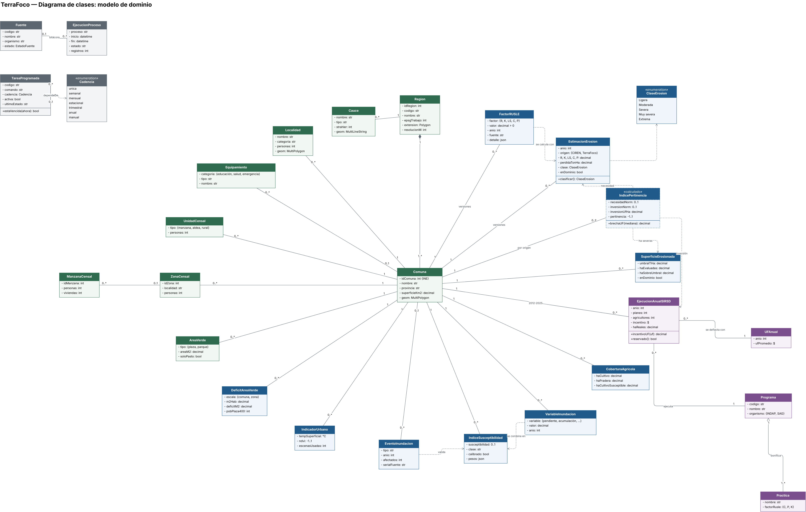
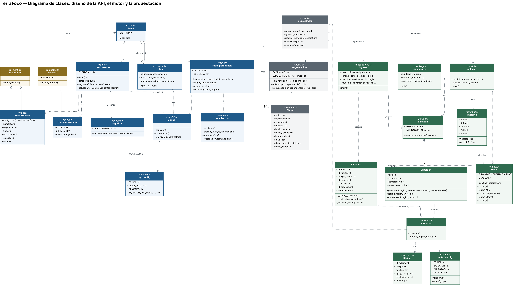

# Diagrama de clases

Modelo de dominio y diseño de clases y módulos de la API, el motor y la orquestación de TerraFoco, en notación UML.

Versión 1.0 · 02-11-2026 · Equipo TerraFoco: Bastián Cárcamo, Carla Morales, Antonio Lankin  
Basado en el código de Fase2/Evidencias Proyecto (api/, motor/) y en el modelo de datos (documento 10)  

## 1. Propósito

Este documento presenta el diagrama de clases UML de TerraFoco en dos niveles, que responden preguntas distintas:

| Vista | Pregunta que responde | Página del archivo editable |
|---|---|---|
| Modelo de dominio | ¿Qué conceptos maneja el sistema y cómo se relacionan? | «Modelo de dominio» |
| Diseño del código | ¿Qué clases y módulos implementan la API, el motor y la orquestación, y de qué depende cada uno? | «Diseño del código» |

Completa los diagramas UML que ya existían —casos de uso, secuencia (vista de procesos 4+1) y componentes— y el modelo entidad-relación (documento 10). El archivo editable es `Diagrama de clases/TerraFoco - Diagrama de clases.drawio`: se abre en draw.io o diagrams.net y se importa en Lucidchart.

### 1.1 Notación

| Símbolo | Significado en estos diagramas |
|---|---|
| Línea continua con multiplicidades | Asociación (1, 0..1, 0..*, 1..*) |
| Rombo relleno | Composición: la parte no existe sin el todo (Región ◆— Comuna) |
| Rombo vacío | Agregación (Programa ◇— Práctica; la app agrega routers) |
| Flecha punteada abierta | Dependencia: usa, crea o se calcula con |
| Triángulo vacío | Herencia (FuenteNueva —▷ BaseModel) |
| «dataclass», «module», «router», «model» | Estereotipos: Python no obliga a usar clases, y buena parte del sistema son módulos de funciones; el estereotipo dice qué es cada caja |
| «calculado», borde punteado | Se obtiene en cada consulta y no se almacena |
| «enumeration» | Conjunto cerrado de valores, validado por CHECK en la base |

## 2. Modelo de dominio

*Figura 1. Diagrama de clases del modelo de dominio*

### 2.1 Cómo leerlo

**Comuna** está al centro porque es la unidad de análisis: todo indicador del sistema es «de una comuna» (o de una zona dentro de ella). Las clases se agrupan por color según el esquema de la base donde viven.

- **Territorio (verde)**: Región se compone de comunas. Cada comuna tiene localidades, zonas y manzanas censales, unidades censales rurales, áreas verdes y equipamiento crítico. La red hídrica (Cauce) pertenece a la región.
- **Suelos (azul, arriba a la derecha)**: los FactorRUSLE de una comuna se combinan en una EstimacionErosion (A = R·K·LS·C·P) que se clasifica en una ClaseErosion. Ambas clases guardan versiones: la asociación 1 — 0..* es la historia de cálculos.
- **IndicePertinencia** es una clase calculada: depende de la erosión vigente, de la superficie con erosión severa y de la serie del SIRSD-S. Hay hasta dos por comuna, una por origen de la erosión (CIREN y cálculo propio).
- **Programas (morado)**: el Programa SIRSD-S (INDAP y SAG) bonifica prácticas y se ejecuta cada año en cada comuna (EjecucionAnualSIRSD), cuyo incentivo se deflacta con la UF del año.
- **Inundaciones y ciudades (azul, abajo)**: seis VariableInundacion se combinan en el IndiceSusceptibilidad, que los EventoInundacion históricos validan. IndicadorUrbano, DeficitAreaVerde y CoberturaAgricola completan los módulos 2 y 3.
- **Operación (gris, arriba a la izquierda)**: cada Fuente del catálogo tiene su bitácora de EjecucionProceso; cada TareaProgramada tiene una Cadencia y puede depender de otra tarea.

### 2.2 Correspondencia con el modelo de datos

| Clase de dominio | Tabla o vista | Notas |
|---|---|---|
| Region | territorio.region | Parametriza la ingesta (área de interés) |
| Comuna | territorio.comuna | Clave: código INE |
| Localidad | territorio.ciudad, territorio.limite_urbano | Dos fuentes INE |
| ZonaCensal / ManzanaCensal | territorio.zona_censal, territorio.manzana_censal (y territorio.manzana) | Censo 2024 |
| UnidadCensal | territorio.unidad_censal | Urbana y rural |
| AreaVerde · Cauce · Equipamiento | territorio.area_verde, territorio.cauce, territorio.equipamiento | OSM e IDE Chile |
| EstimacionErosion | indicadores.erosion | Particionada por región |
| FactorRUSLE | indicadores.factor | Versionado |
| SuperficieErosionada | indicadores.superficie_erosionada | Umbral 18 t/ha/año |
| IndicePertinencia | indicadores.v_pertinencia (vista) | Calculado en consulta |
| VariableInundacion · IndiceSusceptibilidad · EventoInundacion | indicadores.variable_inundacion, indicadores.susceptibilidad_inundacion, indicadores.evento_inundacion | Módulo 2 |
| IndicadorUrbano · DeficitAreaVerde · CoberturaAgricola | indicadores.urbano, indicadores.area_verde, indicadores.cobertura_agricola | Módulos 2 y 3 |
| Programa · Practica · EjecucionAnualSIRSD · UFAnual | programas.programa, programas.practica, programas.sirsd_anual, programas.uf_anual | programas.ejecucion (2021) queda como antecedente |
| Fuente · EjecucionProceso · TareaProgramada | operacion.fuente, operacion.ejecucion_proceso, operacion.tarea_programada | Operación del núcleo |

## 3. Diseño del código

*Figura 2. Clases y módulos de la API (azul), el motor (verde) y la orquestación (gris)*

### 3.1 API (FastAPI)

| Elemento | Tipo | Archivo | Responsabilidad |
|---|---|---|---|
| main.app | FastAPI | api/main.py | Arma la aplicación, CORS, compresión y registra los 10 routers |
| rutas.* | «router» | api/rutas/*.py | Un router por recurso: salud, regiones, comunas, localidades, exposicion, pertinencia, inundacion, urbano, fuentes, ejecuciones. Solo consultan PostGIS y devuelven JSON |
| FuenteNueva, CambioDeFuente | «model» (pydantic) | api/rutas/fuentes.py | Validan el cuerpo de las únicas escrituras (alta y cambio de fuente) |
| requiere_admin | dependencia | api/seguridad.py | Exige la clave de administración; 401 sin clave, 503 si el servidor no la tiene configurada |
| conexion / transaccion / una_fila | «module» | api/bd.py | Abren y cierran la conexión; transaccion() confirma o revierte la escritura |
| focalizacion | «module» | api/focalizacion.py | Brecha en UF y evolución de la focalización por año (funciones puras) |
| config | «module» | api/config.py | Todo por entorno: BD_URL, clave, orígenes |

### 3.2 Motor de procesamiento

| Clase | Tipo | Archivo | Responsabilidad |
|---|---|---|---|
| Region | «dataclass» inmutable | motor/config.py | Área de interés leída de territorio.region por obtener_region() |
| Bitacora | clase (gestor de contexto) | motor/bd.py | Abre una fila en operacion.ejecucion_proceso al entrar y la cierra con ok o error al salir; nunca oculta la excepción |
| Almacen | clase | motor/indicadores/almacen.py | Guarda y lee valores por comuna versionados. Dos instancias: RUSLE (exige positivos) e INUNDACION (admite negativos) |
| Factores | «dataclass» | motor/indicadores/rusle.py | Los cinco factores de una comuna; validar() y perdida() = R·K·LS·C·P |
| rusle | «module» | motor/indicadores/rusle.py | Ecuaciones de cada factor y clasificación en las cinco clases de CIREN |
| calcular | «module» | motor/calcular.py | Reúne los factores del almacén, aplica RUSLE y guarda la erosión |
| ingesta.* | «package», 21 módulos | motor/ingesta/ | Un módulo por fuente: descarga, agrega por comuna y guarda en el almacén, registrando en la bitácora |
| indicadores.* | «package» | motor/indicadores/ | Índice de inundación, terreno, superficie erosionada, áreas verdes y validaciones |

### 3.3 Orquestación

| Clase | Tipo | Archivo | Responsabilidad |
|---|---|---|---|
| Tarea | «dataclass» | motor/orquestacion/programacion.py | Una fila de operacion.tarea_programada en memoria |
| programacion | «module» de funciones puras | motor/orquestacion/programacion.py | Decide si una tarea venció, ordena por dependencia y detecta bloqueos. Sin acceso a la base: se prueba sin PostgreSQL |
| orquestador | «module» | motor/orquestacion/orquestador.py | Carga las tareas, ejecuta las vencidas como subprocesos y registra el resultado |

### 3.4 Decisiones de diseño visibles en el diagrama

- **Separar decisión y efecto**: programacion decide (puro) y orquestador ejecuta. Así la lógica de cadencias tiene 19 pruebas unitarias y la conexión a la base, pruebas de integración (PI-19, PI-20).
- **Un repositorio, dos políticas**: Almacen encapsula el acceso a dos tablas con la misma disciplina de versiones; la diferencia (exigir positivos o no) es un atributo, no código duplicado.
- **Gestor de contexto para la bitácora**: con `with Bitacora(...)` ninguna ingesta puede olvidar cerrar su registro, ni siquiera cuando falla.
- **Inyección de dependencias de FastAPI**: la seguridad es `Depends(requiere_admin)` en las dos rutas que escriben; cambiar a tokens con identidad no toca las rutas.
- **La API no importa el motor**: se comunican solo a través de la base. Por eso cada contenedor tiene su propio `bd.py` y `config.py`.
