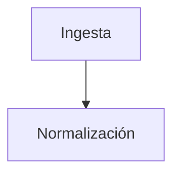

# Documentación del proyecto — Guía de trabajo

Esta carpeta contiene la documentación por fase del Proyecto APT. Aquí se explica
**qué herramienta usar para cada entregable y cómo generarlo paso a paso**.

---

## Índice de documentos

| Documento | Contenido | Entregable de la semana 3 |
|---|---|---|
| [01-perfil-del-proyecto.md](01-perfil-del-proyecto.md) | Identidad, problema, objetivos, alcance, equipo | Perfil |
| [02-arquitectura.md](02-arquitectura.md) | Contexto, componentes, despliegue y modelo de datos | ✅ Diagrama de arquitectura |
| [03-casos-de-uso.md](03-casos-de-uso.md) | Actores, diagrama UML y especificaciones | ✅ Diagramas de casos de uso |
| [04-plan-piloto.md](04-plan-piloto.md) | Candidatos, criterios y gestión del contacto | ✅ Con quién se pilotea |
| [05-scrum.md](05-scrum.md) | Roles, épicas, historias, backlog y sprints | Metodología |
| [06-proceso-bpmn.md](06-proceso-bpmn.md) | Modelo BPMN del ciclo analítico completo | Modelo de proceso |
| [10-como-ejecutar.md](10-como-ejecutar.md) | Levantar el entorno, ver el avance y cargar datos | Operación |
| [11-solicitud-datos-indap.md](11-solicitud-datos-indap.md) | Solicitud del SIRSD-S, bitácora del trámite y plan alternativo | Gestión de contraparte |
| [12-demo-en-codespaces.md](12-demo-en-codespaces.md) | Presentar el sistema —modelo, lectura y escritura— desde cualquier navegador, sin computador propio | Operación |
| [13-modulo-inundaciones.md](13-modulo-inundaciones.md) | Módulo 2: variables, validación contra eventos, recalibración y límites declarados | Análisis |
| `../prototipo/` | Prototipo no funcional navegable | ✅ Prototipo |

---

## Qué herramienta usar para cada diagrama

La decisión de fondo: **el diagrama es código, no una imagen.** Si el diagrama vive
como texto dentro del repositorio, se versiona junto al proyecto, se corrige en
segundos y nunca queda desactualizado respecto de la documentación. Una imagen
exportada a mano se desincroniza a la primera corrección.

| Herramienta | Para qué la usamos | Por qué |
|---|---|---|
| **Mermaid** | Arquitectura, flujos, secuencia, carta Gantt, modelo de datos | **GitHub lo renderiza nativo** dentro de los `.md`. No hay que exportar ni subir imágenes |
| **PlantUML** | Diagramas de casos de uso | Es notación **UML estándar**, que es la que se espera en un proyecto de título. Mermaid no tiene diagrama de casos de uso |
| **BPMN 2.0** | Modelo de proceso de negocio | Formato estándar de la OMG. Se edita en Camunda Modeler o en demo.bpmn.io, y draw.io también lo importa |
| **draw.io** | Alternativa manual | Solo si prefieren arrastrar cajas. Exporta a PNG y SVG |

---

## Cómo generar los diagramas

### A. Mermaid — arquitectura y modelo de datos

**No requiere instalar nada.** Basta escribir el bloque dentro del `.md`:

````markdown

````

Al hacer push, GitHub lo dibuja solo.

**Para previsualizar antes de subir**, cualquiera de estas tres:

1. **[mermaid.live](https://mermaid.live)** — pegar el código y ver el resultado al
   instante. La más rápida, no requiere instalar nada.
2. **VS Code** — instalar la extensión *Markdown Preview Mermaid Support* y abrir la
   vista previa con `Ctrl+Shift+V`.
3. **GitHub mismo** — subir a una rama y mirar el archivo renderizado.

**Para exportar una imagen** (si la necesitan para el informe en Word o el PPT):
en mermaid.live, botón **Actions → PNG** o **SVG**. Usar SVG si van a imprimir.

> ⚠️ Antes de hacer commit de un diagrama nuevo, **péguenlo en mermaid.live**. Un
> error de sintaxis no rompe el archivo, pero GitHub muestra un recuadro de error
> en vez del diagrama, y eso se ve mal en una entrega.

### B. PlantUML — casos de uso

El código fuente de cada diagrama está en [03-casos-de-uso.md](03-casos-de-uso.md).
Tres formas de renderizarlo, de menos a más esfuerzo:

**Opción 1 — Servidor web (la más rápida, sin instalar)**

1. Entrar a [plantuml.com/plantuml](https://www.plantuml.com/plantuml/uml/)
2. Pegar el código completo, desde `@startuml` hasta `@enduml`
3. El diagrama aparece abajo
4. Clic derecho sobre la imagen → *Guardar imagen como…* → guardarla en
   `docs/img/casos-de-uso.png`
5. Referenciarla en el `.md` con ``

**Opción 2 — VS Code (recomendada si van a iterar)**

1. Instalar la extensión **PlantUML** de jebbs
2. Instalar **Java** (la extensión lo requiere) y **Graphviz**
3. Abrir el archivo `.puml` y presionar `Alt+D` para la vista previa en vivo
4. `Ctrl+Shift+P` → *PlantUML: Export Current Diagram* → PNG

**Opción 3 — draw.io**

draw.io importa PlantUML: menú **Extras → Edit Diagram**, o **Arrange → Insert →
Advanced → PlantUML**. Útil si después quieren mover cajas a mano.

### C. draw.io — si prefieren dibujar a mano

1. Entrar a [app.diagrams.net](https://app.diagrams.net) — no requiere cuenta
2. Elegir **Device** para guardar el archivo localmente
3. En el panel izquierdo, activar la biblioteca **UML** desde *More Shapes*
4. Guardar como `.drawio` **y** exportar a `.png` — commitear ambos
5. El `.drawio` es editable después; el `.png` es lo que se ve en el informe

> Guardar siempre el archivo fuente además de la imagen. Si solo commitean el PNG,
> la próxima corrección obliga a redibujar todo.

---

## Convenciones del repositorio

```
terrafoco/
├── README.md                    Portada del repositorio
├── docs/
│   ├── README.md                Este archivo
│   ├── 01-perfil-del-proyecto.md
│   ├── 02-arquitectura.md
│   ├── 03-casos-de-uso.md
│   ├── 04-plan-piloto.md
│   ├── 05-scrum.md
│   ├── img/                     Imágenes exportadas
│   └── uml/                     Archivos fuente .puml
└── prototipo/                   Prototipo no funcional
```

**Nombres de archivo:** minúsculas, sin tildes ni espacios, separados con guiones.
**Numeración:** prefijo de dos dígitos para que el orden sea el de lectura.

### Mensajes de commit

Formato `tipo: descripción en presente`.

```
docs: agrega diagrama de arquitectura
feat: implementa panel de pertinencia en el prototipo
fix: corrige color invertido en indicadores
```

Tipos: `docs`, `feat`, `fix`, `refactor`, `chore`.

---

## Publicar el repositorio

La entrega exige un **enlace público**. Pasos:

1. Crear el repositorio en GitHub como **Public**
2. Subir el proyecto:

```bash
git init
git add .
git commit -m "docs: entrega fase 1"
git branch -M main
git remote add origin https://github.com/USUARIO/terrafoco.git
git push -u origin main
```

3. Para que el prototipo se vea en línea: **Settings → Pages → Source: Deploy from
   a branch → main / (root)**. El sitio queda en
   `https://USUARIO.github.io/terrafoco/prototipo/`

4. Verificar que el enlace abre **en una ventana de incógnito**. Si pide iniciar
   sesión, el repositorio quedó privado.

> Suban el enlace a AVA **antes del sábado**. Un repositorio privado equivale a no
> haber entregado.
