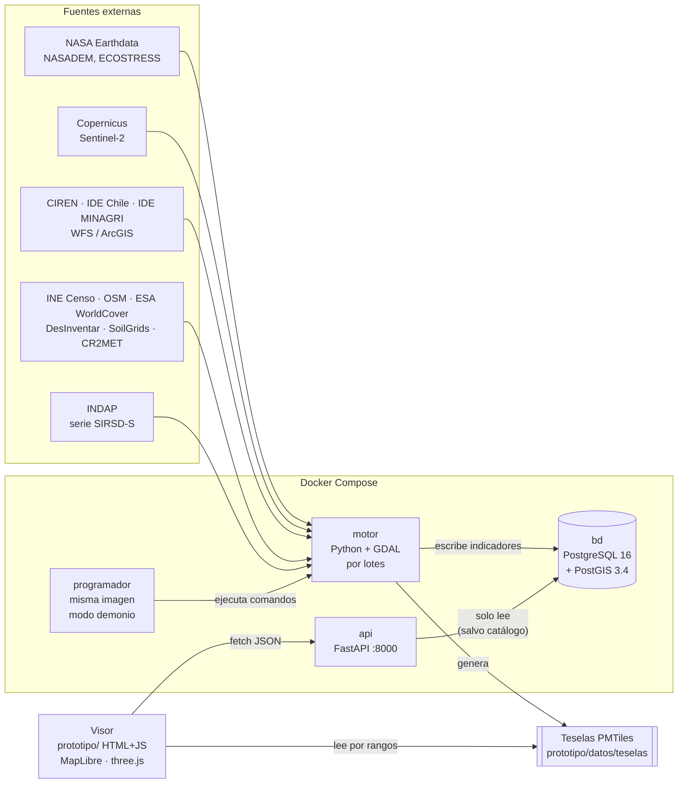

# Arquitectura

Cuatro piezas separadas a propósito: **quien calcula no atiende al público y quien atiende al público no calcula**.

## Las piezas

| Pieza | Carpeta | Tecnología | Qué hace | Nota |
|---|---|---|---|---|
| **bd** | `bd/` | PostgreSQL 16 + PostGIS 3.4 | Guarda territorio, indicadores, programas y operación | [[Esquema de la base]] |
| **motor** | `motor/` | Python 3, GDAL (imagen OSGeo), rasterio, numpy, pysheds, geopandas | Descarga fuentes, calcula indicadores, genera mapas y teselas | [[Motor - raíz]] |
| **programador** | `motor/orquestacion/` | El mismo contenedor del motor, en modo demonio | Decide qué tarea está vencida y la ejecuta en orden | [[Programador de tareas]] |
| **api** | `api/` | FastAPI + psycopg 3 | Expone los indicadores en JSON/GeoJSON; solo escribe el catálogo de fuentes | [[API - núcleo]] |
| **visor** | `prototipo/` | HTML + JS sin framework, MapLibre GL 5, PMTiles 4, three.js | Las pantallas | [[Visor - páginas]] |

## Decisiones de arquitectura que hay que saber defender

1. **El motor no vive detrás de HTTP.** Una ingesta de imágenes satelitales tarda minutos u horas; si la hiciera la API, bloquearía al visor. El motor corre por lotes (`docker exec terrafoco-motor python -m ...`) y escribe en la base; la API solo lee. → [[API - núcleo#main.py]]
2. **La única escritura por HTTP es el catálogo de fuentes**, porque es una decisión humana (administrativa), no un cálculo. Va protegida con una clave de administración. → [[API - núcleo#seguridad.py]]
3. **GDAL desde la imagen oficial de OSGeo**, no por pip: los tres integrantes tienen exactamente la misma versión. Es la primera fuente de "en mi computador funciona". → [[Motor - raíz#Dockerfile]]
4. **Orquestador propio y simple**, sin Airflow: el orquestador no sabe nada del dominio, solo qué comando invocar, cuándo y de qué depende. Migrar a Airflow sería escribir DAGs que llamen los mismos comandos. → [[Programador de tareas]]
5. **Teselas de valores en vez de un servidor de mapas.** Cada píxel guarda el valor (no el color) codificado en RGB; el navegador lo colorea con una expresión. No hace falta GeoServer. → [[Teselas y PMTiles]]
6. **Mejora progresiva en el visor.** Si la API no responde se usa la copia local; si MapLibre no carga, el mapa esquemático. Nunca queda en blanco y siempre declara qué muestra. → [[Copia local y modo sin API]]
7. **Funciones puras separadas de la E/S.** RUSLE, programación de tareas, focalización y cálculo de inundación se prueban sin base de datos ni red. → [[Motor - pruebas]]
8. **La región es un dato, no código.** → [[Motor - raíz#config.py]]

## Dónde corre cada cosa

| Entorno | Qué corre | Nota |
|---|---|---|
| PC de desarrollo (Windows + Docker Desktop) | Todo: bd, motor, programador, api; visor con `servir_prototipo.py` | [[Cómo correrlo]] |
| GitHub Codespaces | Lo mismo, para la demo sin el PC de nadie | [[Despliegue y Codespaces#.devcontainer]] |
| Servidor público (VM Ubuntu) | bd + api + Caddy (HTTPS). **El motor no**: procesa en el PC y se publica el resultado | [[Despliegue y Codespaces#despliegue/]] |
| Copia portable (pendrive) | PostgreSQL embebido + API + visor, lanzados por `TerraFoco.exe` | [[Herramientas#empaquetar_portable.py]] |

Ver también: [[Flujo de datos]] · [[Mapa del repositorio]]
