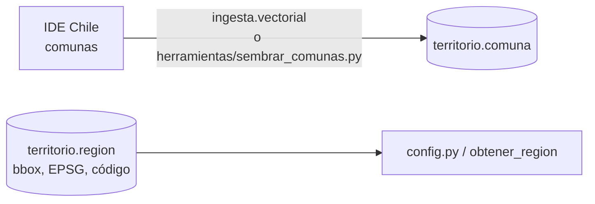
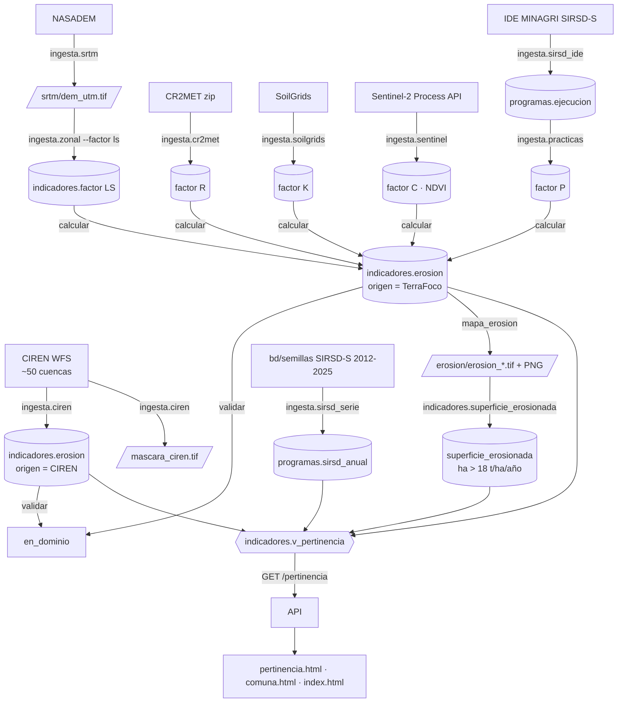
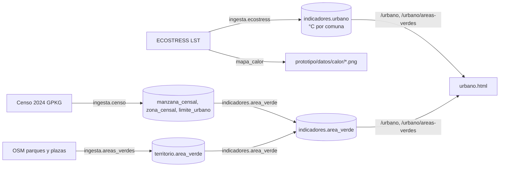

# Flujo de datos

Cómo llega un número desde la fuente externa hasta la pantalla. Cada flecha es un comando del motor (`python -m ...` dentro de `terrafoco-motor`) o una consulta de la API. Los rásteres intermedios viven en el volumen `/datos` del motor (no en git).

## 0 · El territorio (lo primero, sin credenciales)



Con las 33 comunas cargadas ya se cierra el circuito base → API → visor (el "hito del Sprint 0"). → [[Motor - ingesta#vectorial.py]] · [[Herramientas#sembrar_comunas.py]]

## 1 · Módulo de suelos: de los satélites al índice de pertinencia



Puntos de estudio:
- CIREN da la **línea base** desde el primer día: el índice existe aunque no se haya bajado una sola imagen. → [[Motor - ingesta#ciren.py]]
- Cada factor se guarda por separado en `indicadores.factor` con su fuente; `calcular` junta los que hay y **no calcula** una comuna si le falta uno. → [[Motor - indicadores#almacen.py]] · [[Motor - raíz#calcular.py]]
- La vista `v_pertinencia` normaliza **en la consulta**, por eso se puede alternar el origen (CIREN o TerraFoco) sin migrar datos. → [[Índice de pertinencia]]

## 2 · Módulo de inundaciones

```mermaid
flowchart TD
  DEM[/dem_utm.tif/] -->|ingesta.hidrologia| H[/inundacion/: pendiente, curvatura,<br/>acumulacion, twi .tif/]
  IDEH[IDE Chile red hídrica] -->|ingesta.cauces| C[/distancia_cauces.tif/ + territorio.cauce]
  NDVI[/ndvi/ Sentinel-2/] --> IDX
  H & C --> IDX[indicadores.inundacion<br/>suma ponderada por píxel]
  IDX --> ST[/susceptibilidad.tif + .json cortes/]
  IDX --> SI[(indicadores.susceptibilidad_inundacion)]
  DES[DesInventar] -->|ingesta.desinventar| EV[(indicadores.evento_inundacion)]
  SI & EV -->|indicadores.validar_inundacion --marcar-si-pasa| CAL[calibrado = TRUE/FALSE]
  ST -->|mapa_inundacion| PNG[prototipo/datos/inundacion/*.png]
  H & C -->|variables_inundacion| VAR[variables.json + inundacion_variables.pmtiles]
  ST -->|teselas| TES[inundacion.pmtiles]
  WC[ESA WorldCover] -->|ingesta.worldcover| AG[agricola.pmtiles + indicadores.cobertura_agricola]
  CENSO[INE Censo 2024] -->|ingesta.poblacion_censal| UC[(territorio.unidad_censal)]
  OSM[OpenStreetMap] -->|ingesta.equipamiento| EQ[(territorio.equipamiento)]
  OCUC[INE vía OCUC] -->|ingesta.localidades| CI[(territorio.ciudad)]
  SI & EV & UC & EQ & CI & AG -->|/inundacion, /exposicion, /localidades| VIS[inundaciones.html]
  VAR & TES --> VIS
```

Puntos de estudio:
- El índice se calcula **por píxel y después** se agrega por comuna (no al revés): la curvatura media de una comuna es ≈ 0 porque lo cóncavo y lo convexo se cancelan. → [[Susceptibilidad a inundación]]
- Recalcular deja el índice "no calibrado"; la tarea `validar.inundacion` lo vuelve a marcar solo si cumple el criterio. → [[Validación y Spearman]]
- El cruce con población, cultivos y servicios se hace **en el navegador**, sobre la grilla de 30 m pintada, para que siga al umbral sin volver al servidor. → [[Exposición]]

## 3 · Módulo de ciudades



→ [[Áreas verdes y calor urbano]]

## 4 · Lo transversal

- **Bitácora:** cada proceso abre una fila en `operacion.ejecucion_proceso` al empezar y la cierra al terminar. → [[Bitácora y catálogo de fuentes]]
- **Teselas:** `python -m teselas` lee los rásteres finales y escribe `relieve`, `erosion`, `ndvi`, `pendiente`, `inundacion`, `calor` en PMTiles. → [[Teselas y PMTiles]]
- **Copia local:** `herramientas/sembrar_indicadores.py` consulta la API y escribe `prototipo/datos/indicadores.js` para cuando la API no está. → [[Copia local y modo sin API]]
- **Programador:** encadena todo lo anterior por dependencias y cadencias. → [[Programador de tareas]]

Ver también: [[Recorridos por el código]]
